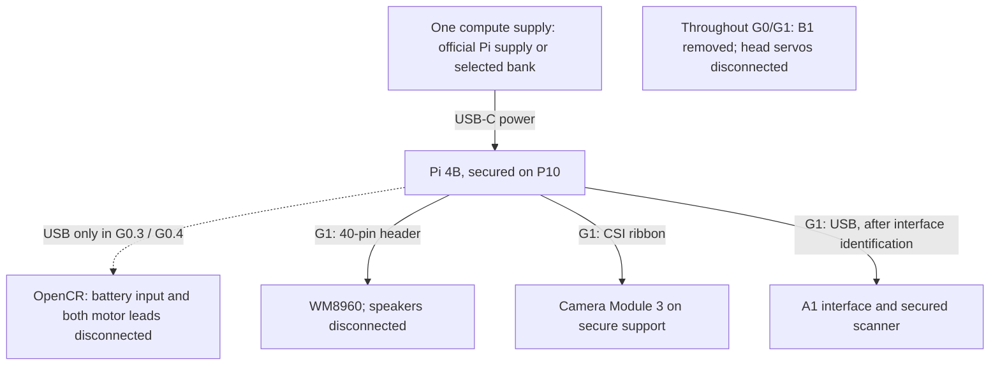
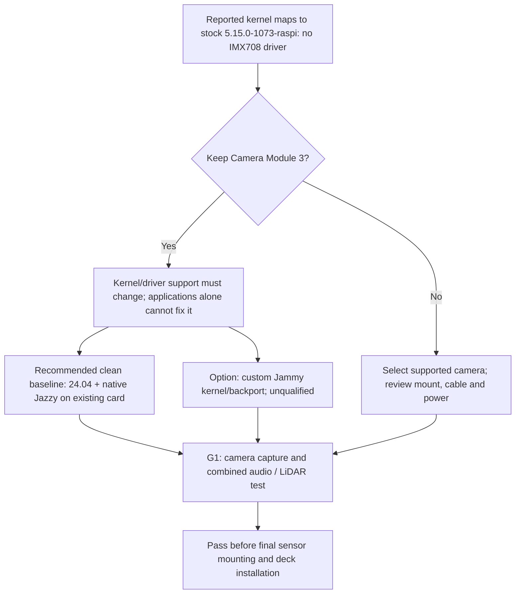
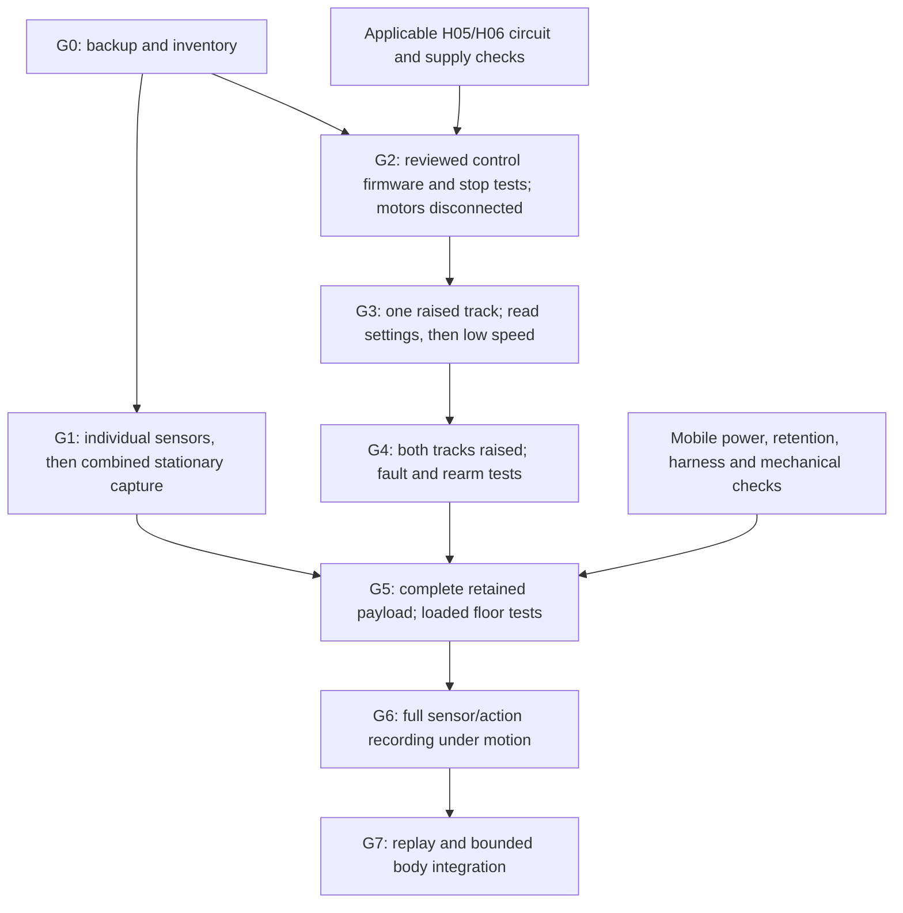
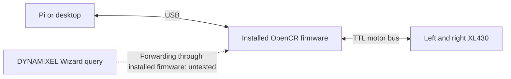

# Skala commissioning procedures

Created 2026-11-20. Updated 2026-11-22. This page gives the commands, expected results and records for the **commissioning gates** in the [assembly guide, section 13](p0-assembly.md#13-commission-in-stages). A gate is a test with recorded acceptance criteria. The [system plan](s1-system-plan.md) defines the design requirements and H01–H10 holds; a hold is an unresolved design or qualification issue, not a test result.

**Coverage:** G0 preserves and inventories the existing installation. G1 tests stationary sensors; its camera commands require a working camera stack, whose installation on the owned Pi is still unresolved. G2–G7 are requirements only, listed at the end with their prerequisites. The repository contains no Skala control implementation, and no gate result has been recorded for this robot.

**Reported starting configuration, corrected on 2026-11-22:** the Pi runs **ROS 2 Humble on Ubuntu 22.04 (Jammy)**; the earlier Jazzy baseline was incorrect. The reported kernel maps to stock `5.15.0-1073-raspi`, subject to the spelling caveat in G0.5. No matching IMX708 module or camera packages were reported; raw inventory output is not retained yet. Preserve the installation in G0. Camera Module 3 Standard is owned and matches the current CAD, but may be replaced if another camera is more practical. Motor access through the existing OpenCR firmware is untested; inability to use it has not been established.

**Sources:** each command or fact below cites its primary source. Where a vendor documents nothing, the step says so; "from source code" means the behaviour was read from the vendor's code, not observed. Re-check a command against its source if the installed software version differs.

**TurtleBot3 scope, clarified on 2026-11-22:** Skala reuses the Pi, OpenCR and motors but leaves the TurtleBot3 application stack behind. References below identify inherited firmware/configuration, optional baseline diagnostics or vendor examples; they do not require migrating TurtleBot3 launches, navigation or robot descriptions. A fresh Jazzy installation needs Skala's chosen device drivers and later its own control/body implementation. Reuse useful low-level support without inheriting the full application.

## Recording results

Make one record per gate run: a plain text or Markdown file named `G<n>-<yyyy-mm-dd>.md`, kept together with the saved output files, for example on the backup drive. Copy this template.

```text
Gate / step:            G1.2 camera
Date, operator:
Hardware revisions:     (e.g. Pi 4B board revision, OpenCR revision, P10 print, sensor model/serial)
Software:               (OS release, kernel, ROS distro, driver commit hashes)
Wiring / power state:   (which supplies connected; drive battery absent?)
Commands run:           (paste exactly, or reference the saved log file)
Expected result:
Observed result:        (paste output; attach files)
Pass / fail / blocked / partial:
Deviations / notes:
```

Use **pass** only when every criterion for the stated step is met; **fail** when a measurement violates a criterion; **blocked** when a prerequisite prevents the test; and **partial** when only part of the stated workload ran. For example, audio and LiDAR passing while the camera is unavailable is a partial G1, not a complete G1 pass. Save raw command output with `2>&1 | tee <name>.log` and retain the capture files. A log file alone does not establish that the command succeeded.

## Safety state for G0 and G1

- **Drive battery B1 disconnected** and out of the robot. No supply on the OpenCR battery input.
- **Both XL430 TTL leads unplugged** from the OpenCR. Head servos unconnected.
- Pi on its P10 adapter on the bench, supported so no connector or cable carries the board's weight. Open air; no cooler is assumed.
- Compute supply: the official Raspberry Pi supply if available, otherwise the selected owned 5 V/3 A bank. Record which one (model, output port, cable) in every G1 record.

This diagram shows the **bench test connections**, not the finished robot harness. Connect and disconnect the HAT and CSI ribbon only with Pi power removed. Test one sensor at a time in G1.1–G1.3; connect all three for G1.4.



The OpenCR USB cable is removed again before G1. This makes sensor testing independent of the unfinished drive-power and stop circuit.

## Before final assembly: software compatibility checkpoint

**Latest user clarification, 2026-11-22:** start from a **clean installation of the best-supported stack**, superseding the earlier in-place-upgrade preference. The recommended baseline is Ubuntu Server 24.04 LTS (64-bit) with native ROS 2 Jazzy on the existing healthy SD card; see G0.7. Jazzy is recommended for its supported Noble packages, not because the camera requires a Jazzy feature. Establish software compatibility **before the robot is assembled**. A spare card is optional. Keep the deck off the chassis, preserve SD-card/ribbon access and use secure temporary sensor supports until this checkpoint passes. Mechanical assembly is not a prerequisite for deciding the OS.

1. Complete G0's backup and inventory. Humble/Jammy is the reported baseline; read the actual kernel, camera-library and ROS package versions. Check IMX708 support against that kernel. A failed `modinfo imx708` query alone is not decisive: a driver could be built into the kernel rather than packaged as a module.
2. Evaluate the current image first, using G0.5's camera routes. If it has compatible kernel/firmware support, investigate the Humble camera application and libcamera combination before considering an OS replacement. Save a real capture under G1.2; device enumeration alone is insufficient.
3. If the installed stack cannot support the selected camera, record exactly which layer is missing and compare a compatible stack change, a substitute camera and an OS upgrade. Determine and document whether an upgrade is required for the chosen route **before final assembly**. An untested driver is an unresolved question, not proof that an upgrade is mandatory.
4. On the selected installation, pass the individual audio/camera/LiDAR checks and G1.4's simultaneous capture test. For the clean installation, retain the G0 backup off the Pi and follow G0.7 after completing G0. Qualify the actual replacement camera before committing its mount if that route was chosen.

**Pass:** record the selected OS/ROS/kernel, camera and driver versions, the keep/change decision, saved captures and the full G1 result. Only then proceed to final sensor mounting and deck installation. This checkpoint settles the software/sensor choice; it does not close the later motor, stop or loaded-driving gates.

## G0 — preserve and inventory the existing installation

**Purpose:** make a restorable copy of the working TurtleBot3 Pi before anything changes, then record exactly what is installed. No upgrade, reflash, `apt upgrade`, motor reset or firmware upload happens in G0.

### G0.1 Back up the SD card

Raspberry Pi's documentation tells you to back up boot media before an upgrade but documents no host-side imaging procedure; its only listed tool, SD Card Copier, runs on the Pi itself ([raspberrypi/documentation](https://github.com/raspberrypi/documentation), `computers/os/updating.adoc`, `software-sources.adoc`). The method below is ordinary disk imaging, not a vendor procedure.

1. Shut the Pi down cleanly (`sudo shutdown -h now`), wait until the green activity LED stops, then remove power. Remove the microSD card.
2. Image the whole card on a desktop computer, not one partition:
   - **Linux host:** identify the card with `lsblk` (check its size; never guess the device). Then `sudo dd if=/dev/sdX of=skala-pi-g0.img bs=4M status=progress conv=fsync`, replacing `sdX` with the card's whole-disk device. A wrong `if=`/`of=` can overwrite a disk, so read the command twice.
   - **Windows host:** use a disk-imaging tool's *read* (not write) function on the card's drive letter. WSL generally cannot see a USB card reader, so do this from Windows itself.
3. Hash the image (`sha256sum skala-pi-g0.img` on Linux, `Get-FileHash` in PowerShell) and record the hash. Keep two copies on separate drives and check that their hashes match. Matching hashes establish identical files, not a successful restore.
4. **Optional restore test, if a spare card is available:** write the backup to a card of at least the same size and boot the Pi from it. Until this has been done, treat the backup as unverified. Buying a spare card is not a prerequisite for reusing the current card.

**Pass:** image file present, hash recorded and two copies kept. **Verified restore** only if step 4 boots.

### G0.2 Record the Pi's software

Re-insert the original card and boot the Pi on its compute supply, with the OpenCR still unplugged. Log in and run the following, saving the output with `tee`:

```sh
{
  cat /proc/device-tree/model; echo
  cat /etc/os-release
  uname -m; uname -r
  ls /opt/ros
  printenv ROS_DISTRO ROS_DOMAIN_ID TURTLEBOT3_MODEL LDS_MODEL
  grep -nE 'ROS_DOMAIN_ID|LDS_MODEL|TURTLEBOT3|ROS_|source ' ~/.bashrc
  ls /etc/udev/rules.d/
  systemctl list-unit-files --state=enabled --no-pager
  crontab -l
  ls ~ ~/turtlebot3_ws/src 2>&1
  find ~ -maxdepth 3 \( -name 'opencr_update*' -o -name 'released_*.txt' \) 2>/dev/null
  dpkg -l | grep -E 'turtlebot3|libraspberrypi-bin|libcamera|camera-ros'
  cat /boot/firmware/config.txt
} 2>&1 | tee g0-pi-inventory.log
```

What to look for, from the TurtleBot3 setup this Pi most likely followed ([SBC setup](https://emanual.robotis.com/docs/en/platform/turtlebot3/sbc_setup/), [bringup](https://emanual.robotis.com/docs/en/platform/turtlebot3/bringup/)):

| Item | Expected from the TurtleBot3 setup | Why it matters |
| --- | --- | --- |
| OS / ROS | User confirms Humble / Ubuntu 22.04 (Jammy), a documented TurtleBot3 pairing | Retain the OS output, installed ROS directories, active shell environment and kernel/package versions; decide the camera route in G0.5 |
| `~/.bashrc` | `source /opt/ros/<distro>/setup.bash`, `source ~/turtlebot3_ws/install/setup.bash`, `ROS_DOMAIN_ID=30`, `LDS_MODEL=LDS-0x` | `TURTLEBOT3_MODEL` is normally exported by hand at bringup, not in `.bashrc`. `LDS_MODEL` refers to TurtleBot3's own LiDAR, not the owned A1 |
| udev | `99-turtlebot3-cdc.rules`: OpenCR (USB 0483:5740) gets permissions only, no `/dev` symlink; USB 10c4:ea60 gets the symlink `/dev/tb3_lidar` | The A1 adapter also uses 10c4:ea60 (see G1.3), so it will appear as `/dev/tb3_lidar` too |
| Autostart | None in the standard setup; bringup is started by hand | Anything enabled beyond the standard setup was added later; record it |
| `opencr_update/` | May remain if the OpenCR was flashed from this Pi: `burger.opencr`, `waffle.opencr`, `update.sh`, `released_<version>.txt` | Records an available firmware package; it does not prove that package is currently installed on the board |

If `vcgencmd` is missing (`command not found`), note it; G1.0 installs it once G0 is complete. Do not install anything during G0.

**Pass:** the log is saved and every row in the table above is recorded, including "not present".

### G0.3 Identify the OpenCR, motors still unplugged

**This step and G0.4 extend the G0 state:** the OpenCR is connected to the Pi by USB only, powered from the compute supply through that cable. Keep B1 disconnected and both TTL leads unplugged; nothing else is connected to the OpenCR. Connect the OpenCR to a Pi USB-A port with the data cable (W08); the OpenCR is then powered from USB only.

```sh
{ lsusb; ls -l /dev/ttyACM*; dmesg | tail -n 20; } 2>&1 | tee g0-opencr-usb.log
```

**Expected:** a device with ID `0483:5740` and a `/dev/ttyACM0` (number may differ). Record the board revision printed on the PCB.

**Firmware version:** this procedure has no validated command for reading the installed TurtleBot3 firmware version. Record any `opencr_update/released_*.txt` file as a recovery-package candidate, with the installed version still **unknown** unless independently identified. The earlier source review found a DYNAMIXEL-protocol USB endpoint (ID 200) with a firmware-version field at address 6; the reviewed Humble ROS node did not read or log it ([OpenCR `turtlebot3_ros2` library](https://github.com/ROBOTIS-GIT/OpenCR/tree/master/arduino/opencr_arduino/opencr/libraries/turtlebot3_ros2), [turtlebot3_node](https://github.com/ROBOTIS-GIT/turtlebot3/tree/humble/turtlebot3_node)). That source observation does not identify the firmware on the owned board. A read-only version query remains later firmware work.

**Do not flash** the OpenCR in G0. This procedure provides no validated firmware read-back or restoration method. Preserve available binaries, source and configuration, and identify a recovery package before any later replacement. The Pi SD image does not back up OpenCR flash or the motors' stored settings.

**Pass:** USB ID, tty device and board revision recorded; firmware package recorded or marked "unknown".

### G0.4 Optional: existing bringup with motors unpowered

Only if G0.2 shows a TurtleBot3 workspace. This shows whether the existing stack still runs; it is not a Skala test. Motors remain unplugged and unpowered.

```sh
export TURTLEBOT3_MODEL=burger      # or the model recorded in G0.2
ros2 launch turtlebot3_bringup robot.launch.py 2>&1 | tee g0-bringup.log
```

**Expected, from source code, not yet observed:** the firmware pings motors 1 and 2 at boot. With them absent, the node logs a WARN containing "Please double check your Dynamixels and Power" and keeps running. "Failed connection with Devices" followed by shutdown means the OpenCR itself was not reached ([turtlebot3_node source](https://github.com/ROBOTIS-GIT/turtlebot3/blob/humble/turtlebot3_node/src/turtlebot3.cpp)). Stop it with Ctrl-C. Do not publish velocity commands.

### G0.5 Decision after G0: the Pi operating system

**The baseline is Ubuntu 22.04 (Jammy) + ROS 2 Humble.** The reported kernel string is `5.15.0.1073-rasbpi`, interpreted here as Ubuntu's `5.15.0-1073-raspi` (package version `5.15.0-1073.76`). That spelling normalization is an inference; retain the literal `uname -r` output with G0. No matching module or camera packages were reported after the IMX708/package queries. This is reported inventory, not an agent-run test on the Pi.

**Exact source check, 2026-11-22:** Ubuntu tag `Ubuntu-raspi-5.15.0-1073.76` has no IMX708 entry in its camera-driver [Kconfig](https://git.launchpad.net/~ubuntu-kernel/ubuntu/+source/linux-raspi/+git/jammy/plain/drivers/media/i2c/Kconfig?h=Ubuntu-raspi-5.15.0-1073.76), [Makefile](https://git.launchpad.net/~ubuntu-kernel/ubuntu/+source/linux-raspi/+git/jammy/plain/drivers/media/i2c/Makefile?h=Ubuntu-raspi-5.15.0-1073.76), or [build configuration](https://git.launchpad.net/~ubuntu-kernel/ubuntu/+source/linux-raspi/+git/jammy/plain/debian.raspi/config/annotations?h=Ubuntu-raspi-5.15.0-1073.76). The tagged [changelog](https://git.launchpad.net/~ubuntu-kernel/ubuntu/+source/linux-raspi/+git/jammy/plain/debian.raspi/changelog?h=Ubuntu-raspi-5.15.0-1073.76) confirms the package version. Thus the stock kernel lacks the driver, rather than merely having it built in instead of loadable. Camera Module 3 cannot work on that unchanged kernel by installing camera applications alone.

Keeping Camera Module 3 therefore requires a compatible kernel/driver and userspace stack. A complete OS/ROS migration is one route, not the only theoretical route: a custom kernel/backport would need its own integration and maintenance review. The reviewed [Ubuntu 24.04 Raspberry Pi kernel configuration](https://git.launchpad.net/~ubuntu-kernel/ubuntu/+source/linux-raspi/+git/noble/plain/debian.raspi/config/annotations) enables `CONFIG_VIDEO_IMX708=m` on arm64, which removes this particular stock-kernel blocker. It does not prove camera, audio or LiDAR operation on a new image.

The current [ROBOTIS Humble SBC instructions](https://emanual.robotis.com/docs/en/platform/turtlebot3/sbc_setup/#raspberry-pi-camera) document `ros-humble-camera-ros` with a source-built Raspberry Pi libcamera on Ubuntu 22.04. Those general camera instructions do not supply the missing IMX708 kernel driver in this specific stock image. The earlier inference that a userspace camera-stack build might be sufficient is now narrowed by the exact kernel check.

**OS and ROS are separate decisions.** The camera needs a compatible kernel, firmware and camera userspace; it does not require Jazzy features. However, the official [Humble binary packages target Jammy](https://github.com/ros2/ros2_documentation/blob/humble/source/Installation/Ubuntu-Install-Debs.rst), while the official [Jazzy binary packages target Noble](https://github.com/ros2/ros2_documentation/blob/jazzy/source/Installation/Ubuntu-Install-Debs.rst). Keeping native Humble on Jammy needs a compatible kernel/camera stack. Keeping Humble on a Noble host could use a Jammy container or a separately maintained source port; neither route is qualified for this robot, and existing Jammy binaries cannot be assumed to work unchanged on Noble. A container still needs the host's camera driver and deliberate sensor-device access.

**Kernel-only follow-up, 2026-11-22:** the [Jammy Pi kernel metapackage](https://packages.ubuntu.com/jammy-updates/linux-image-raspi) currently lists `5.15.0-1113-raspi`. Its source tag `Ubuntu-raspi-5.15.0-1113.116` also lacks IMX708 in [Kconfig](https://git.launchpad.net/~ubuntu-kernel/ubuntu/+source/linux-raspi/+git/jammy/plain/drivers/media/i2c/Kconfig?h=Ubuntu-raspi-5.15.0-1113.116), [Makefile](https://git.launchpad.net/~ubuntu-kernel/ubuntu/+source/linux-raspi/+git/jammy/plain/drivers/media/i2c/Makefile?h=Ubuntu-raspi-5.15.0-1113.116) and [build annotations](https://git.launchpad.net/~ubuntu-kernel/ubuntu/+source/linux-raspi/+git/jammy/plain/debian.raspi/config/annotations?h=Ubuntu-raspi-5.15.0-1113.116); the tagged [changelog](https://git.launchpad.net/~ubuntu-kernel/ubuntu/+source/linux-raspi/+git/jammy/plain/debian.raspi/changelog?h=Ubuntu-raspi-5.15.0-1113.116) confirms the version. Updating to this standard Jammy kernel does not supply the missing driver. This check does not establish that every alternative kernel is incompatible.



If a camera or OS change is needed, compare these options with the backup in hand. Record the chosen route before modifying the installation. A replacement camera must have its own driver, mounting and capture check; no replacement model is selected here.

| Option | What is established | What remains open |
| --- | --- | --- |
| Clean Ubuntu Server 24.04 + native ROS 2 Jazzy on the existing card | Recommended baseline for a clean installation. ROBOTIS documents the Pi 4/Noble/Jazzy combination; Jazzy has official Noble arm64 packages | Follow G0.7. Configure the actual camera, WM8960 and A1 and pass G1 before final assembly. Reimaging erases the card; no reimage or hardware qualification has been performed |
| Keep Humble/Jammy with a custom compatible kernel/driver stack | The stock 1073 kernel is missing IMX708; userspace packages alone are insufficient | No backport or replacement Jammy kernel is selected or qualified. Review driver/firmware/library compatibility and ongoing kernel maintenance before choosing this route |
| In-place Ubuntu 24.04 upgrade; choose the ROS environment separately | Retained alternative, superseded as the preferred method by the clean-start clarification. Ubuntu documents consecutive LTS upgrades; the reviewed Noble Raspberry Pi kernel enables IMX708. Jazzy has official Noble packages; Humble's official packages target Jammy | Resolve how ROS will run before G0.6. A Jammy/Humble container is a candidate if retaining Humble; it needs device/library integration and qualification. A native Humble source port needs separate dependency work. Qualify camera/audio/LiDAR before final assembly; match OpenCR software before G2 |
| Keep the current image and substitute the camera | Camera substitution is allowed; retaining Camera Module 3 is not a hard requirement | Check driver support, resolution/focus, mounting, cable motion and power. P15 fits Camera Module 3, so another camera requires a fit review and may need a different cradle. A USB camera adds to the shared USB budget |
| Keep the current image and defer camera capture | Audio and LiDAR checks can proceed | Record G1 as partial until a camera route passes; this does not qualify the full audiovisual workload |
| Another OS (e.g. Raspberry Pi OS with ROS in a container) | Raspberry Pi OS supports the camera directly | Not researched for this robot; would need its own source check |

The audio (G1.1) and LiDAR (G1.3) checks can proceed independently, subject to their driver checks on the installed OS. The recommended clean installation rewrites the **existing card**; rollback would require restoring the G0 backup. A separate card remains an optional convenience. No OS or ROS migration has been executed.

### G0.6 In-place Ubuntu upgrade and separate ROS decision

**Status:** conditional procedure for an Ubuntu release upgrade; not executed on the Pi. First select the ROS environment described in G0.5. An in-place Ubuntu upgrade does not guarantee that existing Humble binaries will keep working. If retaining Humble, settle the container/source-port approach before changing the OS; alternatively keep Jammy and qualify a compatible kernel/camera stack. This is a software-change step **after G0**, not part of its read-only inventory. Run these commands on the Pi, not the development workstation. Retain G0's backup off the Pi and keep the drive battery and motor leads disconnected. Use stable compute power and preferably a local keyboard/display for the interactive release upgrade.

1. Confirm `dpkg --print-architecture` returns `arm64`, and check free space with `df -h / /boot/firmware`. Noble's Pi installation requires 64-bit userspace; an `armhf` installation cannot take this direct upgrade route ([Noble release notes](https://discourse.ubuntu.com/t/noble-numbat-release-notes/39890)). The upgrader checks the space required for its actual package plan. Preserve workspace sources, local changes, shell configuration and package inventory with the backup.
2. Fully update Jammy, install the release-upgrade tool and reboot. Inspect the proposed package changes before accepting; do not continue past an APT error. These update commands follow [Ubuntu's release-upgrade guide](https://ubuntu.com/server/docs/how-to/software/upgrade-your-release/).

   ```sh
   sudo apt update
   sudo apt dist-upgrade -o APT::Get::Always-Include-Phased-Updates=true
   sudo apt install update-manager-core
   sudo reboot
   ```

3. After reconnecting, ensure `/etc/update-manager/release-upgrades` contains `Prompt=lts` (edit with `sudoedit` if needed), then run:

   ```sh
   sudo do-release-upgrade
   ```

   Confirm the offered target is **Ubuntu 24.04 LTS (Noble)**. Review the upgrade summary and package removals, answer the configuration prompts and reboot when requested. Stop at 24.04 for this procedure. Do not use `-d` to force a development release. If no upgrade is offered or dependency resolution fails, retain the exact message for diagnosis rather than manually replacing release names in APT sources. Third-party repositories, including ROS, are normally disabled by the upgrader.
4. After reboot, save `cat /etc/os-release`, `uname -r` and `dpkg --print-architecture`. Confirm Noble and the active Raspberry Pi kernel. Configure the ROS environment chosen before the upgrade. If Jazzy was selected, use its [official installation instructions](https://github.com/ros2/ros2_documentation/blob/jazzy/source/Installation/Ubuntu-Install-Debs.rst) and install the device packages Skala actually uses. No TurtleBot3 workspace migration is required. If keeping Humble in a Jammy container, keep its Jammy repositories inside that environment. Do not enable the Jammy ROS repository on the Noble host or treat source-building Humble on Noble as a routine supported binary installation.
5. Adapt shell startup and service configuration to the chosen ROS environment. Preserve local workspace sources/configuration, rebuild in that environment and avoid sourcing old host build artifacts. For a container, configure and test camera/audio/USB access and ROS networking explicitly. The [ROS Docker guide](https://github.com/ros2/ros2_documentation/blob/humble/source/How-To-Guides/Run-2-nodes-in-single-or-separate-docker-containers.rst) demonstrates containerized nodes; it does not qualify this robot's sensor integration.
6. Install and configure the camera userspace stack; the documented `camera_ros` route includes Raspberry Pi's libcamera build. Record a real Camera Module 3 capture, then qualify audio and LiDAR individually and together under G1. Recheck boot overlays and HAT driver compatibility after the kernel change. This OS procedure does not flash OpenCR; firmware compatibility remains a separate check before G2.

**Pass:** Noble boots, the chosen ROS environment and rebuilt workspace load, versions and migration changes are recorded, and the full G1 sensor workload passes before final assembly. Successful OS installation alone is not a sensor qualification result.

### G0.7 Clean installation on the existing card

**Recommended baseline:** Ubuntu Server 24.04 LTS, 64-bit, with native ROS 2 Jazzy, using Jazzy's [official Noble arm64 packages](https://github.com/ros2/ros2_documentation/blob/jazzy/source/Installation/Ubuntu-Install-Debs.rst). This is the recommended software baseline for a clean start; peripheral qualification remains outstanding. The image procedure works with either a fresh card or a healthy existing card of adequate capacity. No TurtleBot3 application installation is required.

1. Complete the G0 backup/inventory and copy anything to retain off the card. Shut down the Pi and put the card in the host's reader. The following imaging step erases the card's contents.
2. In Raspberry Pi Imager, select **Raspberry Pi 4**, **Ubuntu Server 24.04 LTS (64-bit)** and the identified SD card. Use a current 24.04 point image; select 24.04 explicitly rather than an unspecified latest Ubuntu release. Configure hostname, account, Wi-Fi and SSH before writing.
3. Boot the Pi on the bench, with drive battery and motor leads disconnected. Run `sudo apt update`, then `sudo apt full-upgrade`, and reboot. Record `/etc/os-release`, `uname -r` and `dpkg --print-architecture`.
4. Configure the official Noble ROS repository and install the **ROS Base** option (`ros-jazzy-ros-base`) using the [Jazzy installation instructions](https://github.com/ros2/ros2_documentation/blob/jazzy/source/Installation/Ubuntu-Install-Debs.rst). Source `/opt/ros/jazzy/setup.bash` in the Pi's Bash environment. Install needed build tools and Jazzy-compatible packages; restore reviewed source/configuration changes only, not old Humble build/install directories or shell startup wholesale.
5. Set up Camera Module 3 through `camera_ros` and Raspberry Pi's libcamera, following the [camera_ros maintainer's instructions](https://github.com/christianrauch/camera_ros) and G1.2. Launch the camera node directly; TurtleBot3 bringup is not needed. Install and verify the actual WM8960 HAT and RPLidar A1 drivers. Save individual captures, then pass G1.4's simultaneous workload before final assembly.
6. Prepare Skala's OpenCR/Pi control implementation and verify its hardware protocol and stop behavior before motor commissioning. Existing OpenCR/DYNAMIXEL code may supply reusable device support; TurtleBot3 host applications are not prerequisites. Reimaging the Pi does not erase or update OpenCR firmware or motor settings; those remain separate commissioning decisions.

**Pass:** the fresh Noble/Jazzy installation is recorded, sensor captures and full G1 pass evidence are retained, and the remaining drive/firmware holds stay explicit. This baseline needs neither a Humble container nor a custom Jammy kernel.

### G0.8 Migration script

The self-contained [Pi migration script](../../scripts/migrate_pi_to_jazzy.py) supports both the existing Jammy/Humble installation and a fresh Noble installation. Copy the file onto the Pi and run it from an interactive terminal with stable compute power and drive power disconnected:

```sh
python3 migrate_pi_to_jazzy.py check
sudo python3 migrate_pi_to_jazzy.py migrate
```

`check` reads the OS, Pi model, architecture and package state without changing them. The script accepts only a Raspberry Pi 4B with Ubuntu 22.04/Jammy or 24.04/Noble and arm64 userspace. It stops for incomplete package operations, held packages or ambiguous repository entries.

On Jammy, `migrate` saves configuration and package inventories under `/var/backups/skala-jazzy/`, removes installed `ros-humble-*` packages and the old ROS repository package with APT's normal removal prompt, disables remaining ROS 2 repository entries, updates Jammy and invokes Ubuntu's interactive release upgrader. Confirm the offered target is **24.04**. On Noble it skips the OS migration and installs native Jazzy ROS Base, `camera_ros`, rosbag2 and basic capture/build utilities. It does not run `autoremove`, migrate TurtleBot3 applications, change OpenCR firmware or edit existing workspaces/shell startup files.

**Reboots:** whenever it prints `REBOOT REQUIRED`, run `sudo reboot`, reconnect and rerun the same `migrate` command. A Jammy package update and the release upgrade can require separate reboots. The script deliberately does not force a reboot or continue installing ROS in the same boot as the OS upgrade.

**Backup limits:** its local archive covers selected system configuration and package inventories, not personal files, workspaces or a restorable whole-card image. Symlinks are preserved as links, including dangling service links and `/dev/null` masks; targets outside the selected backup paths are not copied automatically. Keep the G0 backup and anything important off the card before migrating. Package/release-upgrade output remains on the terminal; command lists are saved with each backup, and Ubuntu writes its own APT/release-upgrade logs.

After success, enter the new environment as your normal user:

```sh
skala-jazzy-shell
```

This starts a Bash shell that sources Jazzy without loading old Humble/workspace startup files. Existing login configuration is preserved; use this command for Jazzy until that configuration has been reviewed. Successful CLI/Python import checks establish a ROS installation only. Camera Module 3 still needs compatible Raspberry Pi libcamera, WM8960/A1 integration still needs qualification, and OpenCR/Skala control remains separate work. Complete G1 before final assembly.

**Validation of the script:** isolated tests cover wrong-host/architecture rejection, repository preservation, backup contents (including dangling and masked service symlinks), package/download failures and reboot boundaries. The official Noble repository-package download and package identity were checked without installing it. An early failure involving a missing `grub-initrd-fallback.service`-like path was reported; a matching backup failure was reproduced and fixed by preserving symlinks instead of following them. That reproduced failure occurs before package mutation. No actual OS migration, Jazzy installation or hardware test has been run on the owned Pi by the agent.

## G1 — isolated compute and stationary sensors

**Preconditions:** G0 passed; drive battery absent; OpenCR not needed (unplug it). Each sensor is tested on its own first, then all together (G1.4). Secure any sensor whose final mount is not fitted so it cannot fall or short against the boards.

### G1.0 Power and thermal baseline

Before connecting sensors, record the baseline. If G0.2 found no `vcgencmd`, install it first. On Ubuntu it is in the `libraspberrypi-bin` package (`sudo apt install libraspberrypi-bin`); this is the first software change after the G0 backup, so record it. Old fault bits persist until reboot, so reboot first.

```sh
vcgencmd get_throttled; vcgencmd measure_temp
# continuous log for the later steps (leave running in a second terminal):
while true; do date +%T; vcgencmd measure_temp; vcgencmd get_throttled; sleep 5; done | tee g1-power.log
```

Without `vcgencmd`, inspect each `/sys/class/thermal/thermal_zone*/type` before selecting the corresponding `temp` file; do not assume zone 0 is the SoC sensor. A temperature reading alone cannot replace the undervoltage/throttle check, so record that part as blocked if no equivalent measurement is available.

`get_throttled` bits ([Raspberry Pi graphics utilities](https://github.com/raspberrypi/documentation/blob/master/documentation/asciidoc/computers/os/graphics-utilities.adoc)):

| Bit value | Meaning now | Bit value | Meaning since boot |
| --- | --- | --- | --- |
| 0x1 | Undervoltage detected | 0x10000 | Undervoltage has occurred |
| 0x2 | Arm frequency capped | 0x20000 | Capping has occurred |
| 0x4 | Currently throttled | 0x40000 | Throttling has occurred |
| 0x8 | Soft temperature limit active | 0x80000 | Soft limit has occurred |

Pi 4 progressively throttles its Arm cores between 80 and 85 °C and throttles Arm and GPU at 85 °C ([frequency management](https://github.com/raspberrypi/documentation/blob/master/documentation/asciidoc/computers/raspberry-pi/frequency-management.adoc)).

**Pass for every G1 step:** `get_throttled` stays `0x0`, and temperature stays below 80 °C. Any undervoltage bit fails the power qualification for that tested supply/cable/load combination; it does not identify the faulty component. Record it under H04/H08, inspect the connections and repeat with the official supply if available to separate source/cable problems from excessive load.

### G1.1 WM8960 audio HAT

Power off. Seat the HAT on the 40-pin header as in guide step 10A; speakers stay disconnected. The HAT uses I2C1 (GPIO2/3, pins 3/5) with the codec at address 0x1a, and I2S on GPIO18–21 (pins 12, 35, 38, 40) ([kernel overlay source](https://github.com/raspberrypi/linux/blob/rpi-6.12.y/arch/arm/boot/dts/overlays/wm8960-soundcard-overlay.dts); [Pi GPIO](https://github.com/raspberrypi/documentation/blob/master/documentation/asciidoc/computers/raspberry-pi/gpio-on-raspberry-pi.adoc)). Keep those pins reserved, as W11 requires.

**Driver.** Waveshare's installer ([WM8960-Audio-HAT](https://github.com/waveshareteam/WM8960-Audio-HAT)) builds a DKMS kernel module for the running kernel. It edits `/boot/firmware/config.txt` (enables I2C and I2S, adds `dtoverlay=i2s-mmap` and `dtoverlay=wm8960-soundcard`), adds modules to `/etc/modules` and installs a `wm8960-soundcard` systemd service. Its documentation names no Ubuntu support. Raspberry Pi kernels from 5.15 onward, and the Ubuntu 22.04 kernel tree, already contain a `wm8960-soundcard` overlay and codec driver, so the DKMS build may be unnecessary; that is an inference, not tested here.

1. Try the in-kernel route first: add `dtparam=i2c_arm=on`, `dtparam=i2s=on` and `dtoverlay=wm8960-soundcard` to `/boot/firmware/config.txt` (keep a copy of the original), reboot, then run `arecord -l`.
2. If no `wm8960soundcard` card appears, use Waveshare's installer instead. Read `install.sh` before running it, and record the commit. The script copies its overlay file to `/boot/overlays` but edits `/boot/firmware/config.txt`; after it runs, check that `wm8960-soundcard.dtbo` exists in the `overlays` directory next to the `config.txt` that was edited. If not, the overlay will not load on reboot. Then: `git clone https://github.com/waveshareteam/WM8960-Audio-HAT; cd WM8960-Audio-HAT; git rev-parse HEAD; sudo ./install.sh; sudo reboot`.
3. Record 10 seconds, using the card number shown by `arecord -l` in place of `1`:

```sh
arecord -l | tee g1-audio-devices.log
arecord -D hw:1,0 -f S32_LE -r 16000 -c 2 -d 10 g1-audio.wav
```

The format, rate and channel count are Waveshare's documented example. Speak, then tap near each microphone in turn.

If the card is listed but the recording is silent, check the capture controls with `alsamixer -c <card>` (F4 shows capture) before concluding that the driver failed. Waveshare's installer also installs saved mixer-state files and a service to restore them, which the in-kernel route does not provide.

**Pass:** the card is listed, the file lasts 10 s, and on playback (on another computer, since the speakers are disconnected) both channels carry the voice and each tap is louder in its own channel. Record the driver route used (in-kernel or DKMS plus commit).

### G1.2 Camera Module 3

**Applies to the owned Camera Module 3.** Use the route selected in G0.5. These commands assume a working IMX708 kernel driver, compatible libcamera and installed capture application; they are not an Ubuntu camera-stack installation procedure. If an application or driver is missing, record that prerequisite as blocked. For a substitute camera, record its identity and equivalent capture checks instead of expecting `imx708`.

1. Power off. Fit the CSI ribbon to the Pi camera socket, contacts facing the connector contacts, as in guide step 10D. Support the camera facing a scene with detail at 0.5–3 m.
2. Leave `camera_auto_detect=1` in config.txt; it detects official cameras. Only if it fails, set `camera_auto_detect=0` and add `dtoverlay=imx708` ([camera configuration](https://github.com/raspberrypi/documentation/blob/master/documentation/asciidoc/accessories/camera/rpicam-configuration.adoc)).
3. For the `rpicam-apps` route, first confirm the commands are installed. Raspberry Pi OS supplies these tools; a working Ubuntu installation is not established by this guide. Run:

```sh
rpicam-hello --list-cameras | tee g1-camera-list.log
rpicam-still --nopreview --output g1-still.jpg
rpicam-vid --nopreview -t 10s -o g1-video.h264
```

([rpicam-apps documentation](https://github.com/raspberrypi/documentation/tree/master/documentation/asciidoc/accessories/camera))

4. `camera_ros` is an alternative capture route, not a requirement to run a second camera process alongside `rpicam-apps`. After sourcing the ROS distribution recorded in G0, its documented package command is `sudo apt install ros-$ROS_DISTRO-camera-ros`; launch with `ros2 run camera_ros camera_node`. The [maintainer's instructions](https://github.com/christianrauch/camera_ros#troubleshooting) currently specify Raspberry Pi's libcamera fork for Camera Module 3. Confirm the camera is enumerated and save a replayable image sequence using the chosen ROS recorder. Installation success or a published topic name alone is not a capture pass.

**Pass:** enumeration identifies the expected sensor; a saved still is sharp at the scene distance; and a saved 10 s video or replayable image sequence contains the scene throughout. Record the capture route, driver/application versions, resolution, frame rate and orientation relative to the mount (Camera Module 3's CSI connector faces down on P15). For a ROS route, retain the recording and its replay command. Use that same route in G1.4.

### G1.3 RPLIDAR A1 and its interface board

Mount or clamp the scanner so the rotor turns freely and the scan plane is clear. Keep fingers and cables away from the rotor.

1. **Identify before connecting** (the guide holds the LiDAR connection until H02 identifies the interface). With nothing plugged in, record the scanner's label (model, revision, serial) and the interface board's markings, connectors, any switches and any auxiliary power input. Photograph both sides of the board. If the board has a separate power input or a switch whose purpose you cannot identify from its markings, stop and record the step as blocked.
2. Plug the interface board into a Pi USB port and check what enumerates:

```sh
{ lsusb; ls -l /dev/ttyUSB* /dev/tb3_lidar /dev/rplidar; } 2>&1 | tee g1-lidar-usb.log
```

**Expected for the reviewed adapter:** USB ID `10c4:ea60` and a `/dev/ttyUSB*` device. Record the actual path; `ttyUSB0` below is an example. If the TurtleBot3 rule from G0.2 matches, `/dev/tb3_lidar` also points to it. The USB ID identifies the bridge chip, not the scanner model. Steps 1–2 provide the identity evidence for H02; they do not close its mounting, cable-restraint or current/scan-clearance checks.

3. **SDK test without ROS** ([rplidar_sdk](https://github.com/Slamtec/rplidar_sdk)): build with `make` in the SDK root; the binaries go to `output/Linux/Release/`. Run:

```sh
./output/Linux/Release/ultra_simple --channel --serial /dev/ttyUSB0 115200 | tee g1-lidar-sdk.log
```

The README's shorter form is out of date; the program needs `--channel --serial` and the baud rate. A1 uses 115200. Expect a stream of angle/distance lines; Ctrl-C stops it.

4. **ROS driver** ([sllidar_ros2](https://github.com/Slamtec/sllidar_ros2), source-only, not in the ROS package index):

```sh
mkdir -p ~/skala_ws/src && cd ~/skala_ws/src
git clone https://github.com/Slamtec/sllidar_ros2.git && git -C sllidar_ros2 rev-parse HEAD
cd ~/skala_ws && source /opt/ros/$ROS_DISTRO/setup.bash && colcon build --symlink-install
source install/setup.bash
ros2 launch sllidar_ros2 sllidar_a1_launch.py serial_port:=/dev/ttyUSB0
```

`sllidar_a1_launch.py` has no viewer and suits the headless Pi (`view_sllidar_a1_launch.py` also starts rviz2). The default port is `/dev/ttyUSB0` at 115200 baud, frame `laser`. In a second terminal, `ros2 topic list`, then `ros2 topic hz` on the scan topic it lists.

5. **Stable device name:** the repository's `create_udev_rules.sh` refers to a package name that does not exist (`rplidar_ros2`), so install its rule directly. It creates `/dev/rplidar` for USB 10c4:ea60:

```sh
sudo cp ~/skala_ws/src/sllidar_ros2/scripts/rplidar.rules /etc/udev/rules.d/
sudo udevadm control --reload-rules && sudo udevadm trigger
```

Any other device with the same USB-serial chip would match the same rule. Record whether that is acceptable or whether to match by serial number later.

**Pass:** SDK lines stream; the ROS scan topic publishes at a steady rate; a hand held at known distances appears at the right range and bearing. The power log shows no undervoltage at scanner start-up; the start-up current itself is the H02/H08 measurement and needs a USB current meter if one is available.

### G1.4 All sensors together

Run audio recording, camera capture and the LiDAR driver at the same time for **10 minutes**, with the power log running and `dmesg -w | tee g1-dmesg.log` in another terminal. Reuse the audio card, LiDAR device and camera route that passed the individual checks. The example below assumes audio card 1, `/dev/rplidar` and `rpicam-apps`; replace those with the recorded values. For a ROS camera, run and record that stream instead of starting `rpicam-vid`. If the camera is unavailable, run audio and LiDAR only and record G1.4 as **partial: camera blocked**; repeat with the camera before G1 closes.

```sh
arecord -D hw:1,0 -f S32_LE -r 16000 -c 2 -d 600 g1-all-audio.wav &
rpicam-vid --nopreview -t 600s -o g1-all-video.h264 &
ros2 launch sllidar_ros2 sllidar_a1_launch.py serial_port:=/dev/rplidar
# in another terminal, using the scan topic found in G1.3:
ros2 topic hz <scan topic> | tee g1-all-lidar-hz.log
```

**Pass:** the audio and camera recordings each cover the full 10 minutes; the LiDAR rate log covers the same interval with no observed interruption; `get_throttled` stays `0x0`; temperature stays below 80 °C; and `dmesg` shows no USB disconnects or undervoltage messages. Compare the LiDAR rate with the G1.3 baseline and record any drop. A rate log does not prove that no scan was lost: per-message gap and clock accounting belongs to G6. Listen for LiDAR motor noise in the audio and record the observation; it feeds H08's noise check. Repeat on the selected owned bank if the first run used the official supply, and retain both results.

## How the gates connect

Arrows show prerequisites, not completed work. Stationary sensor work and controller/stop development can proceed separately after G0. H04–H06 close only against their named evidence; in particular, G3's limited bench supply does not qualify a fully charged drive battery.



## Later gates — what each needs before it can be written

| Gate | Needed first | Facts already sourced for it |
| --- | --- | --- |
| G2 controller and stop | Reviewed Skala OpenCR firmware (start disarmed, explicit arm, command expiry, stop input); confirmed OS/ROS pairing; H05 relay/stop hardware | [ROBOTIS OpenCR setup](https://emanual.robotis.com/docs/en/platform/turtlebot3/opencr_setup/) supplies distribution-specific flashing and recovery instructions. Select the matching package after G0; a stock TurtleBot3 upload does not implement or qualify Skala's stop circuit |
| G3 motor identity | G2 passed; a verified read-only path to the motor bus | Use the [XL430 control table](https://emanual.robotis.com/docs/en/dxl/x/xl430-w250/). Candidate TurtleBot3 settings are left ID 1, right ID 2, 1 Mbps; read the actual values before changing them. Motor access is discussed below |
| G4 fault tests | Skala firmware implementing the faults to be injected | — |
| G5–G7 | G4 passed; H04–H06 and H09/H10 progress | — |
| Head servo centring | H03 servo/horn match; a PWM source before head firmware exists | — |
| Wiring continuity and polarity | H05 connector and fuse selection | — |

### Motor access before firmware replacement

The existing TurtleBot3 stack, the OpenCR USB endpoint and a transparent motor-bus bridge are different interfaces. Finding OpenCR over USB does not establish whether DYNAMIXEL Wizard can address the motors behind it.



The 2026-11-20 source review found no USB-to-motor forwarding code in the reviewed TurtleBot3 firmware. **That observation is not a test of Wizard access on this board.** First investigate a read-only query through the existing stack. A separate U2D2 is another direct-access option if available. Replacing OpenCR with ROBOTIS's `usb_to_dxl` or `turtlebot3_setup_motor` sketch is a firmware change, not an inventory command; preserve the baseline and review the loss of any Skala stop logic before using that route. Motor power remains governed by G2/G3.

For the eventual G3 procedure, the XL430 addresses are: ID **7**, Baud Rate **8** (value 3 = 1 Mbps), Operating Mode **11**, Temperature Limit **31**, Max/Min Voltage Limit **32/34** (0.1 V units), Torque Enable **64**, Bus Watchdog **98** (20 ms units), Present Input Voltage **144**, and Present Temperature **146**. EEPROM changes require torque disabled. The bus watchdog operates with torque enabled and watches bus traffic; it does not replace Skala's command-age timeout.
