# Prototype 0 — assembly guide

How the TurtleBot3-scale rig goes together. It is written for two configurations:

- **Configuration A — the full design.** Four identical articulated flippers, each with a pitch servo in a chassis-side mount and a drive servo in the arm. This is what the spec, the concept drawing and every later stage assume. It needs four XL430s and two ICT-01 track sets beyond what is on hand.
- **Configuration B — interim, parts on hand.** Two articulated flippers in front, two passive wheeled skids behind at a fixed, pin-selected angle. Nothing to buy. It proves the pivot, the arm, the firmware and the climb sequence; it cannot push with the rear or self-right.

Everything shared between them is written once; the places where B differs are marked **[B]**. Parts are from `cad/` (printed) and the hardware tables below. Every dimension that mates to a bought part is traced to the maker's drawing or model in `cad/params.py`; the only measurements left to you are the print-fit coupon and closing a track (section 0).

Robot frame throughout: **X forward, Y left, Z up**, origin at the centre of the chassis plate's top face. The pitch horn faces are the chassis side edges (Y = ±76 mm); the arms sit 6 mm outboard of them on printed spacers. "Inboard" means toward the chassis centreline. Every mounting position below is a named grid hole in `cad/params.py` (`PLACE`) and is drawn to scale in Figures 4, 8, 9 and 10; nothing is left to be judged by eye.

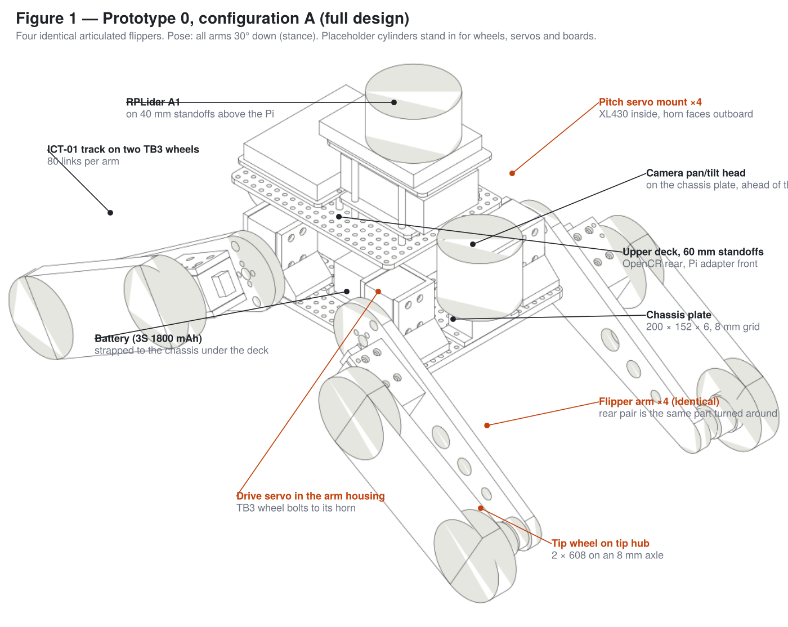

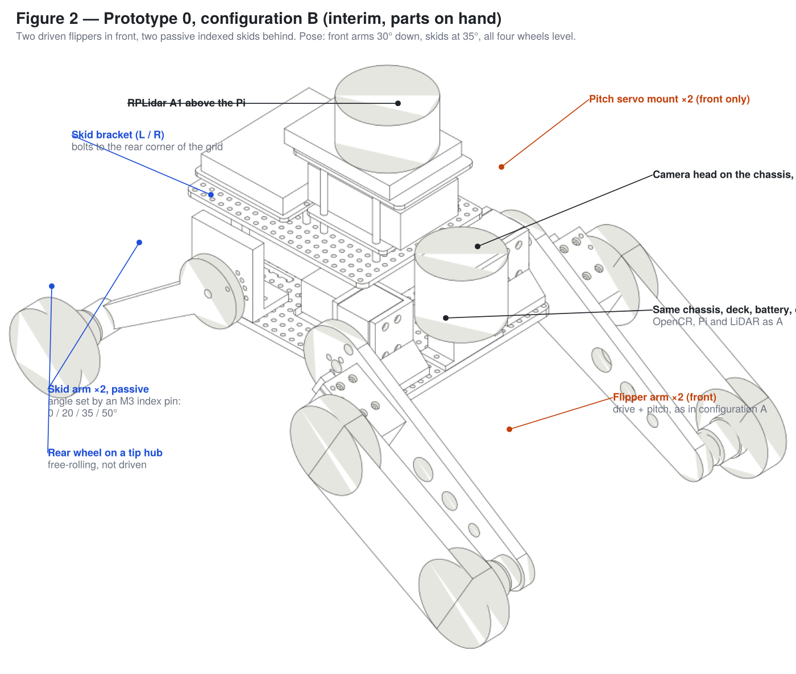

## 0. Before printing anything

Almost every dimension this design depends on comes from the manufacturers' own files, not from measurement: the XL430 body, taps, horn and connectors from Robotis's STEP; the TB3 wheel (Ø66 × 18.2, Ø7 bore, four Ø2.1 horn holes at PCD 16) from the wheel mesh in Robotis's own TurtleBot3 URDF; the OpenCR hole pattern (66 × 96, Ø4) from the board STEP in `ROBOTIS-GIT/OpenCR-Hardware`; the RPLidar A1 holes and heights from Slamtec's datasheet drawing; the ICT-01 pitch (6 mm, 40 per pack, two packs per track) from Robotis Japan's listing and the TurtleBot3 Tank. The sources are quoted in `cad/params.py` next to each number. Two things are still yours to check, because they are properties of *your* printer and *your* track rather than of the parts:

1. **Print the tolerance coupon** (`coupon_p0`) — fits in PLA depend on the printer and filament. Press a 626 into each of the three seats; the one that needs a firm thumb push but no mallet is your `PRESS_FIT`. Slide an M6 bolt through the three bores; the one that slides freely without wobble is `CLEAR_FIT`. Drive one of the servo's M2.6 self-tappers into the three counterbored test holes — it should bite firmly through the 2 mm web. Drop the M6 socket head into the Ø10.4 pocket: it should enter by hand. Try an XL430 in the pocket and the spacer on a horn. Put the numbers in `params.py`, rebuild, and run `uv run cad/check_p0.py` — it rebuilds the whole assembly at six poses and reports any interference or off-grid hole.
2. **Close one track on a pair of wheels** before printing the arms, if you can borrow two wheels: 80 links at 6 mm pitch should close at a 136 mm centre distance, which is the figure Robotis's own Tank uses (its firmware keeps the 33 mm wheel radius with the caterpillar on). The tip slot gives ±4 mm. If your loop closes outside that, change `ICT01_PITCH` or `TB3_WHEEL_D` and rebuild; everything downstream moves with them.

Then print in this order — hub spacers and pivot spacers, tip hubs, pitch mounts, **[B]** skid brackets and arms, deck and adapters, camera parts, chassis plate, flipper arms. Arms last because they are the longest print and the most likely to change.

## 1. What you are building

| Subassembly | What it is | A | B |
| --- | --- | --- | --- |
| **Chassis plate** | 200 × 152 × 6 mm printed plate with an 8 mm M3 hole grid (the TurtleBot3 pitch). Everything bolts to it. | 1 | 1 |
| **Pitch servo mount** | A printed box holding one XL430 standing on its horn end, horn facing outboard; bolts to the plate's corner so the horn face is flush with the plate edge. The arm bolts to that horn through a 6 mm printed spacer. | 4 | 2 |
| **Flipper arm** | Tapered printed arm, 182 mm pivot-to-tip (drive axis 46 + 136 mm wheel centres), carrying its own drive XL430 in a housing at the root, a TB3 wheel on that servo's horn, and a second TB3 wheel on a free-spinning hub at the tip. The ICT-01 links loop around both wheels. | 4 | 2 |
| **Pivot spacer** | Ø26 × 6 printed disc between the pitch horn and the arm (and between skid bracket and skid arm). The horn is flush with the servo case, so this is what keeps the arm clear of the case and the mount — and the drive-servo lead runs out through the gap it creates. | 4 | 4 (2 arms + 2 skids) |
| **Tip hub** | Printed hub with two 626 bearings on an M6 × 50 socket-head bolt; the head sits in a pocket in the hub flange, reachable with a 5 mm hex key through the wheel's Ø7 centre bore, and the nylock on the arm's inboard face clamps it in the tip boss slot. The TB3 wheel screws to the flange. Two printed Ø9.5 × 3 spacers per hub. | 4 | 4 (2 arms + 2 skids) |
| **Skid bracket / skid arm** [B] | A printed upright at each rear corner with an 8 mm pivot and four index holes, and a passive arm with a tip hub and wheel. The arm's angle is fixed by one M3 pin; 0 / 20 / 35 / 50°. | — | 2 + 2 |
| **Upper deck** | 164 × 120 × 4 mm plate on four 60 mm standoffs, above the battery and the mount tops. Carries the two board adapters. | 1 | 1 |
| **OpenCR adapter** | 84 × 112 × 3 plate: the OpenCR's 66 × 96 holes to deck grid holes at (−104, ±32) and (−24, ±32). OpenCR sits long-side-across at the rear. | 1 | 1 |
| **Pi adapter** | 72 × 76 × 3 plate: Pi 58 × 49 holes to deck grid holes at (−8, ±32) and (40, ±32). The same four holes carry the LiDAR standoffs. | 1 | 1 |
| **LiDAR adapter** | 100 × 74 × 3 plate on four 40 mm standoffs stacked on the Pi adapter's holes; the RPLidar A1's four M2.5 holes (front pair 56 apart, rear pair 40 apart, 70 between rows) with the LiDAR's axis at x = 20. | 1 | 1 |
| **Batteries** | Motor LiPo: LB-012 3S 1800 mAh across the chassis centre under the deck. Compute LiPo: a second LB-012 along X in the rear bay (x = −107…−19, |y| ≤ 29, 50 mm tall) feeding a 5 V / 5 A buck for the Pi. A power bank that fits that envelope can replace the second LiPo + buck; a 10 000 mAh bank does not fit anywhere on P0. | 2 | 2 |
| **Camera pan/tilt** | Three printed parts and two MG90S micro servos on the chassis plate at the front centre (x = 88), ahead of the deck: a pan base (servo shaft up), a tilt yoke on the pan horn, and a camera cradle between the yoke's uprights carrying a Raspberry Pi Camera Module. Pan ±90°, tilt −45° to +30°, driven from two OpenCR PWM pins. The ribbon goes to the Pi's CSI port. A fixed 10° mount (`camera_mount_p0`) is the no-servo fallback. | 1 | 1 |

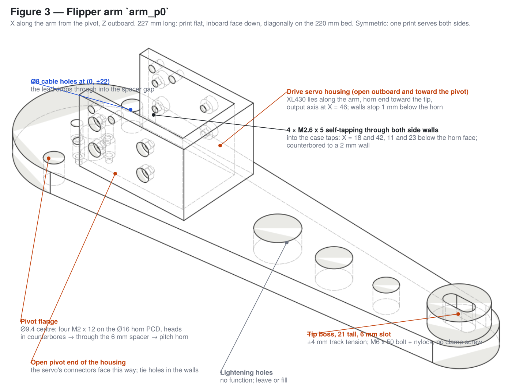

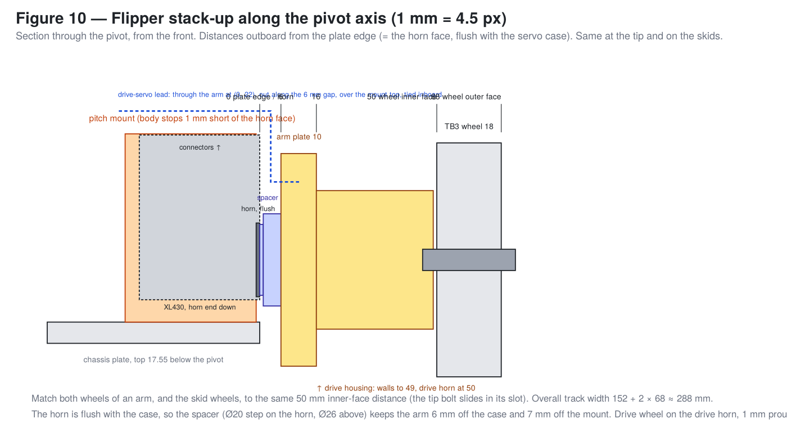

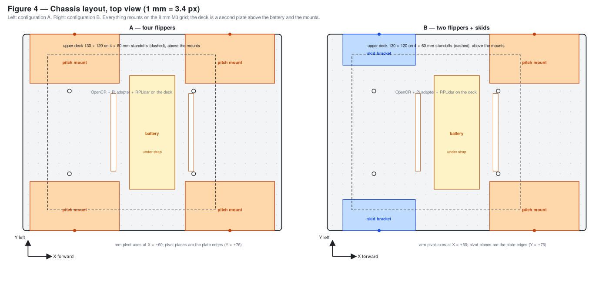

## 2. Printed parts and hardware

| Printed part | A | B | Print notes |
| --- | --- | --- | --- |
| Chassis plate `chassis_p0` | 1 | 1 | Flat, 4 walls, 30 %. |
| Pitch servo mount `pitch_mount_p0` | 4 | 2 | Back wall down, 5 walls, 40 %. All identical; the part is symmetric. |
| Flipper arm `arm_p0` | 4 | 2 | Inboard face down, rotated 45° on the bed (227 mm long; fits the 220 mm bed only diagonally). 5 walls, 40 %. PLA+. No supports needed (the housing is open toward the pivot and outboard). **All identical** — the arm is symmetric about its long axis; a right-hand or rear arm is the same print turned over or around. |
| Tip hub `tip_hub_p0` | 4 | 4 | Flange down, 6 walls, 100 %. |
| Hub spacer `hub_spacer_p0` | 8 | 8 | Any orientation, 100 %. Two per hub. |
| Pivot spacer `pivot_spacer_p0` | 4 | 4 | Ø20 step down, 100 %. One per flipper, one per skid. |
| Skid bracket `skid_bracket_p0_L` / `_R` | — | 1 + 1 | Upright flat (foot up), 5 walls, 40 %. Handed; the build emits left and right. |
| Skid arm `skid_arm_p0` | — | 2 | Flat. PLA+. Identical, symmetric. |
| Upper deck `deck_p0` | 1 | 1 | Flat, 3 walls. |
| Pi adapter `pi_adapter_p0` | 1 | 1 | Flat, 3 walls. |
| OpenCR adapter `opencr_adapter_p0` | 1 | 1 | Flat, 3 walls. |
| LiDAR adapter `lidar_adapter_p0` | 1 | 1 | Flat, 3 walls. |
| Pan base `pan_base_p0` | 1 | 1 | Foot down. Servo pocket is through; flange recess on top. |
| Tilt yoke `tilt_yoke_p0` | 1 | 1 | Plate down, uprights up; no supports. |
| Camera cradle `camera_cradle_p0` | 1 | 1 | Lay the plate flat, discs up; a little support under the discs. |
| Fixed camera mount `camera_mount_p0` | (1) | (1) | Fallback only, if you skip the pan/tilt. |
| Tolerance coupon `coupon_p0` | 1 | 1 | First. |

| Hardware | A | B | Where |
| --- | --- | --- | --- |
| DYNAMIXEL XL430-W250-T | 8 | 4 | 1 pitch + 1 drive per flipper. **Buy 4 for A.** |
| TB3 Wheel/Tire ISW-01 | 8 | 8 | Two per arm or skid. On hand. |
| ROBOTIS ICT-01 links | 320 (8 sets) | 160 (4 sets) | 80 per track at 6 mm pitch. **On hand: 80 (2 sets).** Buy 6 sets for A, 2 for B. |
| M6 × 50 socket-head cap screw, partially threaded (ISO 4762, 8.8) | 4 | 4 | Tip axles. The 26 mm plain shank carries the bearings; 5 mm hex key. |
| M6 × 35 hex bolt | — | 2 | Skid pivots. |
| M6 nylock + M6 washer | 4 | 6 | Tip bolts (**[B]** + skid pivots). |
| 626-2RS bearing (6 × 19 × 6) | 8 | 8 | Two per tip hub. |
| M3 × 8 socket head + nylock | ~30 | ~30 | Mount feet, skid brackets, deck standoff bases, spares. |
| M3 × 20 + nylock | — | 2 | Skid index pins (through arm, spacer gap and bracket). |
| M3 × 60 standoff (or 2 × 30 stacked) | 4 | 4 | Deck. |
| M3 × 12 standoff M/F + M3 × 6 | 8 | 8 | OpenCR adapter and Pi adapter on the deck. |
| M3 × 40 standoff M/F | 4 | 4 | LiDAR adapter, threaded onto the Pi adapter's standoff screws. |
| M3 × 6 / M2.5 × 6 | 8 | 8 | OpenCR → its adapter (M3); RPLidar → its adapter (M2.5, into the LiDAR's own hex standoffs). |
| Second LB-012 (or any 3S pack ≤ 88 × 35 × 50) | 1 | 1 | **Buy.** Compute supply, rear bay. |
| 5 V / 5 A buck converter (e.g. Pololu D24V50F5 or a 5 A UBEC) + USB-C pigtail | 1 | 1 | **Buy.** Under the deck beside the rear slot, zip-tied. |
| 25 mm hook-and-loop strap, ~350 mm | 1 | 1 | Compute battery. |
| M2.6 × 5 self-tapping (supplied with each XL430, 5 per servo) | 32 | 16 | Case screws through the counterbored housing/mount walls, 4 per servo. |
| M2 × 12 socket head | 16 | 8 | Arm → spacer → pitch horn, 4 each (3 mm of plate + 6 mm spacer + 3 mm into the horn). The supplied M2 × 5 are too short. |
| PHS M2 × 4 (supplied with the wheels, 20 per pair) | 32 | 32 | Wheels → drive horns and → tip-hub flanges, 4 each. |
| M2.5 × 6 | 4 | 4 | Pi → adapter. |
| Raspberry Pi Camera Module v2 or v3 + 300 mm CSI ribbon | 1 | 1 | **Buy if not on hand** (~$25–35). |
| MG90S micro servo (metal gear) with horns and screws | 2 | 2 | Pan and tilt. **Buy** (~$4 each). SG90 works but strips. |
| M2 × 6 | 4 | 4 | Camera board → cradle. |
| M3 × 16 + nylock + 2 washers | 1 | 1 | Cradle pivot through the left yoke upright. |
| 3-pin servo extension leads, 300 mm | 2 | 2 | Pan/tilt servos → OpenCR PWM header. |
| 25 mm hook-and-loop strap, ~400 mm | 1 | 1 | Battery. |
| Dynamixel 3-pin TTL cables | 8 | 4 | 180 mm for pitch servos, 240 mm into the arms. |
| Zip ties, 2.5 mm | ~30 | ~20 | Routing. |

Tools: hex drivers 1.5 / 2.0 / 2.5 mm, Phillips #0 for Robotis screws, calipers, deburring tool or countersink, small arbor press or vice with soft jaws for bearings.

## 3. Servo preparation (bench, before any mechanical assembly)

Do this with each XL430 alone on the U2D2 or OpenCR bus so ID conflicts cannot happen.

1. Set IDs and 1 Mbps baud. **A:** 1 = left front pitch, 2 = right front pitch, 3 = left front drive, 4 = right front drive, 5 = left rear pitch, 6 = right rear pitch, 7 = left rear drive, 8 = right rear drive. **B:** IDs 1–4 only.
2. Pitch servos: **Position Control** mode. Note the raw position with the horn's index mark pointing along the case centreline; this is "arm horizontal" and becomes that joint's zero offset in firmware.
3. Drive servos: **Velocity Control** mode.
4. Current limit ~60 % of max on all for first power-up.
5. Paint-pen each servo's ID on its body. Fit horns to the pitch servos now, index mark aligned as in step 2.

## 4. Tip hubs (4)

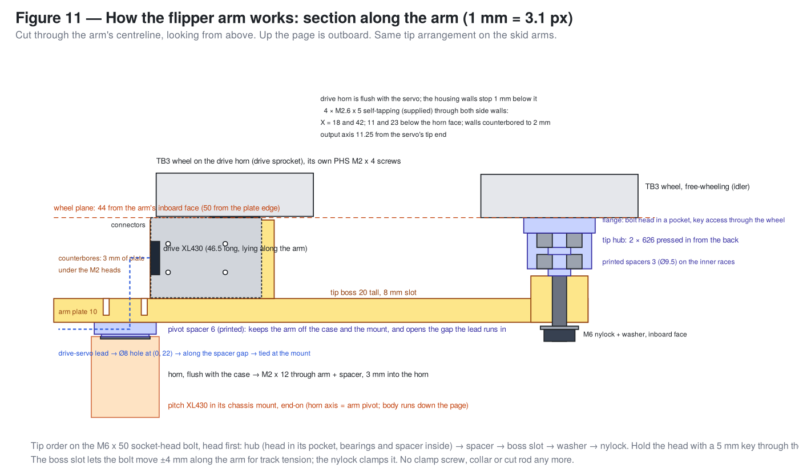

The tip wheel is an idler. Nothing drives it: an M6 bolt is clamped in the arm's tip boss and stays still, and the hub turns on that bolt on two 626 bearings. The TB3 wheel screws to the hub's flange using the same four-hole pattern it uses on a servo horn, so the wheel and its ICT-01 links free-wheel while the drive wheel at the other end of the arm does the work.

1. Drop the M6 × 50 bolt into the hub from the back, head first: the head seats in the Ø10.4 pocket behind the flange. A 6.5 mm hole through the flange face lines up with the wheel's Ø7 centre bore, so a 5 mm hex key reaches the head with the wheel fitted.
2. Over the bolt, press the first 626 into the bore from the back, outer race only, square, until it sits against the flange. Then one printed spacer (it sits on the inner race), then the second 626 flush with the back of the hub.
3. Spin the hub on the bolt: free, no wobble. The bolt's plain shank should run through both bearings with the thread starting just past the second one.
4. Screw a TB3 wheel to the flange with four of its own PHS M2 × 4 (they thread into the Ø1.7 holes). The flange faces outboard (toward the wheel); the hub body sits inboard of the wheel.

Result: a wheel that spins freely on a bolt, with 32 mm of bolt sticking out of the back. Make four.

## 5. Chassis plate and battery

Everything that touches the chassis plate, and the grid hole it uses (Figure 4):

| Part | Position (x, y), mm | Holes | Fastener |
| --- | --- | --- | --- |
| Front pitch mounts (both configs) | pivot axis x = +60, horn face on the plate edge y = ±76 | (32, ±48) (32, ±64) (88, ±48) (88, ±64) | M3 × 8 + nylock through the foot slots |
| Rear pitch mounts [A] | pivot axis x = −60 | (−32, ±48) (−32, ±64) (−88, ±48) (−88, ±64) | same |
| Skid brackets [B] | pivot axis x = −60 | (−80, ±56) (−80, ±64) (−40, ±56) (−40, ±64) | M3 × 8 + nylock |
| Deck standoffs, 60 mm | — | (−80, ±32) (24, ±32) | M3 × 8 from below |
| Camera pan base | shaft at (88, 0), foot across Y | (88, ±24) | M3 × 8 + nylock |
| Motor LiPo strap | across Y through the slots | slots at x = ±30 | 25 mm strap |
| Compute LiPo strap | along X through the slots | slots at (−63, ±22) | 25 mm strap |

1. Deburr the grid holes both sides.
2. Thread the motor-battery strap through the two centre slots, buckle up. The LB-012 lies across Y under the strap, between the slots. Thread the second strap through the rear pair of slots at (−63, ±22); the compute LB-012 lies along X under it, |y| ≤ 17.5, overhanging the plate's rear edge by 7 mm (under the deck). Do not fit either battery yet.
3. Fit the four 60 mm deck standoffs from below at (−80, ±32) and (24, ±32). Do not fit the deck yet; the mounts and arms are easier with it off.

## 6. Pitch servo mounts (A: 4, B: 2)

Each mount is a box, open outboard and open on top, with slotted feet that bolt to the grid. The servo **stands on its horn end**: the output axis is only 11.25 mm from that end of the body, so standing it this way puts the pivot 17.5 mm above the plate (which is what gives the flat pose its ground clearance) and leaves the back end — where the two 3-pin connectors are — facing up and open, 7 mm under the deck.

1. Drop a pitch servo into the mount from the open outboard face, horn outboard, horn end down on the floor, connectors up. Its wide faces are against the mount's X walls. The servo stands **1 mm proud** of the mount's outboard face — the mount body stops short of the horn so nothing printed can touch the arm's spacer.
2. Four of the servo's own **M2.6 × 5 self-tapping** screws through the counterbored holes in the mount's X walls into the case (the holes are at 4 and 28 mm above the pivot, 11 and 23 mm in from the horn face — they only line up one way; the counterbores leave 2 mm of wall, the same as a Robotis frame).
3. Plug the servo leads in from above *now*; they leave the top of the mount and run under the deck edge. The front mounts' connectors are just ahead of the deck's front edge (x = 54); the rear mounts' are under its corner with 7 mm to spare.
4. Place the mount on the chassis top face so its **horn face is flush with the plate's side edge** and the horn axis is at x = +60. Its foot slots sit over grid holes (32, ±48), (32, ±64), (88, ±48), (88, ±64) — the slots give ±2 mm along Y to bring the horn face flush. **A:** rear mounts the same at x = −60 over (−32…−88, ±48/±64), (the mount is symmetric, so no rotation matters). M3 × 8 through the slots, nylocks underneath, finger-tight. Figure 10 shows the stack from the plate edge outward.
5. Sight along each pair of horns: left and right must be coaxial. Adjust in the slots, then torque.

## 7. Flipper arms (A: 4, B: 2)

Build one, then repeat; the parts are identical. A right-hand arm is the same print turned over so its servo housing faces outboard; a rear arm is turned around so its tip points aft. The order matters: the arm goes onto the pitch horn **before** its drive servo goes in, because the servo's plugs sit over two of the pivot screws.

1. **Arm to pitch horn.** Pitch servo at its "horizontal" reading, arm held horizontal. Put a pivot spacer on the horn, Ø20 step toward the servo (it sits on the horn disc only; the Ø26 part clears the case by 1 mm). Arm over it, outboard face toward you; four **M2 × 12** down the counterbores in the arm's outboard face, through the spacer, into the horn; torque in a cross. The arm's inboard face now stands 6 mm off the horn and 7 mm off the mount body — that gap is deliberate, the lead runs in it.
2. **Drive servo.** It lies *along* the arm: horn end toward the tip, back end (connectors) toward the pivot, which is the open end of the housing. Drop it in from outboard, horn out; its output axis is 46 mm from the pivot and the housing only fits it one way round. Four of its **M2.6 × 5 self-tapping** screws through the counterbored holes in the housing's side walls (at 18 and 42 mm from the pivot, 11 and 23 mm below the horn face). Plug the lead in through the open end, drop it through the **Ø8 hole in the arm plate beside the pivot flange** (the one at 0, +22 — the other is for the mirrored arm), and out along the spacer gap, upward, over the top of the mount. Zip-tie the slack to the housing's tie holes.
3. **Drive wheel.** TB3 wheel straight onto the drive horn with its PHS M2 × 4 screws. The horn stands 1 mm proud of the housing walls; spin the wheel and check it touches nothing.
4. **Tip wheel.** The hub-and-wheel from section 4 brings its own bolt. Onto the bolt, inboard of the hub: one printed spacer, then through the tip-boss slot (the boss is 21 mm tall), then an M6 washer and nylock on the arm's inboard face, loose. Both wheels' inner faces must be **50 mm from the chassis plate edge** (6 spacer + 10 plate + 34 housing — Figure 10), i.e. 44 mm from the arm's inboard face; the hub stack (3 + 20) puts it there by itself. Figure 11 shows the whole arm in section.
5. **Track.** Loop the ICT-01 links around both wheels. 80 links at 6 mm pitch close at a 136 mm centre distance; the slot gives ±4 mm. Slide the bolt in the slot until the lower run deflects ~5 mm under a thumb, then tighten the nylock while holding the head with a 5 mm hex key through the wheel's centre bore.
6. Rotate the arm by hand (power off). The drive wheel sweeps a 79 mm radius and the tip wheel 215 mm about the pivot, entirely outboard of the plate edge. In configuration A the front and rear arms on a side share a plane: see the limits in section 11 before powering up.

## 8. Rear skids [B only]

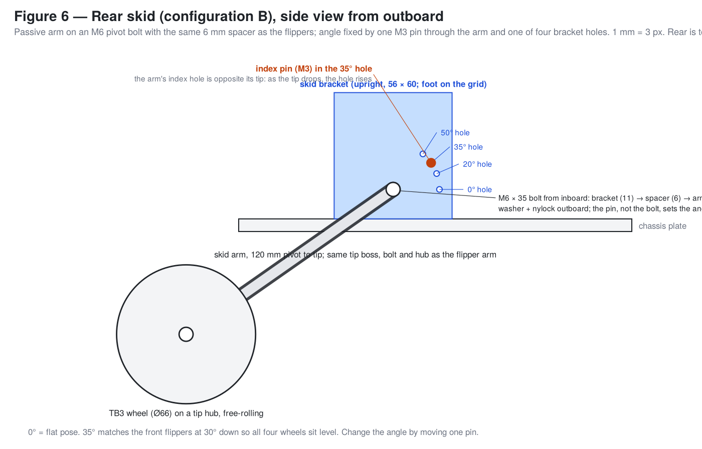

1. Bolt a skid bracket (L on the left, R on the right) to the rear corner of the plate: upright's outboard face on the plate edge, pivot axis at x = −60, foot holes over (−80, ±56), (−80, ±64), (−40, ±56), (−40, ±64). Four M3 × 8.
2. M6 × 35 bolt from inboard through the bracket's pivot hole, then a pivot spacer (Ø20 step toward the bracket), then the skid arm pointing aft, then an M6 washer and nylock. Snug, not tight — the pin sets the angle, the bolt only clamps the stack.
3. Line the arm's index hole up with one of the bracket's holes — start with **35°** — and drop an M3 × 20 through arm, gap and bracket as the pin, nylock. Now tighten the pivot nylock.
4. Tip hub, spacer, wheel and bolt exactly as in 7.4–7.5, matching the wheel plane to the front wheels: 50 mm from the plate edge to the wheel's inner face (Figures 10 and 11).
5. 0° is the flat pose; 35° puts all four wheels level with the front arms at 30° down (`cad/assembly_p0.py 30 35`).

## 9. Upper deck and electronics

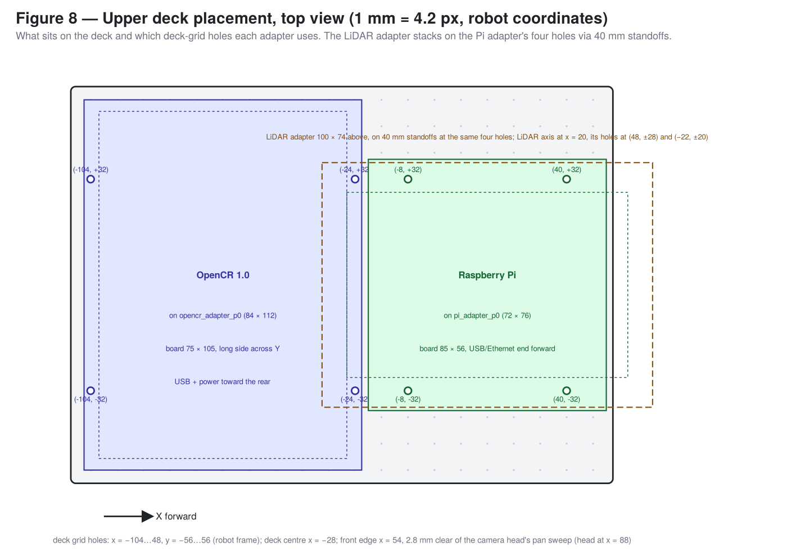

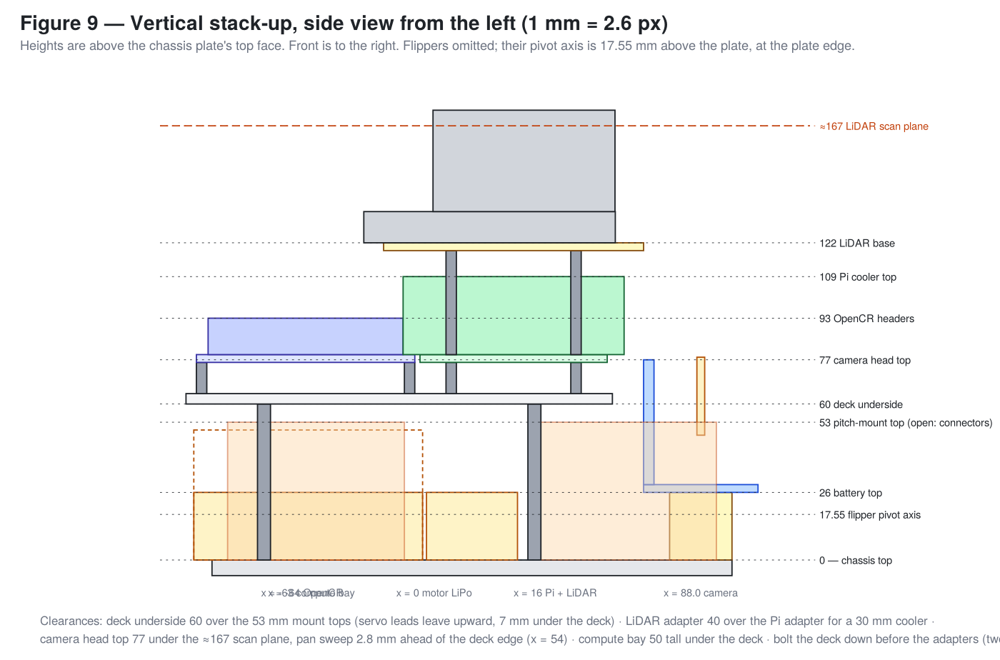

Everything on the deck, and the deck-grid hole it uses (robot coordinates; the deck's grid runs x = −104…48, y = −56…56):

| Part | Centre (x, y) | Holes | Height above chassis top |
| --- | --- | --- | --- |
| Deck plate 164 × 120 | (−28, 0) | to chassis standoffs at (−80, ±32), (24, ±32) | underside 60, top 64 |
| OpenCR adapter + OpenCR | (−64, 0), board long side along Y | (−104, ±32), (−24, ±32) on M3 × 12 standoffs | adapter 76–79, headers to ~93 |
| Pi adapter + Pi | (16, 0) | (−8, ±32), (40, ±32) on M3 × 12 standoffs | adapter 76–79, cooler top ~109 |
| LiDAR adapter + RPLidar A1 | adapter (16, 0); LiDAR axis (20, 0), wide end forward | adapter on the same four holes via M3 × 40 standoffs; LiDAR on its holes at (48, ±28) and (−22, ±20) | adapter 119–122, scan plane ≈167, top 173 |
| Camera pan/tilt head | (88, 0) on the **chassis**, not the deck | (88, ±24) | top 77; pan sweep stops 2.8 mm short of the deck edge |

1. **Bolt the deck down first**: M3 × 8 through the deck into the four 60 mm standoffs at (−80, ±32) and (24, ±32). Two of those screw heads end up under the adapters, which is fine because the adapters sit 12 mm higher — but it means the deck cannot be removed without lifting the adapters.
2. **OpenCR adapter** on four M3 × 12 standoffs at (−104, ±32) and (−24, ±32); OpenCR onto the adapter's slotted holes with M3 × 6, long side across the robot, USB and power connectors toward the rear, headers up.
3. **Pi adapter** on four M3 × 12 standoffs at (−8, ±32) and (40, ±32); Pi onto it with M2.5 × 6 and its own 11 mm standoffs, long side along X, USB/Ethernet end **forward** (it overhangs the deck's front edge by 4 mm, above the camera head). Do not use M3 × 6 on top of the four adapter standoffs — the LiDAR standoffs go there instead.
4. **LiDAR adapter** on four M3 × 40 M/F standoffs threaded onto the Pi adapter's four standoffs; RPLidar A1 onto the adapter's four holes with M2.5 × 6 into the LiDAR's own hex standoffs, wide end of the base forward, motor/connector end aft; its leads go down through the slot behind the rear holes to the USB adapter board, which zip-ties to a LiDAR standoff. The 40 mm clears a Pi 5 cooler (30 mm) with airflow; the scan plane at ≈167 mm is above the camera head (77) and the LiDAR's rotating head has a clear 360° view — the raised flipper tips are the only thing that can enter it.
5. **Camera pan/tilt** (Figure 7). Centre both MG90S servos with a servo tester or the OpenCR before fitting horns.
   - Drop the pan servo into the pan base from the top, shaft up, lead out through the pocket; two M2 self-tap screws through the flange into the block. Bolt the base to the **chassis plate** at the front centre — foot across Y, grid holes (88, ±24) — between the two front pitch mounts, flush with the plate's front edge. The yoke's corners sweep a 31 mm radius when it pans; at x = 88 that stops 2.8 mm short of the deck's front edge (x = 54). The head's top is at 77 mm, under the LiDAR's scan plane and 2 mm under the Pi board's forward overhang.
   - Fit a two-arm horn to the pan servo. Bolt the tilt yoke's plate to it (centre M2.5 screw plus the two pin holes) with the yoke's servo upright on the robot's right.
   - Slide the tilt servo into the right upright from outside, shaft pointing inward; two M2 self-tap screws through the upright into the flange. Fit a two-arm horn on the inside.
   - Bolt the Pi Camera board to the cradle with four M2 × 6, lens through the window, ribbon connector downward. Bolt the cradle's horn disc to the tilt horn; pass an M3 × 16 with a washer each side through the left upright into the cradle's pivot boss, nylock just snug so it turns freely.
   - Set both servos to centre: the camera should look straight ahead and level. If not, pull the horn and re-index by a tooth.
   - Connect the CSI ribbon to the Pi before the deck goes on (a Pi 5 needs the 22-to-15-pin ribbon; a 300 mm ribbon reaches). Leave a loose loop above the pan base so ±90° of pan does not strain it; route it up and back under the deck's front edge.
6. **Buck converter**: zip-tie it to the deck's underside just forward of the cable slot (x ≈ −50, under the OpenCR adapter's window), input leads down to the compute LiPo's connector, USB-C output up through the slot to the Pi. Feed the servo bus and the motor-battery lead up through the same slot — it sits at x = −64, under the OpenCR adapter's 44 × 60 window, so cables come up between the adapter and the board.

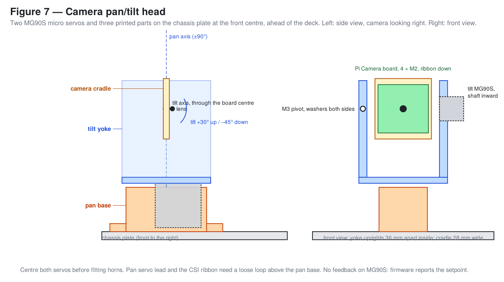

## 10. Power budget

The LB-012 is 11.1 V, 1800 mAh (≈20 Wh). That is enough for the motors alone; it is not enough to also run a Pi, LiDAR and camera for a useful session, and a stalling servo on the same pack will brown out the Pi. So P0 runs **two independent supplies**: one LiPo for the OpenCR and every servo, and a **second LB-012 through a 5 V / 5 A buck** for the Pi and everything hanging off it. (A USB power bank was the first idea; there is no room on P0 for a 10 000 mAh one — the only free volume under the deck is the 88 × 58 × 50 rear bay, which a second LB-012 fits with room for the buck. A bank that fits that envelope works too, but most Pi 5-capable PD banks also refuse to re-negotiate after a brown-out, which a dumb buck never does.)

| Load | Supply | Typical | Peak | Notes |
| --- | --- | --- | --- | --- |
| XL430-W250-T, each | LiPo via OpenCR bus | 0.2–0.5 A | 1.4 A stall | Pitch servos holding stance sit near the top of the typical range |
| 4 servos (B) / 8 servos (A) | LiPo | ~1.5 A / ~3 A | 5.6 A / 11 A | Firmware current limits (60 % to start) cap the real peak |
| OpenCR 1.0 | LiPo | 0.2 A | — | |
| MG90S ×2 (pan/tilt) | OpenCR 5 V | 0.1 A | 1.4 A | Only stalls if the head is pushed |
| Raspberry Pi 5 + cooler | Compute LiPo via buck | 1.2–2 A @ 5 V | 3 A | Pi 4: ~1 A typical |
| 5 V buck, idle | Compute LiPo | 10–20 mA | — | |
| RPLidar A1 | Pi USB | 0.45 A @ 5 V | 0.6 A | Motor + scanner |
| Pi Camera | Pi CSI | 0.25 A @ 5 V | — | |

**Runtime on the LiPo (motors only):** configuration B ≈ 1.7 A average → ~55–60 min of mixed driving; configuration A ≈ 3.2 A → ~30 min. Stair work pulls more; a second LB-012 or any 3S pack up to ~5000 mAh (≈380 g, still under the 2 kg rig limit) fits under the strap.

**Compute supply:** the second LB-012 (≈20 Wh) through a 5 V / 5 A buck gives the Pi 5 + LiDAR + camera (~8–10 W) about **2 h**; with a Pi 4, ~3 h. Set the buck to 5.1 V. Use a buck rated 5 A continuous with ≥ 90 % efficiency (Pololu D24V50F5, or a 5 A "UBEC"); add a 470–1000 µF low-ESR capacitor at its output if the Pi reports under-voltage. Switch: the LB-012's own connector — unplug to power down the Pi *after* a clean shutdown.

**Why not one battery:** the OpenCR's 5 V output is rated 4 A, which would run a Pi 5 without USB loads, but every servo stall drags the shared battery rail; separate supplies also mean the Pi keeps logging when the e-stop or the firmware cuts motor power — the same split as the full-size design. If you do run single-battery, feed the buck from the motor LiPo with a 1000 µF cap at the Pi, never from the OpenCR's 5 V header.

**OpenCR limits (from its e-manual):** input fuse 10 A; 12 V output 4.5 A max; 5 V output 4 A max; 55 W total on the regulated outputs. The Dynamixel ports pass battery voltage through that 10 A fuse, so configuration A's 11 A theoretical stall *must* be kept below it with per-servo current limits (eight at 60 % = 6.7 A worst case); the LB-012's own 5C rating is 9 A. Bench development (firmware, servo tuning, pan/tilt) should run from the 12 V / 4.5 A SMPS on the OpenCR's DC jack, not the LiPo.

## 11. Wiring

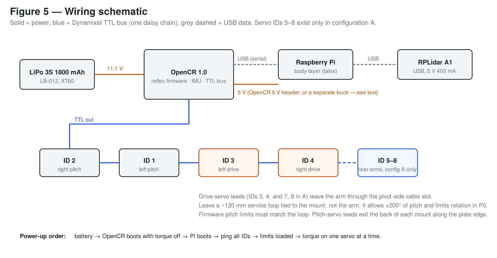

Power: the motor LB-012 feeds the OpenCR's battery input and, through the OpenCR, the Dynamixel bus and the two MG90S. The Pi, LiDAR and camera run from the compute LB-012 through the buck (section 10). Nothing except the pan/tilt servos draws 5 V from the OpenCR.

Dynamixel bus, one daisy chain, in this order to keep runs short:

```
OpenCR TTL → ID 2 → ID 1 → ID 3 → ID 4            (B)
OpenCR TTL → ID 2 → ID 1 → ID 3 → ID 4 → ID 6 → ID 5 → ID 7 → ID 8   (A)
```

- Pitch-servo leads leave the top of each mount (the connectors face up) and run under the deck edge; tie them along the inside of the plate edge.
- Drive-servo leads come out of the open pivot end of the housing, down through the Ø8 hole in the arm plate, and run in the 6 mm gap between the arm and the mount, radially outward past the mount's top, then inboard. Leave a **~120 mm service loop** there, coiled and tied to the *mount*, not the arm. This loop allows about ±150° of pitch and the firmware limits must match it.
- **Arm limits (A).** The front and rear arms on a side are coplanar and their tip circles overlap, so the firmware must enforce: (i) neither arm beyond 90° down (tip under the body is useless anyway); (ii) both arms may be raised to 90° up at the same time, but one arm may only go past that — up to 150° up, i.e. tucked back over the body — while the other is **at or below horizontal**. `cad/check_p0.py` verifies these poses are collision-free. Self-righting, which would need both arms past vertical together, is therefore not available on P0 in either configuration.
- USB: Pi → OpenCR (micro-USB) and Pi → RPLidar A1. Tie under the deck.
- Camera: CSI ribbon from the cradle up to the Pi with a loose loop above the pan base; no twist. Pan and tilt servos to two OpenCR PWM pins (e.g. D4 and D5 on the Arduino header) with 5 V and ground from the OpenCR's 5 V header.
- Grounds: the buck's output ground reaches the OpenCR through the Pi's USB serial cable; that single tie is enough for the PWM and serial references to agree. Do not add a second ground path.
- Batteries last: compute LiPo first (buck → Pi boots), then the motor LiPo (OpenCR boots with torque off). Nothing moves until the firmware enables torque.

## 12. First power-up checklist

On blocks, wheels and arms free.

1. Battery in, OpenCR on, Pi booted. All Dynamixels answer a ping at their IDs; `rpicam-hello` (or `libcamera-hello`) shows a picture; the RPLidar spins; pan and tilt go to centre when the firmware starts and sweep gently to their limits without the ribbon pulling.
2. Torque **off**. Move each arm (and skid) by hand through its range; nothing binds, the lead slides freely in the spacer gap and does not pull taut before 150° up or 90° down.
3. Load the reflex firmware with limits first: pitch −150° (up) to +90° (down) about each horizontal offset, plus the arm-to-arm rule from section 11 in configuration A; current trip at the step-3 limit, IMU tip-over at ±60°, 500 ms heartbeat timeout → hold pitch, zero drive.
4. Torque on one servo at a time. Command each pitch servo ±10° and check direction: left and right are mirrored, so one side's positive is the other's negative. Fix signs in firmware, not by swapping cables.
5. Each drive servo at 10 rpm forward; both (all four) tracks should move the robot forward. Fix signs likewise.
6. Set stance: arms 30° down (**[B]** skids at 35°). All four wheels touch at once; if one floats, the horizontal offsets differ — adjust in firmware.
7. On the floor: 1 m forward at 0.2 m/s, turn in place, stop. Currents well under the trip, nothing loosened.
8. Then the first test stair (100 × 150 mm book step) under the scripted sequence — that sequence belongs to the firmware/body-layer work, not this guide.

## 13. What P0 cannot do, by configuration

| | A | B |
| --- | --- | --- |
| Self-right | No — the two arms on a side cannot both pass vertical (they are coplanar) | No |
| Push with the rear on a step | Yes | No — front pull only, hence the small test stair |
| See tread edges | No (2D LiDAR); climb runs on IMU + servo current | Same |
| Camera | Pi Camera Module on a two-servo pan/tilt: pan ±90°, tilt −45…+30° | Same |

Moving from B to A later: remove the two skid brackets and arms, add two pitch mounts and two arms at the rear corners (the spacers, hubs and wheels carry over), four servos and two more track sets. Chassis, deck, electronics and firmware are unchanged apart from four more servo IDs.

## 14. Height, mass and tipping

Numbers from `uv run cad/check_p0.py` (mass estimates in `params.MASS`; weigh the real parts and update them):

| | A | B |
| --- | --- | --- |
| Mass | ≈ 2.7 kg | ≈ 2.1 kg |
| Centre of gravity | x ≈ 0, 48 mm above the ground (flat) | x ≈ +31, 52 mm above the ground (flat) |
| Height, flat / 30° stance | 188 / ≈ 279 mm to the LiDAR top | same |
| Belly clearance, flat / 30° stance | 9 / ≈ 100 mm | same |
| Static tip-back (body pitch at which the CoG passes the rear contact) | 79° | 75° |
| Stair slope for comparison | 32° (178 × 280), 34° (100 × 150 test step) | same |

The stack *looks* tall, but everything above the deck weighs about 400 g against 2 kg of servos, arms, wheels and batteries sitting at pivot height or below, so the CoG is only ~50 mm off the floor. Falling backwards on a stair would need the body to pitch past ~75°, more than twice the slope. What limits P0 on real stairs is track length, not height: the ground contact spans ~550 mm, less than two nosings of a 178 × 280 stair (664 mm), so it will climb one step at a time rather than smoothly — which is why the test stair is 100 × 150. Keep the heavy items where they are (batteries on the plate, nothing heavier than the LiDAR up top) and the margin stays.

## Related

- Design: [`../design/physical-design-spec.md`](../design/physical-design-spec.md)
- Print settings: [`../design/filament-guide-adventurer-5m-pro.md`](../design/filament-guide-adventurer-5m-pro.md)
- CAD and print manifest: [`../../cad/README.md`](../../cad/README.md)
- Body interface the firmware and Pi driver target: [`../design/talos-capability-manifest.md`](../design/talos-capability-manifest.md)
- Figures are generated by [`figures/make_figures.py`](figures/make_figures.py) from the CAD views and from `PLACE`/`STACK` in `cad/params.py`; regenerate after any geometry or placement change.
