# Skala assembly guide — fixed tracks, deck and boards

Updated 2026-11-25. **Resuming with a partly assembled robot? Start with the construction session and bench sequence below.** Steps 2–9 cover the current base/deck/board fit candidate. Steps 10–14 carry the design through sensors, power, wiring, commissioning and research use, with explicit HOLD points for unfinished design interfaces. Software identification and isolated bench checks begin while the deck is still off the chassis; section 13 defines their acceptance gates, not a requirement to finish all assembly before testing. The deck/board candidate remains **P0-U1-2026-11-03**. The [complete-system design](s1-system-plan.md) owns connection details and H01–H10 closure conditions; these steps are not a claim that the whole robot is ready to energize.

The active mechanical candidate is **P0-S1-2026-11-02-R2**. If the installed hub is the earlier version without rear cap fixings, **replace P3 and add P8, the three-screw rear bearing cap**. An existing R2 hub/cap that matches the guide does not need another print because of this documentation update. The bore remains a 19.3 mm fit candidate. The [build review](p0-build-review.md) separates physical results from CAD evidence.

**Carrier correction, 2026-10-31:** the previous carrier left only two approximately 1.55 × 5 mm wall feet connecting the motor housing to the idler-side body. Do not print or use that version as a load-bearing module. The current carrier has a continuous **28 mm wide × 10 mm thick backplate beneath the motor**, joining the root and idler-side body. Regenerate the files with the normal build command; `cad/out/FIT_ARTICLES.json` must identify the current revision **P0-S1-2026-11-02-R2**. The carrier correction changed P1 and F1; the later idler correction changes P3 and adds P8/H8 as described below.

## Resume construction with the upper-deck parts

The last physical report, **2026-11-20**, has the tracks assembled and moving by hand, sensor mounts printed, both board adapters off the deck, and the deck off the chassis. Motor operation and the upper-deck completion check are still unrecorded.

This deck/board session uses the specified **U1–U8 BOM hardware without substitutions**. That restriction concerns the mounting stacks; it does not make Camera Module 3 a permanent payload requirement. Check received labels and quantities against U1–U8. The bench target is **P6 standing on its four secured 60 mm columns, with OpenCR on P9 and the bare Pi 4B on P10**; attaching the columns to the chassis comes later.

1. Disconnect the drive battery, compute supply and every USB power source. Keep the lower-module leads loose and unplugged from OpenCR. Work with the deck off the chassis, supported by its columns or edges so no board or connector bears its weight.
2. Retain the existing P5 chassis and P6 deck. Have **one current P9 `opencr_adapter_s1.stl` and one P10 `pi4_adapter_s1.stl`** ready. Their downloads and identifying dimensions are in [step 7](#7-prepare-the-upper-deck-and-its-four-columns). If those exact adapters are already printed, this documentation update requires no replacement print. The older `opencr_adapter_p0` and `pi_adapter_p0` are different parts.
3. Lay out U1–U8 using [the four hardware groups in step 7](#sort-the-bom-hardware). Complete the deck-column tops and, if the matched P11 frames are ready, their foot fixings before installing the board adapters. Prepare each board/adapter assembly, then attach it to the deck from below. Follow the access dependencies below for the HAT screws and CSI ribbon. Keep the four U4 chassis screws aside during bench work; the deck can stand on its secured columns.
4. Apply the board/adapter checks in [step 9](#upper-deck-completion-check) now. Defer the chassis-dependent checks until the deck is trial-fitted, then repeat the full check at installation. If a fixing will not seat, identify its layer/part before changing the stack; extra washers, shorter columns or forced PCB holes change the checked geometry.

If the deck is already installed, use [step 9's removal procedure](#9-assemble-the-bare-pi-4b-and-install-the-deck) to lift it as an assembly. If boards are already fitted but a covered deck-column screw needs attention, remove the affected board/adapter assembly from the deck first; do not force a driver between the PCB and its adapter. If the lower chassis cannot yet support the upper assembly, complete the deck on the bench and defer only its final chassis attachment.

**This mechanical session ends with supported boards and a recorded fit; the deck may remain off the chassis.** Secure each subassembly properly for any powered check. Access is preserved by leaving modules removable, not by leaving PCB screws or hardware loose.

### Fit covered fasteners before closing access

Arrows mean “finish this before the next part blocks access.” This is an assembly-order diagram, not a wiring diagram. Work unpowered; if HAT or LiDAR matching is still unresolved, leave the covering assembly removable and defer that branch.

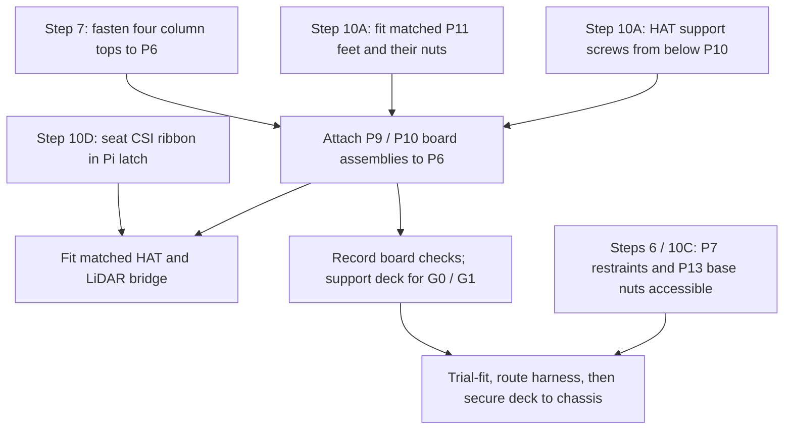

G0 needs only the secured Pi, with OpenCR connected by USB for its specific inventory steps. G1 sensors may use secure temporary supports. Neither requires the final HAT/bridge/head assembly or final deck installation to be complete.

### Bench checks before attaching the deck

**Software checks before final assembly:** Ubuntu and ROS distribution upgrades were reported complete on 2026-11-23. Record the updated versions and qualify the sensor stack. Keep the deck off the chassis and the Pi/SD/ribbon accessible until the [software compatibility checkpoint](commissioning-procedures.md#before-final-assembly-software-compatibility-checkpoint) passes. A secured Pi adapter and temporary sensor supports are sufficient for these checks; final camera mounting must use the selected camera.

Reported hardware history records prior operation of this Pi and OpenCR with these same two motors in a TurtleBot3. **Humble/Jammy is the pre-upgrade configuration**, recorded on 2026-11-22; both distributions were updated as of 2026-11-23 toward the planned Noble/Jazzy baseline. Post-upgrade version output, OpenCR firmware and motor settings remain to be recorded. Retain any earlier backup and preserve the updated installation before further changes. Prior TurtleBot3 operation does not establish Skala geometry, stop behavior or the new two-supply installation.

| Order | Mechanical state | Work and condition for moving on |
| --- | --- | --- |
| 1. Inventory and preserve software — G0 | Deck off chassis; Pi secured on its adapter. Drive battery absent; OpenCR and motor/head power disconnected initially | Image the SD card first, then boot Pi from its separate supply and record OS, ROS, kernel and startup services. G0.3/G0.4 use USB-only OpenCR power with motor leads still unplugged. No upgrades, reflashing or motor resets during inventory |
| 2. Start power work — H04–H06 | Keep the under-deck bay and connectors accessible. Motors remain physically disconnected during G2 controller/stop checks | Start with an owned 5 V/3 A bank or the official Pi supply if available. Record the bank model/output port and qualify its cable/load before relying on it. Identify drive connectors/polarity, fuses, relay, stop, head-servo regulator and mounting space; no new compute supply is a baseline purchase. Close the applicable drive/stop and supply-interaction checks before G3; finish mobile-source retention before floor tests. Stationary sensors can proceed on the qualified compute source while drive-power design continues |
| 3. Stationary sensor checks — G1 | Deck supported on its columns; bridge removable. Camera and LiDAR securely supported independently if their final mounts are not ready | Test camera, WM8960 and identified A1/interface separately, then together from the qualified compute source. Fit the HAT supports and CSI ribbon with power removed. Save samples; resolve device/driver, thermal and supply issues before restricting access |
| 4. Trial assembly and harness routing — steps 9–12 | All power removed; offer the deck to its four chassis holes | Check real connector reach, head/ribbon motion, power-tray clearance, battery retention and service loops. Label leads; do not cut to final lengths until the complete route is demonstrated. Remove the deck again wherever access is needed |
| 5. Controlled motor checks — G3/G4 | Track modules securely fixed and tracks raised clear. Deck secured either on the robot or on a stable bench support within unstressed cable reach | After G2 passes and reviewed Skala limits/stop behavior are implemented, read existing motor settings, verify each side at low speed, then test command loss, USB loss, reset and stop/rearm. Existing firmware is not assumed to provide these behaviors |
| 6. Complete installation, then floor tests — G5 onward | Complete deck installation with four U4 screws after the under-deck mounts and routing are ready; the deck remains removable for service | Repeat the complete mechanical/access checks and installed power/stop tests. Fit the actual retained payload and batteries before floor/load qualification; stationary bench results do not establish mobile performance |

For the first Pi-only inventory, follow [G0 in the commissioning procedures](commissioning-procedures.md#g0--preserve-and-inventory-the-existing-installation): SD backup, then `cat /etc/os-release`, `ls /opt/ros`, `uname -m`, `uname -r` and the rest of its inventory. The [software plan](s1-system-plan.md#software-and-data-endpoint) owns Skala's control implementation and selective reuse of device support; migration of the TurtleBot3 application is not required. The [power plan](s1-system-plan.md#two-supplies-and-physical-stop) owns H04–H06. Sensor matching remains H01–H03. None requires bolting the deck down merely to read software versions.

Before restricting access, finish the deck-column top screws (step 7), P7 chassis restraints (step 6) and P11 frame-foot nuts (step 10A). The HAT support screws enter from below P10; fit the camera ribbon before the HAT/bridge obstructs its latch. If board adapters are already fitted, remove only the affected adapter assembly when its covered fixings need access. The LiDAR bridge can stay off during debugging. A temporary unpowered deck fit is useful now, but final cable dressing and mobile operation wait for the sequence above.

## 0. Print the small fit article first

Use these current S0 files, already oriented on the print bed. Do not use the older arm STLs in `cad/out`.

Generate them with the normal `uv run cad/build.py` command from the repository root. It writes the seven lower files below and the two upper adapters in step 7 to `cad/out/stl/`, with matching STEP files in `cad/out/step/` and the validation receipt in `cad/out/FIT_ARTICLES.json`. P3's STL comes from its reviewed, pinned STEP. Part IDs, names and filenames follow `cad/print_parts.json`; the same filenames are used by the BOM and vault downloads.

| File | Bed footprint and height | Print order |
| --- | --- | --- |
| F1 Motor fit coupon — [motor_fit_coupon_s1.stl](../../cad/out/stl/motor_fit_coupon_s1.stl) | 70 × 55.3 × 43 mm | One first; includes the actual motor pocket, selected screw holes and widened lead exits |
| F2 Bearing fit coupon — [bearing_fit_coupon_s1.stl](../../cad/out/stl/bearing_fit_coupon_s1.stl) | 125 × 33.5 × 6 mm | Retain the existing sample; no repeat sample print is required for the 19.3 mm hub trial |
| P1 Track carrier — [track_carrier_s1.stl](../../cad/out/stl/track_carrier_s1.stl) | 183.35 × 183.35 × 43 mm | One after F1 passes; already turned 45°. Resolve the separate hub fit before duplicating modules |
| P2 Fixed bracket — [fixed_bracket_s1.stl](../../cad/out/stl/fixed_bracket_s1.stl) | 38 × 36 × 32 mm | Two for the first module; supplied lying on its broad side |
| P3 Tip hub — [tip_hub_p0.stl](../../cad/out/stl/tip_hub_p0.stl) | Ø30 × 21.5 mm | Revised hub with three rear pilot holes; wheel flange down, open bearing cavity up |
| P8 Idler bearing cap — [idler_bearing_cap_s1.stl](../../cad/out/stl/idler_bearing_cap_s1.stl) | Ø30 × 2 mm | One per revised hub; supplied countersinks down, shallow bearing relief up; no supports; check complete stack before duplication |
| P7 Drive-lead restraint — [drive_lead_restraint_s1.stl](../../cad/out/stl/drive_lead_restraint_s1.stl) | 24 × 44 × 12 mm | One for the first module's chassis connection; supplied lying on its broad side |

For a 0.4 mm nozzle, use PLA/PLA+, 0.20 mm layers, six walls, six top/bottom layers and 40% gyroid infill. Start at 215°C nozzle / 60°C bed, 45 mm/s outer walls, 60 mm/s inner walls and 25 mm/s first layer; use the filament maker's temperature range if 215°C falls outside it. Open the enclosure door and use the PLA cooling profile. Add a 5 mm brim. Enable removable build-plate supports beneath the motor coupon/carrier's side-window roofs; P2, P3, P7 and P8 need no supports in the supplied orientations. Do not rotate these files onto a different face.

Remove supports and burrs completely. Check F1 Motor fit coupon with the **actual motor and terminated lead**, following step 2: the case seats without force, all four screws seat, and the lead follows the R12 bend without a trapped wire. F1 intentionally omits the idler and chassis pads. Retain F1 until the first full module passes; it is not installed on the robot.

F2 is a separate bearing-fit sample, not a robot component. Its CAD includes labels, but they were not visible on the printed sample. Do not require another sample solely to recover those labels. Print the revised P3 at 100% scale with the same material, layer height, wall settings and hole/XY compensation used for that sample; keep the flange on the bed and leave supports off inside the bearing bore. Record those settings with the full-hub result.

Identify the printed hub, bearing and spacers using step 3 before the bearing/clamp check: the original 608 hub and large pivot spacer are not the current idler parts. Reuse only matching parts that pass the check. A failed fit is resolved on the coupon or hub before printing another carrier. Confirm the revised motor coupon has material under the motor and that the actual case still seats; an earlier open-bottom coupon does not check that new surface. The repeatable first-module acceptance procedure follows step 6.

## 1. Identify the assembly and lay out the parts

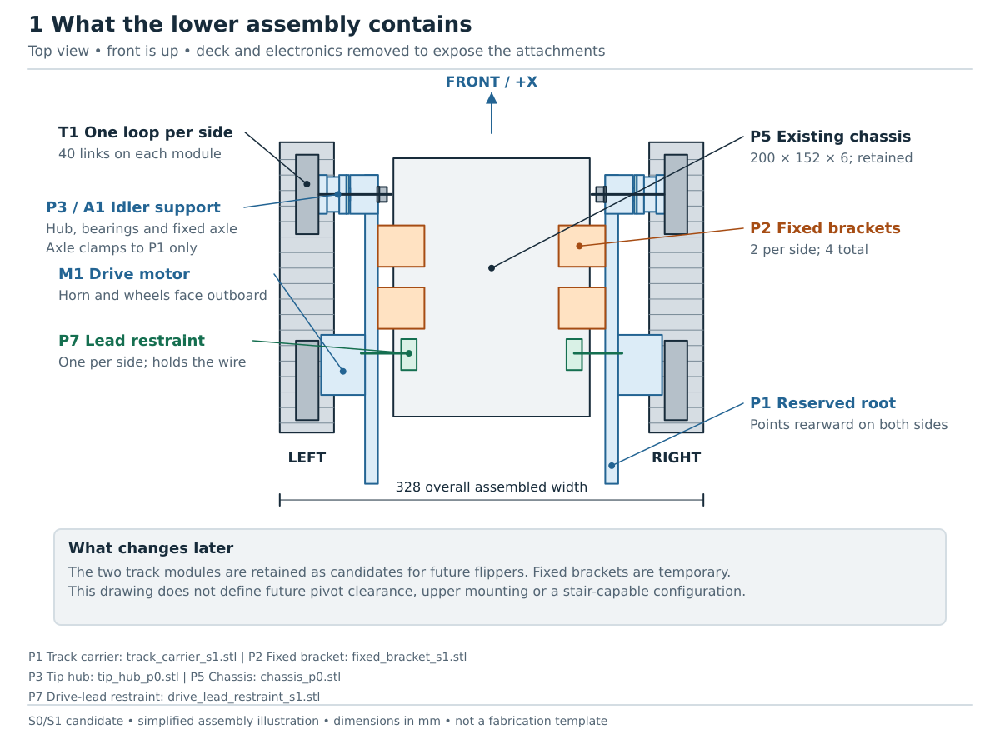

The two track modules sit beside the retained chassis. The motor, both sprockets and track face **away from the chassis**. The unused circular root of each module projects toward the **rear**. Four removable brackets join the modules to the existing chassis holes. There is no pitch motor in this build.

Both wheels connect to the same printed body: the **drive wheel through the XL430 horn/output and motor case**, and the **idler through its hub, two bearings and fixed M6 axle**. The printed body then bolts directly to the two chassis brackets. The drive end has no separate external bearing; its radial and sideways loads still need qualification. The two idler bearings do not relieve the motor of the drive wheel's own loads.

“Carrier” in a CAD filename is **P1, the revised arm/track-module body with its motor housing built in**. It is not a second housing to buy or print. Inboard means toward the chassis; outboard means away from it.

| Already printed | Disposition |
| --- | --- |
| Chassis, P5 | Retain; bracket feet use existing holes |
| Upper deck, P6 | Retain unchanged; four columns and the board adapters are installed in steps 7–9 |
| Tip hubs, P3 | Replace the hub without rear retaining-cap holes with revision R2; print P8 as well |
| 3 mm spacers, P4 | Retain plain `hub_spacer_p0` rings after the complete stack check; large four-hole pivot spacers are different parts |
| Four earlier arms | Superseded; S0 starts with one revised P1 fit article, then a second for S1 |
| Separate pitch-motor housings and pivot spacers | Set aside; not used by the fixed base |

P1 fits the 220 mm bed in the supplied orientation, including the 5 mm brim. The 328 mm vehicle width is assembled size. The [CAD workflow](../../cad/README.md) reproduces these S0 fit files; they are not evidence of a qualified payload rating.

### Parts used by these steps

Quantities are loose components unless the row explicitly says “set.” Use the [purchasing BOM](p0-bom.md) for exact supplier links, combined fastener quantities, package sizes and owned stock. The [parts register](../../cad/staged_base.json) also contains the later four-module counts.

| ID  | Part                                                                                             | One module | Two-module base |
| --- | ------------------------------------------------------------------------------------------------ | ---------: | --------------: |
| P1 | Track carrier — [track_carrier_s1.stl](../../cad/out/stl/track_carrier_s1.stl) | 1 | 2 |
| P2 | Fixed bracket — [fixed_bracket_s1.stl](../../cad/out/stl/fixed_bracket_s1.stl) | 2 | 4 |
| P3 | Tip hub — [tip_hub_p0.stl](../../cad/out/stl/tip_hub_p0.stl); revised 626/M6 hub with three rear cap pilots, 19.3 mm bore | 1 | 2 |
| P4 | Hub spacer — [hub_spacer_p0.stl](../../cad/out/stl/hub_spacer_p0.stl); plain Ø9.5 × Ø6.3 × 3 mm ring | 2 | 4 |
| P5 | Chassis — [chassis_p0.stl](../../cad/out/stl/chassis_p0.stl); 200 × 152 × 6 mm | — | 1 |
| P6 | Upper deck — [deck_p0.stl](../../cad/out/stl/deck_p0.stl); 164 × 120 × 4 mm, installed in steps 7–9 | — | 1 |
| P7 | Drive-lead restraint — [drive_lead_restraint_s1.stl](../../cad/out/stl/drive_lead_restraint_s1.stl) | 1 | 2 |
| P8 | Idler bearing cap — [idler_bearing_cap_s1.stl](../../cad/out/stl/idler_bearing_cap_s1.stl) | 1 | 2 |
| M1  | XL430-W250-T drive motor                                                                         |          1 |               2 |
| W1  | Bare TB3 sprocket, rubber tyre removed                                                           |          2 |               4 |
| T1  | ICT-01 link                                                                                      |         40 |              80 |
| B1  | 626 bearing, 6 × 19 × 6                                                                          |          2 |               4 |
| A1  | M6 × 50 partially threaded socket-head axle; nominal 26 mm plain shank, supplier tolerance in BOM                                   |          1 |               2 |
| H1  | Supplied M2.6 × 5 **tapping** case screw                                                         |          4 |               8 |
| H2  | M2 × 4 wheel screw                                                                               |          8 |              16 |
| H3  | M4 × 25 socket bolt + **two** Ø9 × Ø4.3 × 0.8 washers + M4 nyloc, 7 mm across flats, 5 mm high   |     4 sets |          8 sets |
| H4  | M3 × 20 socket bolt + **two** Ø7 × Ø3.2 × 0.5 washers + M3 nyloc, 5.5 mm across flats, 4 mm high |     8 sets |         16 sets |
| H5  | Ø12 × Ø6.4 × 1.6 washer + M6 nyloc, 10 mm across flats, 6 mm high                                |      1 set |          2 sets |
| H6  | M3 × 16 socket bolt + two Ø7 × Ø3.2 × 0.5 washers + M3 nyloc, 4 mm high                          |     2 sets |          4 sets |
| H7  | Nylon cable tie, 2.5 × 100 mm                                                                    |          1 |               2 |
| H8 | M2×0.4 × 6 mm Phillips countersunk screw, DIN 965, head Ø3.8 maximum, PH0; **6 mm includes head** | 3 | 6 |
| C1  | ROBOTIS X3P 180 mm JST–JST TTL lead, supplied with XL430; reuse owned stock                      |          1 |               2 |

H3 therefore means eight bolts, sixteen washers and eight nuts for the whole base. H4 means sixteen bolts, thirty-two washers and sixteen nuts. H5 means two washers and two nuts. H6 adds four bolts, eight washers and four nuts. Step 7 lists the additional deck/board hardware; the BOM combines shared sizes.

Washer dimensions are outside diameter × bore × thickness, in mm. These sizes and nut heights define the modeled stacks. Do not substitute larger washers without checking the joint: a Ø12 M4 washer at the lower bracket bolt intersects the bracket foot. The CAD uses nominal socket-head envelopes of Ø7 × 4 high for M4, Ø5.5 × 3 for M3, and Ø10 × 6 for A1; bolt lengths exclude the head. The [BOM's fit details](p0-bom.md#fit-details-that-affect-substitutions) cover the selected suppliers' larger head diameters and washer tolerances, checked separately against this geometry.

Have a 5 mm hex key for A1, 3 mm and 2.5 mm hex keys for the specified M4/M3 socket heads, matching nut tools, the correct crosspoint driver for H1/H2, calipers and a bearing seating tool that contacts the outer race. Keep the power sources disconnected throughout steps 2–6.

## 2. Install one motor and its lead

**Take:** P1 ×1, M1 ×1, C1 ×1, H1 ×4, W1 ×1 and H2 ×4. Leave the track off.

The [ROBOTIS XL-430 drawing dated 24 March 2018](https://www.besttechnology.co.jp/modules/knowledge/gate.php/new_XL430_dimension.pdf.pdf?_noumb=&openfile=new_XL430_dimension.pdf&refer=Dynamixel+XL430-W250&way=attach) specifies a 34 mm case, 2 mm horn projection and four M2 wheel holes on a Ø16 circle. With the case seated at module Z=10, the horn face and idler wheel face are both Z=46. The model includes the horn and central projection; no extra drive-wheel spacer is required.

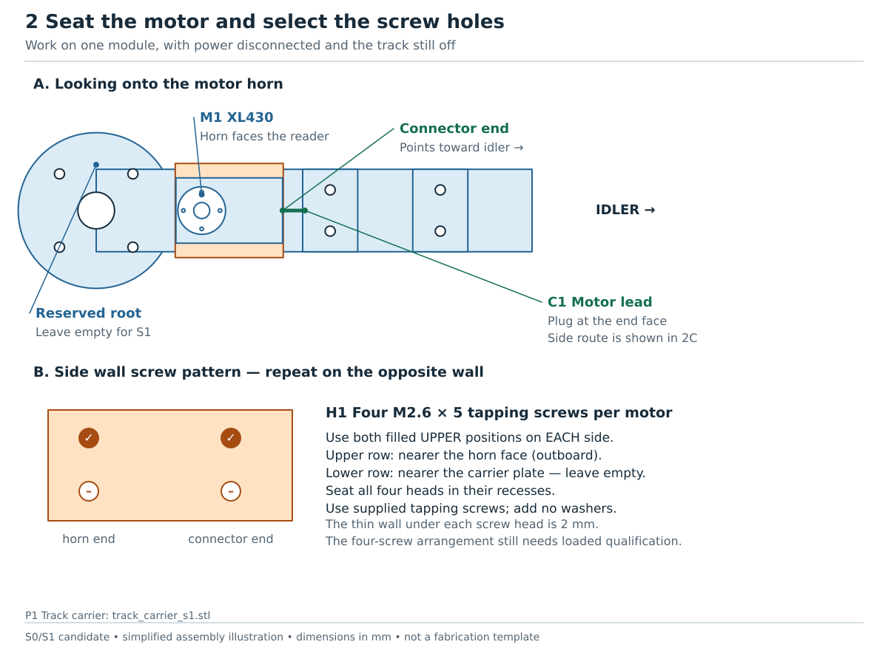

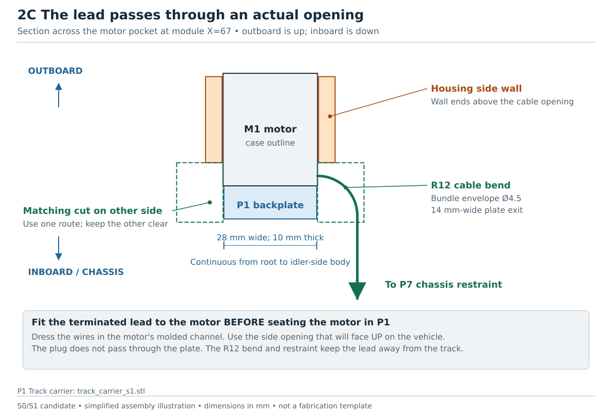

1. With M1 still outside P1, seat C1 in one TTL socket. Dress its wires in the motor's molded side channel. Use the channel that will face **upward on the installed vehicle**. Keep the unused socket empty. Do not remove the motor's rear cover or route through its optional rear idler opening.
2. Place P1 with its pocket accessible, circular root to the left and idler end to the right. Seat the motor with the horn outboard and the **long connector end toward the idler**. Lay the wire bundle through the open side/plate cut as you lower the motor. The terminated connector stays in the motor; it is never pulled through a plate hole. Outside the case, dress the bundle to the R12 bend in Figure 2C, then inboard toward the chassis. The route allows a bundle up to Ø4.5 mm and leaves the root opening unused.
3. The housing has four counterbored holes on each side. Use **both holes in the row nearest the horn face on each side**, four H1 screws total, as filled in Figure 2B. Leave the row nearer the carrier plate empty. In module CAD coordinates the selected pairs are (X=50, Z=33) and (X=74, Z=33), on both side walls. This matches the retained R1 four-screw arrangement.
4. Start all four screws before seating the heads. Each passes through the counterbored wall into the motor's plastic mounting hole; add no washer. Use the supplied tapping screws, not similarly sized machine screws. The remaining printed wall is nominally 2 mm. A screw that bottoms before its head seats, or needs force to align, indicates a failed fit.
5. Remove the rubber tyre from W1. Place the sprocket against the motor horn and align its four mounting holes. Start four H2 screws, then seat them evenly without forcing the plastic threads. There is no hub, bearing or P4 spacer between the drive sprocket and horn.

**Check before continuing:** the case sits without being forced, all selected heads seat in their recesses, the connector can be removed, and neither the lead nor the housing touches the sprocket during hand rotation. The four-screw fixing remains subject to loaded qualification; no tightening torque is established.

The wheel's 2 mm mounting plate leaves approximately 2 mm engagement for each M2 × 4 screw, within the horn drawing's 3.5 mm maximum thread depth. Use the four tapped M2 positions; the four smaller alternate holes are not the wheel-screw positions. For H1, the 2 mm housing wall and 0.3 mm case clearance leave approximately 2.7 mm screw penetration. Seat the tapping screws by hand with a short driver; do not use a powered driver.

The [ROBOTIS XL430 manual](https://emanual.robotis.com/docs/en/dxl/x/xl430-w250/#connector-information) identifies the TTL connector and pin numbering. Do not infer pinout from this diagram's colours. Keep motor power disconnected when changing connections.

## 3. Assemble the idler hub and axle

**Take:** revised P3 ×1, P8 ×1, H8 ×3, B1 ×2, P4 ×2, A1 ×1, H5 ×1 set, W1 ×1 and H2 ×4. H8 is a **flat Phillips countersunk M2×6 DIN 965 screw**, measured including its head; H2 remains the **M2×4 pan-head wheel screw**.

**Retention correction:** the earlier hub could slide off the bearings even with the axle nut tight. The four front holes attach the wheel to the hub; they do not attach the hub to the axle. Revision **P0-S1-2026-11-02-R2** adds three rear pilot holes and the separate P8 cap. Reprint P3 and print P8; the carrier, axle, 626 bearings and plain P4 spacers remain the same. Confirm this revision in `cad/out/FIT_ARTICLES.json` before using a downloaded STL.

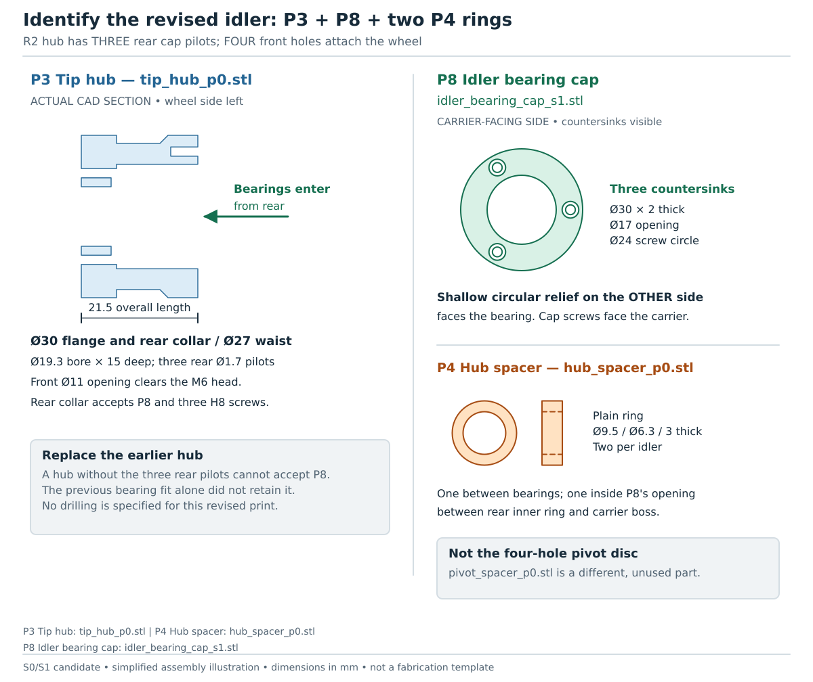

Identify P3 by its **Ø30 front flange, Ø27 waist and Ø30 rear collar with three pilot holes**. It is 21.5 mm long. Its rear bearing cavity is Ø19.3 × 15 mm deep; its front centre opening is Ø11. P8 is the separate Ø30 × 2 mm ring with three countersinks and a shallow circular relief on the opposite face. P4 is the plain **Ø9.5 outside × Ø6.3 bore × 3 mm** ring. The large four-hole `pivot_spacer_p0.stl` is not used. The older straight-cylinder 608 hub and the uncapped stepped hub are superseded.

The owned bearings are **626: 6 mm bore × 19 mm outside × 6 mm wide**. The failed 18.9 mm bore was enlarged to 19.3 mm after the unlabelled F2 sample accepted the bearing in alternating holes. That result did not identify a precise calibrated allowance. Use the same material and slicer settings; remove burrs without enlarging the bore. Both bearings must seat fully without hammering, rocking or turning in the hub. The cap supplies axial retention; it does not cure radial looseness.

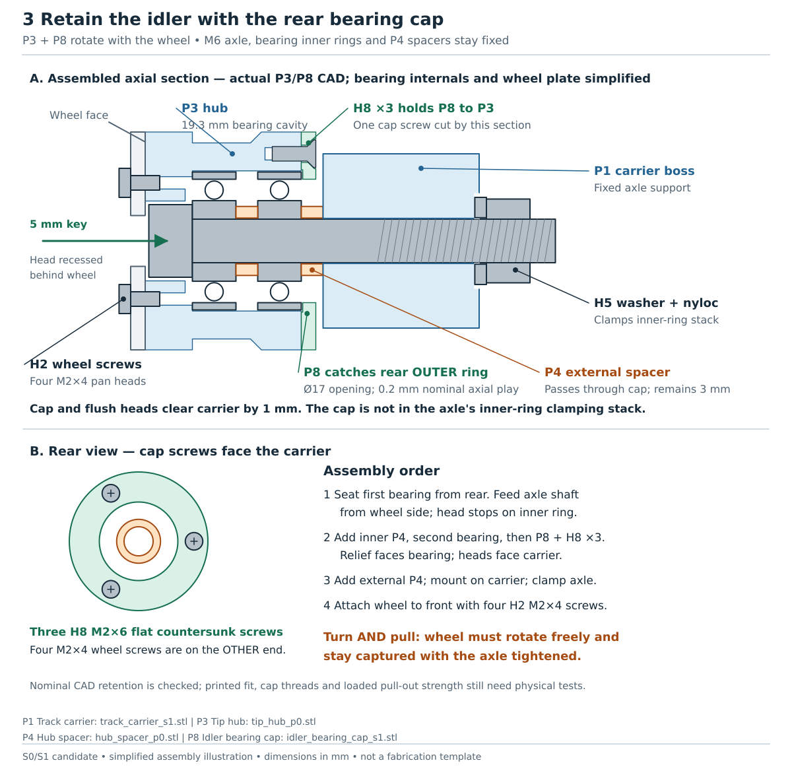

1. With P3 empty, check that the three H8 screws start straight in its **printed rear pilots** using a short PH0 driver. The pilots are Ø1.7 × 5 mm deep. Remove the screws and any plastic swarf before inserting bearings. Do not force a screw that will not start, use a powered driver or substitute a longer screw. No drilling is part of this revision.
2. Insert the first B1 through P3's large rear opening and seat it against the internal front shoulder, pressing on the **outer ring**. This shoulder is relieved around the seal and inner ring.
3. From the **wheel side**, insert A1 **threaded end first** through P3's Ø11 opening and the first bearing. Its head stops on the bearing's inner ring, recessed 0.5 mm behind the wheel mounting face. Hold the bolt while building the stack; the enlarged opening has no floor that traps its head.
4. From the rear, slide one P4 onto the axle against the first bearing's inner ring, then insert the second B1. It sits at the end of P3. The first P4 is now between the two bearing inner rings.
5. Slide P8 over the axle. Its **shallow Ø19.6 circular relief faces the bearing; its three countersinks face the carrier**. Align the three holes with P3's rear pilots. Start all three H8 screws, then seat them evenly by hand. Their heads must be flush or slightly recessed and the cap must sit flat on the hub's rear collar. About 4 mm of each screw engages the hub; no nuts or washers are added. Do this before fitting the hub to the carrier, which obstructs the cap driver approach.
6. Slide the **second P4** onto the axle, through P8's central opening, against the rear bearing's **inner ring**. It remains a separate 3 mm spacer; it is not replaced by the cap. Pass A1 through P1's idler slot. Seat the H5 washer in the shallow 0.6 mm recess on P1's inboard face and add the nyloc nut. Start with the axle centred in the 8 mm adjustment travel.
7. Hold A1 with a 5 mm hex key from the wheel side and seat the axle nut. Both bearings must run on its plain shank. The nut clamps **inner rings → both spacers → carrier**. P3 and P8 rotate together around that fixed stack. P8's lip catches only the rear bearing's **outer ring**; its 0.2 mm nominal relief avoids clamping the two outer rings together. Confirm the lip and front shoulder clear the actual bearing seals.
8. Place W1 against P3's front flange and fasten it with four H2 screws. The four wheel holes are separate from the three cap holes. The M6 head stays recessed behind the wheel; its hex key remains accessible through the wheel's centre bore.

**Check before continuing:** with the axle nut seated, turn the wheel by hand and gently pull it outward. It must turn freely and remain captured, with only slight end movement (nominally 0.2 mm), rather than sliding off the bearings. Check the cap and its screw heads clear the carrier throughout a full turn; the nominal face gap is **1 mm**. Confirm neither bearing runs on axle threads and no screw has stripped. If it binds, rocks, rubs, or pulls off, stop and resolve that result before duplicating the module. Loosening the axle nut is not the cure for a bound bearing stack.

The nominal inner stack is unchanged: **6 mm bearing / 3 mm spacer / 6 mm bearing / 3 mm spacer / carrier**. P8 occupies 2 mm of the existing external spacer's 3 mm gap, around the spacer rather than in its clamping path. Hand retention and free rotation are initial checks; screw pull-out, printed cap strength, bearing fit and loaded durability remain unqualified.

## 4. Attach the two fixed brackets

**Take:** P2 ×2 and H3 ×4 sets. Do this before closing the track to preserve access to the outboard nuts.

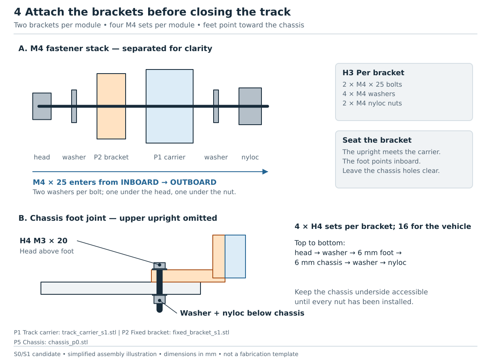

1. Hold each P2 upright against the **inboard** face of P1 at its dedicated mounting pad. The bracket foot points inboard, toward where the chassis will sit. Leave the four holes around the circular root unused.
2. Fit two H3 sets per bracket. From inboard to outboard the order is **M4 bolt head → washer → 6 mm bracket upright → 10 mm carrier plate → washer → nyloc nut**.
3. Start both bolts in each bracket before seating either nut. Keep the feet aligned rather than pulling a misaligned bracket straight with its bolts.
4. Check that the bracket feet and module sit without rocking and that all four nuts remain accessible. The loose module now has two feet ready to land on the chassis.

The four fixed-mount holes are separate from the future root interface. Removing the brackets later does not require cutting the carrier. Use the same bracket print on both vehicle sides; its geometry is symmetric about its lengthwise centre.

**Check before continuing:** four M4 sets are present, with eight washers total; the feet point toward the body; no screw, nut or tool traps the drive lead. Inspect fit and tool access on the real parts before making the second module.

## 5. Fit the track

**Take:** T1 ×40. Both sprockets are already installed and bare.

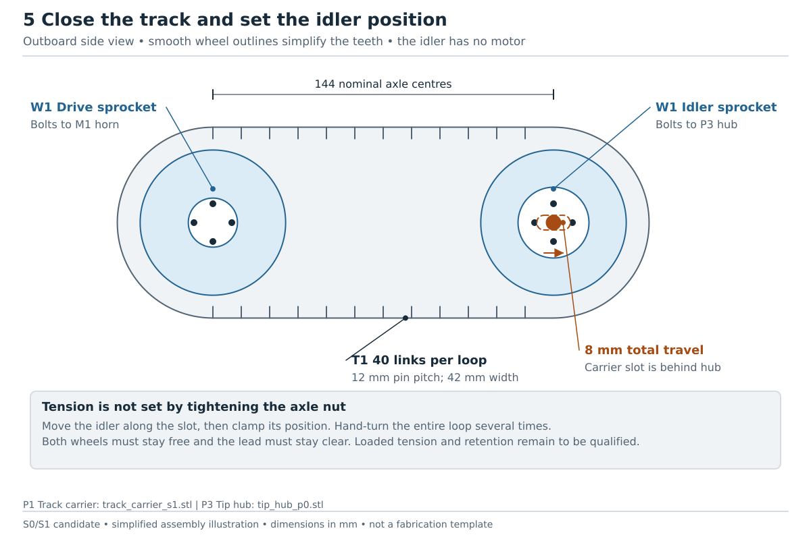

1. Join the ICT-01 links into one 40-link chain, keeping the tread faces outward and every joint oriented consistently. Use the [ROBOTIS link assembly illustration](https://robotis.us/products/tb3-caterpillar-ict-01-40ea) for the molded pin/socket connection. Do not force a joint in the opposite direction.
2. Loosen the idler clamp just enough to slide the axle. Move the idler toward the drive wheel, wrap the chain around both sprockets and close the final joint on an accessible straight run.
3. Move the idler outward to remove excess slack while keeping free articulation. Nominal axle centres are 144 mm; the slot provides ±4 mm from the centre. Do not change the link count or force closure to conceal a fit problem.
4. Hold A1 through the wheel bore and clamp H5 with the axle in the selected position. Hand-turn the whole loop through several revolutions. Check each link joint, tooth engagement and lead clearance.
5. Mark the accepted axle position on the carrier. Record the centre distance so the second module starts from a known setting.

**Check before continuing:** the loop closes within the slot travel, runs without binding or derailing by hand, and cannot reach the lead through its available slack. No numerical tension, loaded retention or service life is yet established. Tightening the axle nut clamps the chosen position; it does not set track tension.

At S0, continue with the first module's chassis attachment and restraint in step 6, then perform the first-module acceptance checks. A powered bench test needs the completed supply/stop arrangement and controller procedure specified in [steps 11–13](#11-assemble-the-two-supply-domains). Do not duplicate a failed fit.

## 6. Attach the modules to the chassis

**Take:** two inspected modules, P5 ×1 and H4 ×16 sets. Leave the deck off and support the chassis so its underside remains accessible.

For the first S0 article, use one module and eight H4 sets on its side only. Fit its P7 restraint below and complete the acceptance checks before printing the second module. The following counts and drawing show the finished two-module base.

### Find the bracket holes on the printed plate

The coordinates in this guide are **millimetres, not hole numbers**. The origin is the centre of the 200 × 152 mm plate, at its centre hole. X increases toward the front, Y toward the robot's left and Z upward from the top surface. A bracket's centre position is halfway between its two mounting-hole rows; it is not a foot-screw location.

Orient the plate with its **200 mm length running front to back**. The end nearest the **two shorter strap slots running lengthwise** is the **rear**; put that end toward you and the opposite end away from you. The two longer strap slots near the middle run across the width. The drawing below includes those cutouts and the actual hole pattern so the printed plate can be matched to it.

Count rows **from the front along an outside column of holes**, starting with row 1 at the first hole, 4 mm from the front edge. Hole centres are 8 mm apart. On each side, use **columns 1 and 3 counted inward from that side's long edge**: their centres are 4 mm and 20 mm from the edge. Leave column 2 between them unused by the bracket screws.

| Bracket on either side | Hole rows counted from front | Hole-centre distances from front edge | Columns counted inward from nearest long side |
| --- | --- | --- | --- |
| Front bracket | **8 and 10** | **60 and 76 mm** | **1 and 3** — 4 and 20 mm from side edge |
| Rear bracket | **14 and 16** | **108 and 124 mm** | **1 and 3** — 4 and 20 mm from side edge |

Each bracket uses the four intersections of its two rows and two columns. Its holes form a **16 × 16 mm square**, with one unused grid position between adjacent screws. For example, the front-left bracket uses row 8/column 1, row 8/column 3, row 10/column 1 and row 10/column 3. Repeat from the right edge for the right-hand brackets.

The foot points inward onto the plate; the upright stands outside the long edge. The bracket's outer face is **12 mm beyond the plate edge**, so do not try to make the upright flush with that edge. Fit the screws loosely until both brackets on a module align.

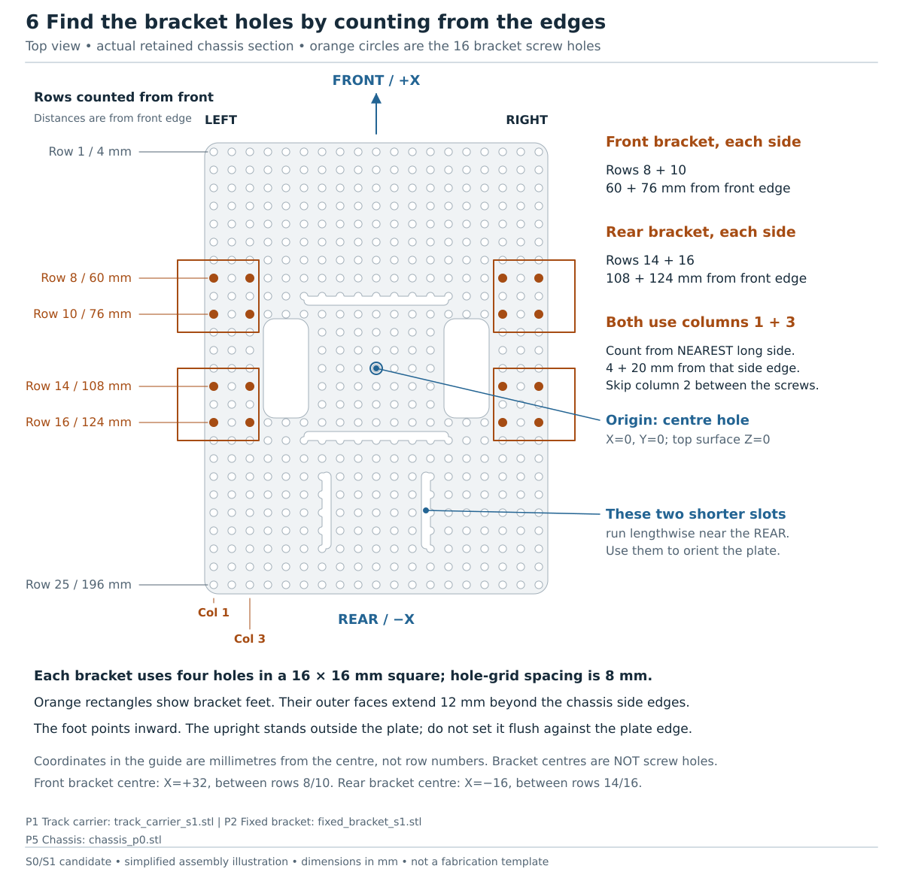

1. Place both modules beside P5 with their drive sprockets outboard and their circular root extensions rearward. The drive wheel axes are behind the chassis centre; the idler axes are ahead of it. Identify left and right while looking forward along the robot.
2. Land the four bracket feet on the row/column positions above. A foot uses four holes. No drilling of the retained chassis is specified.
3. Insert each H4 set from above: **M3 head → washer → bracket foot → chassis → washer → nyloc nut below**. Start all sixteen sets loosely. Access the underside now; do not postpone fitting those nuts until the deck is on.
4. Align the modules and seat the fasteners progressively, avoiding crushed feet or a bowed chassis. The two brackets on each side must share the load without rocking.
5. Turn both tracks by hand again. Check the M4 nuts, M3 ends, lead and chassis edge for contact. Ensure removal of a drive lead will not require dismantling a track.

### Fit the drive-lead restraints

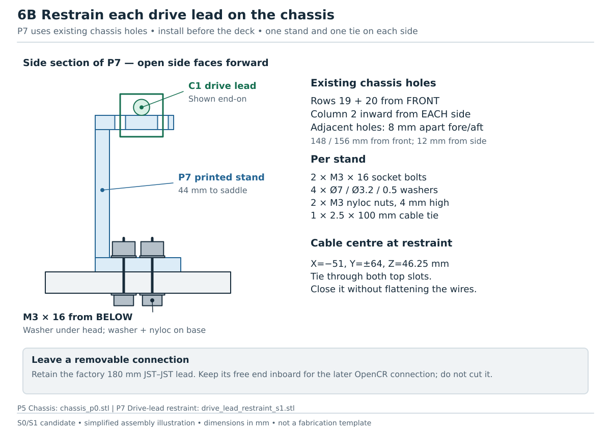

Use P7 ×2, H6 ×4 sets and H7 ×2 for the complete base. The same printed stand serves both sides, with its **open side facing forward and its solid upright toward the rear**.

Use **rows 19 and 20 counted from the front, in column 2 counted inward from the nearest long side**. The rear is the end nearest the two short, lengthwise strap slots. Count rows along the outside column, starting at the first hole 4 mm from the front edge, then move one column inward to the restraint holes.

| Restraint | Rows from front | Column counted inward | Hole-centre distances from edges |
| --- | --- | --- | --- |
| Left P7 | **19 and 20** | **2 from the left edge** | **148 and 156 mm behind the front; 12 mm from the left edge** |
| Right P7 | **19 and 20** | **2 from the right edge** | **148 and 156 mm behind the front; 12 mm from the right edge** |

Each stand uses **two adjacent holes, 8 mm apart fore/aft**, with no unused hole between them. These are behind the rear bracket's rows 14 and 16. Coordinate cross-check: row 19 is X=−48 and row 20 is X=−56; column 2 is Y=+64 on the left or Y=−64 on the right.

Insert H6 **from beneath the chassis**: head → washer → 6 mm chassis → 4 mm stand base → washer → nyloc. Start both nuts through the stand's open side before tightening. The CAD checks bolt insertion from below and side access to these nuts. Install these before the deck or payload obscures access.

Lay each lead across its stand at X=−51, Y=±64, Z=46.25. Pass one 2.5 mm tie down one top slot and up the other, closing it over the bundle without flattening the insulation. The modeled path from the motor side exit to the restraint is 43.85 mm, with R12 bend radius. Leave the rest of the factory 180 mm lead inboard for the later OpenCR connection. Secure its free end temporarily above the chassis; no loose loop may hang beside or below the tread. Do not cut or extend the lead during this unpowered assembly.

To service a motor lead, disconnect power, unplug its body end, cut the restraint tie, and withdraw the motor plug through the open connector end. The track stays fitted. If a real connector cannot be reached that way, record the obstruction during the coupon/first-module check before duplication.

### Coordinate reference

These values describe the same placement in the robot coordinate frame; they are not hole indices. Origin: chassis top centre. X forward, Y left, Z up. Bracket centre X=+32 corresponds to the front bracket between rows 8 and 10; X=−16 is the rear bracket between rows 14 and 16.

| Attachment | Coordinates in mm |
| --- | --- |
| Left bracket foot holes | Every combination of X=−24, −8, +24, +40 with Y=+56, +72 |
| Right bracket foot holes | Same X values with Y=−56, −72 |
| Bracket centres | X=−16 and +32 on each side |
| Module-to-bracket screws | At each bracket centre, Z=11 and 29 |
| Module inboard faces | Y=+88 and −88 |
| Drive / idler axes | X=−72 / +72; Z=20 |

**Check before continuing:** all sixteen foot bolts have two washers and a nyloc nut; both tracks remain free after clamping; the structure does not rock or distort. The minimum nominal clearance to flat ground is only about 6.4 mm, so clearance must also be measured under the intended payload.

This completes the **proposed unpowered lower assembly**. After its fit checks pass, steps 7–9 describe the unpowered deck/board installation. Loaded strength and driving performance remain unqualified.

### First-module acceptance before duplication

1. With the track off, check that the motor seats and that the wheel face has no visible wobble during hand rotation. Check all four motor screw heads and all wheel screws for full seating without stripped threads.
2. Clamp the idler stack, mark the axle position and rotate the wheel. Gently pull it outward: P8 must keep the hub captured, with only slight end play. Confirm all three H8 heads are seated and the cap clears the carrier through a full turn. It must remain free-running with no hub-to-boss contact. Check that the bolt's plain shank supports both bearings.
3. Close the 40-link loop. Start with the axle at the slot centre; remove slack by sliding the idler, then clamp it. Hand-turn at least ten complete track circuits in each direction. Reject any repeating bind, link lift, derailment, or visible axle movement. Record the accepted axle centre distance; no numerical working tension is asserted from CAD alone.
4. Check the R12 lead bend, tie and free tail throughout that motion. Unplug and reconnect the motor lead once with the track fitted. Inspect insulation for pinching or scraping.
5. Attach the first module and its restraint to the retained chassis. Confirm the structure sits without rocking and that each specified nut can be reached. Mark the M4 joints and axle clamp with witness lines. Record unloaded ground clearance and any looseness.

Only after these checks pass, make the second P1 and its brackets/restraint. Loaded driving qualification remains a physical test after power/stop design is complete: increase payload in measured increments, record chassis deflection, axle migration, motor temperature and lateral play, and inspect the witness marks after steering. There is no claimed payload rating or stair capability from the fit checks.

## 7. Prepare the upper deck and its four columns

Keep batteries and USB power disconnected. **Build the upper assembly off the chassis, then attach it from underneath.** The rear deck screws become hidden beneath the OpenCR adapter, and the Pi covers two of its adapter screws. The sequence below avoids having to reach through a fitted board.

Retain P5 and P6. Print one of each new adapter, flat as exported, at 0.20 mm layers, six walls, six top/bottom layers and 40% infill using the existing PLA profile. No supports are needed. Remove the brim and check the holes before offering a PCB to the print. Do not use the old `opencr_adapter_p0.stl` or `pi_adapter_p0.stl`: the first has insufficient material outside its deck holes; the second uses the earlier Pi orientation.

| ID | Part | Quantity for this stage |
| --- | --- | ---: |
| P9 | OpenCR adapter — [opencr_adapter_s1.stl](../../cad/out/stl/opencr_adapter_s1.stl); 92 × 112 × 3, 44 × 60 central window | 1 |
| P10 | Pi 4B adapter — [pi4_adapter_s1.stl](../../cad/out/stl/pi4_adapter_s1.stl); 64 × 96 × 3, 34 × 50 central window | 1 |
| U1 | M3 female–female column, 60 mm body, 5 mm AF, at least 4 mm usable thread depth at each end; selected part has 10 mm | 4 |
| U2 | M3 female–female column, 12 mm body, 5 mm AF, through-threaded | 8 |
| U3 | M3×8 socket-head screw | 20 |
| U4 | M3×10 socket-head screw | 4 |
| U5 | Steel M3 washer, Ø7 × Ø3.2 × 0.5 | 28 |
| U6 | Unthreaded nylon spacer, Ø5 × Ø3.2 × 6 | 8 |
| U7 | OpenCR board fixing: M3×20 socket screw, **Ø6 × Ø3.2 × 0.5 nylon washer**, M3 nyloc, 5.5 mm AF / 4 mm high | 4 sets |
| U8 | Bare Pi board fixing: M2.5×20 socket screw, **two Ø6 × Ø2.7 × 0.5 nylon washers**, M2.5 nyloc, 5 mm AF / at most 3.6 mm high | 4 sets |

U7 uses an additional U5 washer beneath the adapter; those four washers are included in U5's total. U8 already includes both washers. The [upper BOM](p0-bom.md#deck-and-board-hardware) gives supplier links and combined totals. These are ordinary bought spacers and fasteners; no fabricated metal bracket is required. Have 2.5 mm and 2 mm hex keys, a 5 mm spanner for the columns/Pi nuts, and a 5.5 mm nut tool for OpenCR. Check the delivered screw drive sizes.

**Audio HAT boundary:** U8 specifies the bare-board mounting fit. The confirmed WM8960 uses the GPIO-side Pi mounting positions for its upper supports; its final support stack may replace two U8 screws. Retain any hardware supplied with the HAT and do not buy a duplicate microphone or a HAT spacer kit yet. P10's mounting-hole pattern is retained for that next stack.

### Sort the BOM hardware

Separate the following four groups before assembly. This allocates the U1–U8 totals above; **do not add these quantities to them**. U7 and U8 mean the complete sets defined in that table, including their nylon washers and nuts. Keep U5 steel washers separate from both nylon-washer types.

| Group | Put in this group | Use and reserve |
| --- | --- | --- |
| Deck-column tops, step 7 | U1 ×4; U3 ×4; U5 ×4 | Attach the four 60 mm columns to P6 before installing either board assembly |
| OpenCR, step 8 | U2 ×4; U3 ×8; U5 ×12; U6 ×4; U7 ×4 sets | Use four U3/four U5 for adapter-column tops and four U5 under PCB nuts. Reserve the other four U3/four U5 for attachment through P6 in step 9 |
| Pi, step 9 | U2 ×4; U3 ×8; U5 ×8; U6 ×4; U8 ×4 sets | Use four U3/four U5 for adapter-column tops. Reserve the other four U3/four U5 for attachment through P6 |
| Final chassis attachment, step 9 | U4 ×4; U5 ×4 | Keep these aside until the deck and both boards are assembled |

Check the easy-to-confuse items once: U1 = 60 mm threaded column; U2 = 12 mm threaded column; U6 = 6 mm **unthreaded** insulating spacer. The OpenCR PCB-side washer is Ø6 maximum; the Ø7 steel washer goes below its adapter. Pi board bolts are M2.5; its adapter-to-deck bolts are M3. Use the bought U6 spacers for this build; the earlier printed substitute remains only a temporary fitting option.

### Attach the deck columns

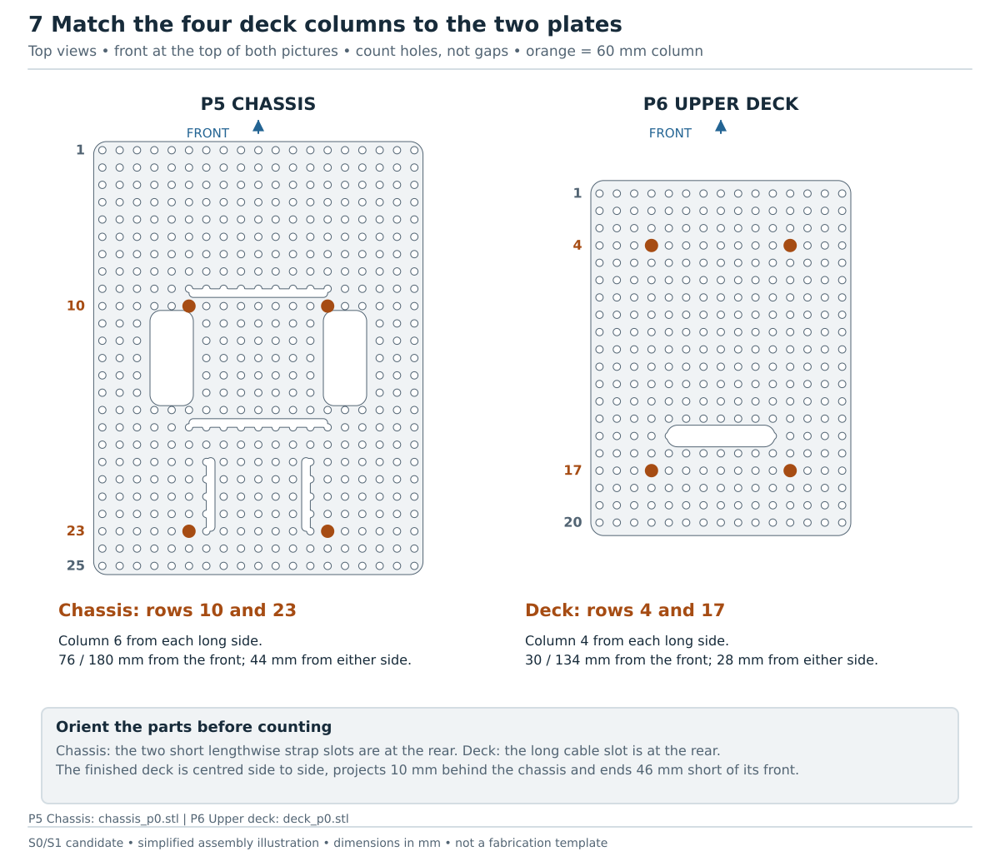

1. Identify the front of P5 using step 6: the pair of short lengthwise strap slots is toward the rear. On P6, the large crosswise cable slot is toward the rear. Mark each front edge with removable tape.
2. Count **chassis rows 10 and 23 from the front**, using the uninterrupted outside column as the row reference. The support holes are **column 6 from each long side**. Their centres are 76 and 180 mm behind the front edge, 44 mm in from either side. These are separate from the track-bracket holes.
3. On the deck, use **rows 4 and 17 from its front**, **column 4 from each long side**. Centres are 30 and 134 mm behind the deck front, 28 mm in from either side. The chassis starts its grid 4 mm from the front; the deck starts 6 mm from the front. Do not transfer row numbers from one plate to the other.
4. With P6 off the robot, put one U3 screw through one U5 washer and down through each of those four deck holes. Thread a U1 column onto each screw from beneath P6. Seat each column end directly against the deck; hold its flats while tightening the screw gently. Add no washer between column and plastic. Four U3 and four U5 are used here.
5. Check the four column bodies are each 60 mm long and their lower ends lie in one plane. They will sit directly on the chassis. Leave U4's four bottom screws and four U5 washers aside until step 9.

The top stack is screw head → 0.5 mm washer → 4 mm deck → column. M3×8 gives 3.5 mm nominal thread engagement. At the bottom, M3×10 passes through a 0.5 mm washer and 6 mm chassis, also giving 3.5 mm engagement. A screw that stops before clamping indicates a wrong length, blocked thread or incorrect column; do not compensate by piling on washers.

## 8. Assemble OpenCR and its adapter

**Take:** P9, OpenCR 1.0, U2 ×4, U3 ×8, U5 ×12, U6 ×4 and U7 ×4 sets. Reserve four U3 screws and four U5 washers for attaching the adapter to the deck in step 9.

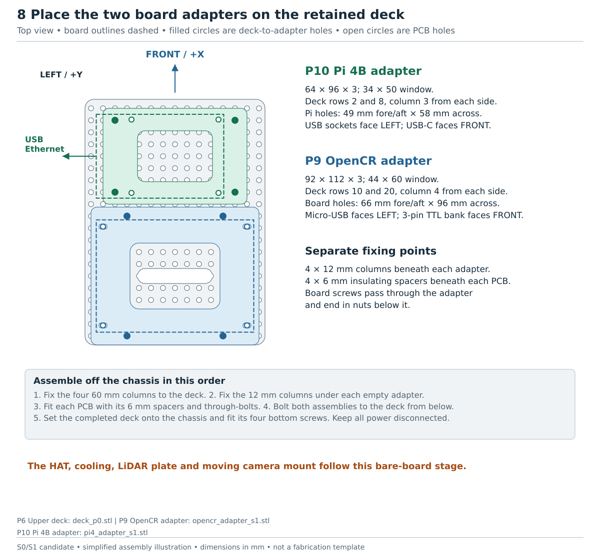

1. Put P9 on the bench. Its **92 mm direction runs fore/aft**, and its 112 mm direction across the vehicle. The four round Ø3.4 holes are the deck fixings; the four short slots nearer the corners are the PCB fixings. The two patterns do not share screws.
2. At each round hole, pass U3 through a U5 washer from the top of the adapter into one U2 column beneath it. The column sits directly against the adapter underside. Tighten all four before placing the board. This uses four screws and four washers.
3. Put one U6 spacer above each slotted hole. Place OpenCR on them with its components upward, **micro-USB edge toward the robot's left and bank of three 3-pin TTL connectors toward the front**. Use the physical labels and connector count; the 4-pin bank is RS485. The 105 mm board dimension runs across the vehicle.
4. At each board hole insert a U7 M3×20 from above through its **6 mm OD nylon washer**, the PCB, 6 mm nylon spacer and adapter. Beneath the adapter add one U5 steel washer and the U7 nyloc. Start all four before seating them. Hold each nut and tighten only enough to seat the board on its spacers without bending it.
5. Inspect the connector next to the rear/right board screw. **A normal Ø7 M3 washer touches it in the manufacturer CAD; the PCB-side washer must be Ø6 maximum.** The Ø7 steel washer belongs beneath the adapter. Check the actual board revision for clearance at all four screws.

The PCB underside is 6 mm above the adapter, not directly against the plastic. ROBOTIS's Rev H CAD puts its lowest underside feature 2.19 mm above the adapter in this stack. The board holes are Ø4 on a 66 × 96 pattern; M3 is a clearance fixing with washers and nuts, not a screw threaded into the PCB. The adapter slots accommodate small printed-position variation, not a different board pattern. [Manufacturer CAD](https://github.com/ROBOTIS-GIT/OpenCR-Hardware/blob/4c56093c5aaedbcb98b374f94a8046187834022c/Layout/OpenCR_REVH.step)

## 9. Assemble the bare Pi 4B and install the deck

**Take:** P10, Pi 4B, U2 ×4, U3 ×8, U5 ×8, U6 ×4, U8 ×4 sets, plus the deck/columns and OpenCR assembly. This step is a bare-board fit, with no case or HAT fitted. Cooling and the HAT must be incorporated before enclosing the Pi beneath a LiDAR plate.

Steps 6–7 below are the chassis trial-fit/installation procedure. They may be deferred while following the [bench sequence](#bench-checks-before-attaching-the-deck); keep U4 ×4 and their U5 washers together. A supported deck/board assembly does not need to be attached to the chassis for the initial Pi inventory and stationary sensor checks.

1. Put P10's **64 mm direction fore/aft and 96 mm direction across the robot**. Its four larger holes, 48 × 80 apart, take the deck columns. The smaller holes, 49 × 58 apart, take the Pi. Attach four U2 columns beneath the larger holes with U3 and U5 from above, just as for OpenCR. Keep the other four screws/washers for attaching this assembly to P6.
2. Insert the microSD card before mounting the Pi. Put four U6 spacers above the small holes. Place the Pi components-up, **USB/Ethernet sockets toward the robot's left, USB-C and micro-HDMI edge toward the front, GPIO header toward the rear**. Its 85 mm length runs across the robot. The board overhangs farther at the USB end because its mounting pattern is offset from its centre. [Pi 4B mechanical drawing](https://pip-assets.raspberrypi.com/categories/559-mechanical/documents/RP-001185-MD-1-Mechanical%20Drawing.pdf)
3. Insert each U8 M2.5×20 from above through one nylon washer, the board, U6 spacer and adapter; add the second nylon washer and nyloc beneath. Seat all four gently without bending the PCB. The common Ø3.2-bore U6 spacer clears the M2.5 screw; the Pi and adapter holes locate it. Do not force an M3 screw through the Pi.
4. With P6 still off the chassis and its four long columns already secured, position the OpenCR assembly on its rear half. Its four U2 columns meet **deck rows 10 and 20, column 4 from each side**. From beneath P6, insert the four reserved U3 screws with U5 washers into the columns. Hold the column flats while tightening.
5. Position the Pi assembly on the front half. Its U2 columns meet **deck rows 2 and 8, column 3 from each side**. Attach it from beneath with the remaining four U3/U5. The adapters have a 2 mm fore/aft gap. Do not use the old Pi-to-LiDAR shared-hole arrangement.
6. Support the tracked base so its underside is accessible. Lower the deck assembly onto the four chassis holes identified in step 7. Keep both loose drive leads inboard and clear of the column ends. Fit **U4 M3×10 + U5 washer from below the chassis into each U1 column**. Start all four before tightening. Hold the columns' flats; do not twist the loaded deck to tighten them.
7. Check the deck is centred side to side, projects **10 mm behind the chassis**, and ends **46 mm short of the chassis front**. Its underside is 60 mm above the chassis top, with no extra washers under the columns. The board adapters start 12 mm above the deck top. Check each board is level, all four supports are seated, and screw tips clear P6.

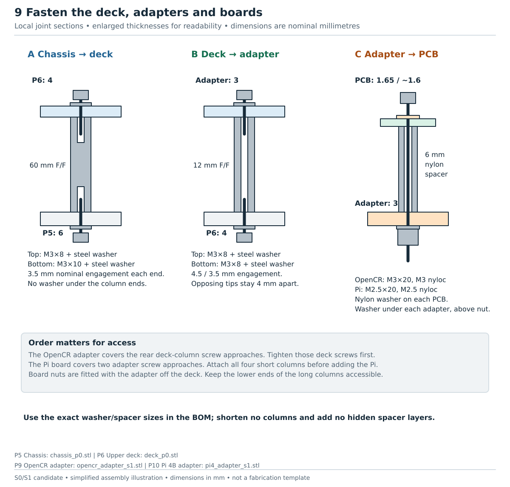

**Inspection before adding sensors:** no printed hole required forcing; boards are supported at all four mounting holes; nothing touches their underside components; there are no loose nuts or swarf; both adapters remain separate; columns and printed plates do not rock. The OpenCR bolts project about 4.35 mm beyond their nuts and stop about 3.15 mm above P6; the Pi values are approximately 4.8 and 3.1 mm. Check the actual stack, including washer thickness and PCB revision. No tightening torque or payload rating has been qualified.

To service the deck, disconnect its cables, support it, remove the four U4 screws from beneath the chassis and lift the entire upper assembly vertically. The U1 columns stay attached to P6. Remove the adapter's four underside deck screws before servicing its PCB nuts. Do not pull a deck away while its drive or data leads remain attached.

Coordinate reference: P6 centre X=−28, underside Z=60; U1 at X=−80/+24, Y=±32. P9 centre X=−64 and P10 mounting-pattern centre X=+16; both adapter undersides Z=76 and PCB undersides Z=85. P9 deck holes X=−104/−24, Y=±32; P10 deck holes X=−8/+40, Y=±40. These coordinates describe the installed robot, not the translated print-bed STL origin.

### Upper-deck completion check

Record the assembly date and pass/fail for the following before fitting upper sensors. Check visible plate/spacer faces; do not insert a metal measuring tool among PCB components.

- [ ] P6 front/back and both board connector orientations match the drawings. OpenCR micro-USB and Pi USB/Ethernet face left; Pi GPIO faces rear.
- [ ] Four U1 columns connect chassis to deck; eight U2 columns connect deck to adapters; eight U6 spacers support the two PCBs. Nominal clear distances are **60 mm chassis-top to deck-underside, 12 mm deck-top to adapter-underside, and 6 mm adapter-top to PCB-underside**.
- [ ] Both boards have all four fasteners, correct PCB-side nylon washers and nuts below the adapters. No component touches a fixing or printed surface; neither board bends or rocks.
- [ ] All twenty U3 screws, four U4 screws and twenty-eight U5 steel washers have the destinations in step 7's allocation. Extra pieces from a supplier pack are spares, not missing layers in a joint.
- [ ] Adapters remain separated; bolt tips clear P6; all column ends seat against their intended plates. There is no loose hardware beneath either PCB.
- [ ] Drive leads are free of column ends and remain unplugged. The microSD, USB-C, USB and OpenCR connectors remain accessible; no wire is trapped when the deck is placed on the chassis.

Record any failed item by part ID and location, for example “P9, rear-right board washer,” and leave that assembly unpowered. Passing this check establishes the actual bare-board fit, not loaded driving or sensor/power qualification. Continue with the WM8960 support stack, sensor mounts and remaining interface checks in step 10.

## 10. Fit audio, camera and LiDAR

**U2 sensor candidate: P0-U2-2026-11-06.** All supplies disconnected. P5/P6/P9/P10 are retained. The new geometry checks the Camera 3 Standard model and the retained deck/board geometry; the owned A1/interface and MG90S/horn details still need matching. This is a reviewable fit design, not a powered or loaded release. See the [sensor hardware BOM](p0-bom.md#sensor-mounting-hardware) and [H01–H03](s1-system-plan.md#closure-register-and-effect-on-existing-parts).

The schematic below shows the intended appearance after this step, with the camera facing forward. It uses the current CAD positions and proportions. Teal identifies the new printed sensor mounts. P17 is shown as a carrier only: its interface-board attachment still needs resolving. The power installation and final harness follow in steps 11–12.

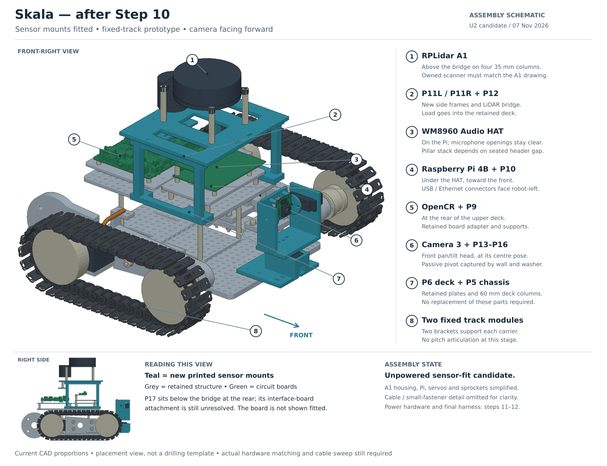

| ID | Part / exact print file | Quantity | Before printing or fitting |
| --- | --- | ---: | --- |
| P11L | LiDAR side frame, left — [lidar_side_frame_s1_L.stl](../../cad/out/stl/lidar_side_frame_s1_L.stl) | 1 | Existing deck hole pattern checked; fit one frame before its mate |
| P11R | LiDAR side frame, right — [lidar_side_frame_s1_R.stl](../../cad/out/stl/lidar_side_frame_s1_R.stl) | 1 | Use this handed file; no slicer mirroring |
| P12 | LiDAR bridge — [lidar_bridge_s1.stl](../../cad/out/stl/lidar_bridge_s1.stl) | 1 | Match A1 feet to step 10B |
| P13 | Camera pan base — [camera_pan_base_s1.stl](../../cad/out/stl/camera_pan_base_s1.stl) | 1 | Match actual servo flange/shaft geometry to step 10C |
| P14 | Camera yoke — [camera_yoke_s1.stl](../../cad/out/stl/camera_yoke_s1.stl) | 1 | Match servo and supplied horn before printing |
| P15 | Camera cradle — [camera_cradle_s1.stl](../../cad/out/stl/camera_cradle_s1.stl) | 1 | Camera fit checked against manufacturer CAD; match horn |
| P16 | Camera pivot bush — [camera_pivot_bush_s1.stl](../../cad/out/stl/camera_pivot_bush_s1.stl) | 1 | Temporary fit bush; same-size nylon tube for running |
| P17 | LiDAR interface carrier — [lidar_interface_carrier_s1.stl](../../cad/out/stl/lidar_interface_carrier_s1.stl) | 1 | Identify the board and its insulating supports; carrier is not a complete board holder |

Build with the normal `uv run cad/build.py`; sensor outputs are in `cad/out/stl` and `cad/out/step`. The files are already oriented for printing: P11 frames on their broad sides, P12/P17 flat, P13/P14 upright and P15 on its rear face with its four posts upward. Use the established 0.20 mm / six-wall profile for first fit; use removable supports beneath P14's horizontal servo opening and beneath any unsupported P13 recess roof. Do not print the full conditional set before matching its bought interfaces. No strength/creep rating is inferred from this profile.

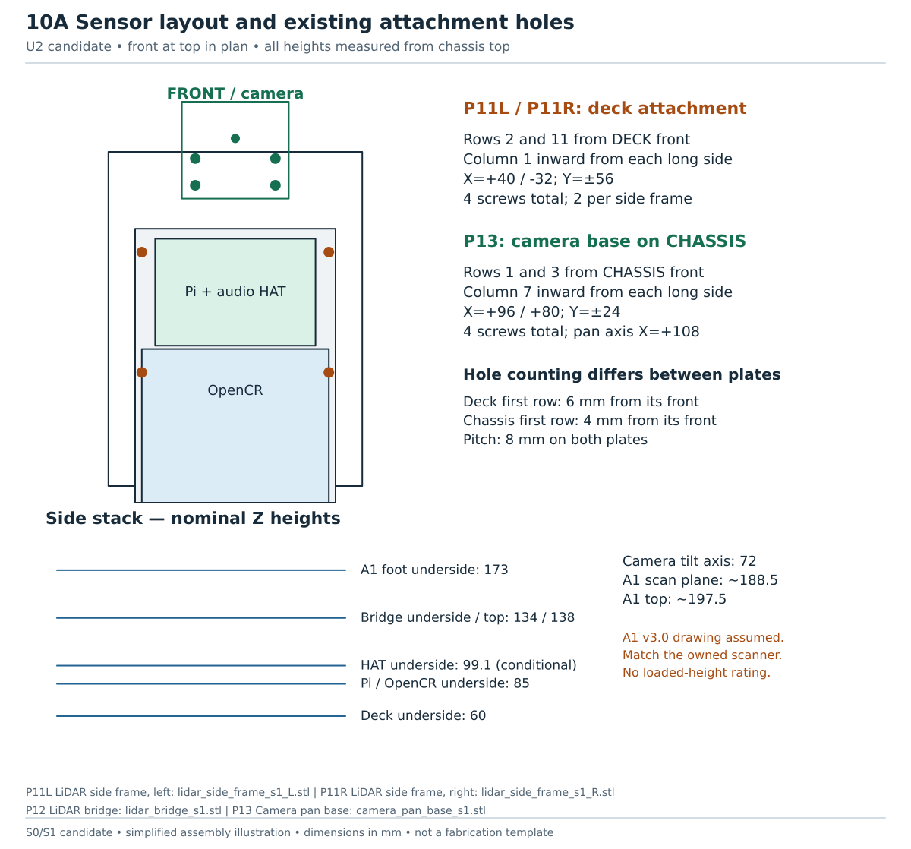

### 10A. Fit the HAT and prepare the bridge feet

1. Seat the WM8960 on the unpowered Pi with all 40 pins aligned, without screws pulling it down. The Pi supplies its 5 V/GND through this header; no separate HAT power lead or converter is required. The candidate uses **two M2.5 female–female 12 mm pillars**, each on a 0.5 mm nylon washer above the Pi: **12.5 mm between Pi top and HAT underside**. Check that the naturally seated assembly has this gap and that the socket makes proper contact. If it does not, record the actual gap and change this small support stack; do not force the header. The supplied HAT pack can be reused only if it provides the same stack. This seating check is the remaining H01 input.
2. At the two **GPIO-side Pi holes** (X=−8.5, Y=±29), replace the U8 20 mm bolts/nuts with M2.5×16 screws entering **from below P10**: head → existing nylon washer → adapter 3 → existing spacer 6 → Pi PCB ~1.6 → existing nylon washer → 12 mm female pillar. Nominal lower engagement is 4.4 mm. The opposite two U8 joints remain as assembled.
3. Fasten the HAT above those pillars with M2.5×6 and one Ø6 × Ø2.7 × 0.5 nylon washer per screw; nominal engagement 3.9 mm. Keep both microphone openings exposed. The modeled HAT top is Z=109.6; P12 underside is Z=134, leaving 24.4 mm. A cooler must separately fit beneath the HAT; no cooler is silently added to this stack.
4. With P9/P10 temporarily off the deck if already fitted, place P11L/P11R at **deck rows 2 and 11 from the front, column 1 inward from each long side**. These are X=+40/−32, Y=±56; 14/86 mm behind the deck front and 4 mm in from its sides. The frames' tall rails sit outside the deck edges; the feet point inward.
5. Use four V1 M3×16 sets from **below**: head → washer → deck 4 → frame foot 6 → washer → nyloc. Fit/tighten the nuts before the board adapters cover their approach. Refit the adapters and confirm USB plugs can pass between the uprights. The frame's front upright sits ahead of its front foot, so left and right files must be correctly handed.

### 10B. Install the LiDAR bridge and scanner

**The scanner sits above the bridge; its separate interface PCB belongs below the bridge.** P11L/P11R are the two tall side frames attached to the deck in 10A. P12 bolts across their top rails. Four **35 mm M3 columns** support the scanner above P12. Two different, **15 mm M2.5 columns** suspend P17 beneath P12's rear edge. The PCB is stationary on P17; it does not go on the rotating scanner or plug onto the Pi's GPIO header.

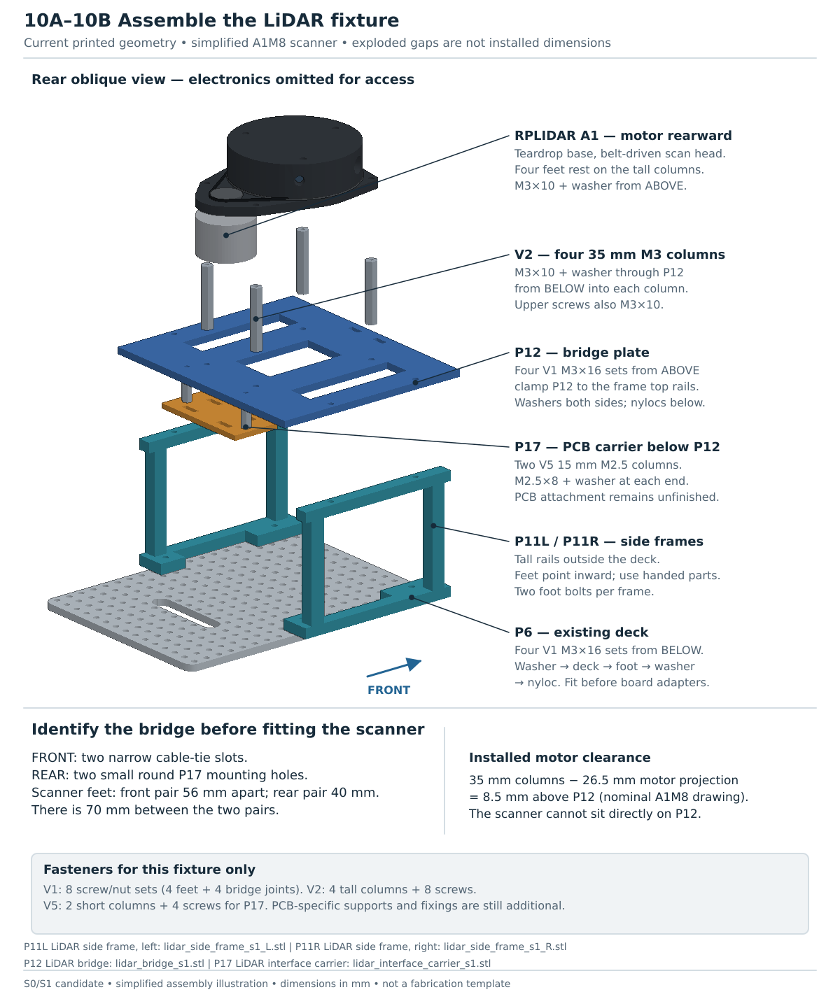

#### 10B.1. Identify the parts and fit the scanner columns

1. Orient P12 with its **two narrow cable-tie slots towards the robot's front**. Its **two small round carrier holes are at the rear**. The front scanner-hole pair is 56 mm apart; the rear pair is 40 mm apart, with 70 mm between the pairs. Match the owned scanner to the [SLAMTEC A1M8 v3.0 drawing, page 16](https://files.seeedstudio.com/products/114992561/LD108_SLAMTEC_rplidar_datasheet_A1M8_v3.0_en.pdf): four **Ø3.3 clearance holes**, not assumed threaded holes. The rotor axis lies 28 mm behind the front pair and 42 mm ahead of the rear pair. A different pattern or supplied mounting arrangement keeps P12 conditional.
2. With P12 off the robot, attach four V2 **M3 female–female 35 mm columns** to its scanner holes. Each lower fixing is **M3×10 head → Ø7 × Ø3.2 × 0.5 washer → P12 from below → column**. Nominal thread engagement is 5.5 mm. These are threaded columns, so there is no nut at either end.
3. Put the scanner onto the columns with its **motor/connector end rearward**. Each upper fixing is **M3×10 head → washer → scanner foot from above → column**. The drawing's foot thickness is 5 mm, giving 4.5 mm engagement; check the actual foot and screw reach before tightening.

The 35 mm columns leave **8.5 mm between the hanging motor and P12** for the modeled 26.5 mm motor projection. The scanner does not sit directly on P12. The old 40/55 mm Pi-to-LiDAR supports are not used in this deck-supported fixture.

#### 10B.2. Fit the carrier and account for the bare PCB

**The interface is confirmed to be a bare PCB (2026-11-25); its model and dimensions remain unrecorded. P17 is a carrier plate, not a finished PCB holder.** Its attachment to the bridge is specified below. The insulating supports and fixings between the PCB and P17 have not yet been designed, so there is no missing bag of specified PCB fasteners or completed board holder to find.

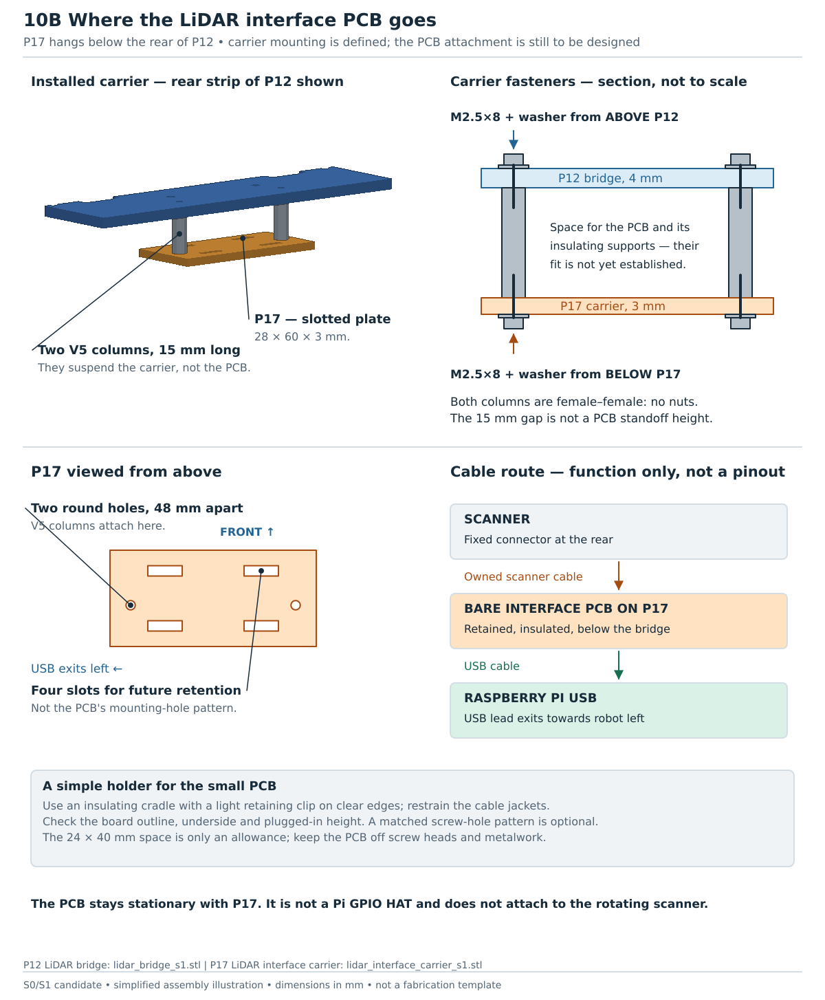

1. Identify P17: the small **28 × 60 × 3 mm plate**, with two round holes 48 mm apart and four rectangular slots. The round holes mount it to P12; the slots allow a future retention arrangement and **are not the PCB's hole pattern**.
2. Attach two V5 **M2.5 female–female 15 mm columns** below P12's rear holes (X=−44, Y=±24). At each hole, insert **M2.5×8 head → Ø6 × Ø2.7 × 0.5 washer → P12 from above → column**. Nominal thread engagement is 3.5 mm.
3. Hold P17 below the columns. Insert **M2.5×8 head → washer → P17 from below → column** at each round hole. Nominal engagement is 4.5 mm; no nuts are used. P17's top is Z=119, leaving 15 mm to P12's underside. Those columns suspend the carrier; they are **not supports screwed into the PCB**.
4. The intended PCB location is **above P17, in that gap**, with USB exiting towards the robot's left. The **24 × 40 mm board space is a design allowance, not a measured PCB size**. When the board is available, record its outline, hole diameters/spacing, underside parts, connector directions and markings. Use these to finish insulating supports and positive retention, and check the whole board/plug assembly fits beneath P12. If it does not, revise P17 and its small support arrangement before installation.
5. Until that attachment is defined, leave the PCB off the robot. P17 can be fitted empty for an unpowered assembly check, or left off for access; this does not prevent fitting the frames and a matched scanner. Do not lay a bare PCB across the carrier screws or metal columns, suspend it by its cables, or improvise a tie across components. V5 mounts the carrier only; PCB supports and fixings are additional.

For a stationary sensor check before the final PCB holder exists, secure the identified PCB separately on an insulating bench support and restrain its cables; follow [G1.3](commissioning-procedures.md#g13-rplidar-a1-and-its-interface-board). Its connection and power arrangement still need identification before plugging it in. Mobile operation waits for the retained PCB and strain-relieved plugs.

#### 10B.3. Attach the bridge to its frames

1. Keep the Pi's CSI latch and HAT supports accessible until their unpowered fitting steps are complete. Set P12 onto the P11L/P11R top rails with the scanner's motor and P17 at the rear.
2. Attach with **four V1 M3×16 sets from above**: **head → washer → P12 bridge 4 → frame rail 6 → washer → nyloc below**. The four joints are X=−20/+36, Y=±64. Tighten without bowing the bridge. Together with the four frame-foot sets in 10A, this fixture uses **eight of the thirteen V1 sets**; the other five belong to the camera assembly.
3. Check that the motor/belt, plugs and cable route are clear. P12 underside/top are Z=134/138; scanner foot underside is Z=173, nominal scan plane ~188.5 and scanner top ~197.5 for the A1M8 drawing. These are installed heights; the exploded illustration deliberately separates parts to show their connections.

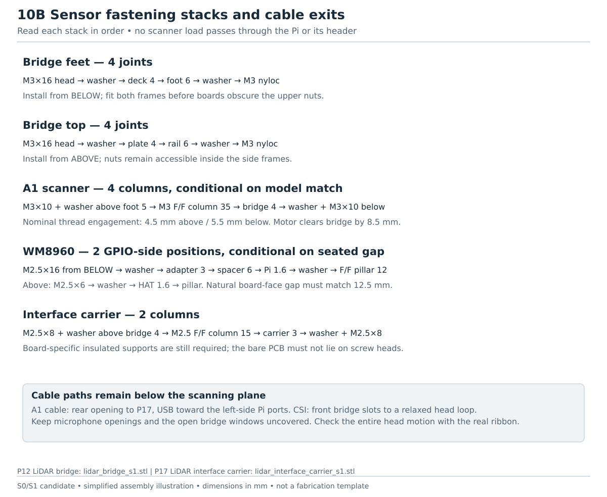

### 10C. Assemble the corrected camera head

**The camera base and swivel join through the pan servo and its horn.** P13 is the fixed base on the chassis. P14 is the U-shaped rotating yoke (the swivel). The servo body is held in P13; the servo's supplied horn bolts beneath P14 and fits onto the servo's upward-facing splined shaft. There is no direct P13-to-P14 bolt. P16 belongs to the separate horizontal **tilt** pivot, not between the base and swivel.

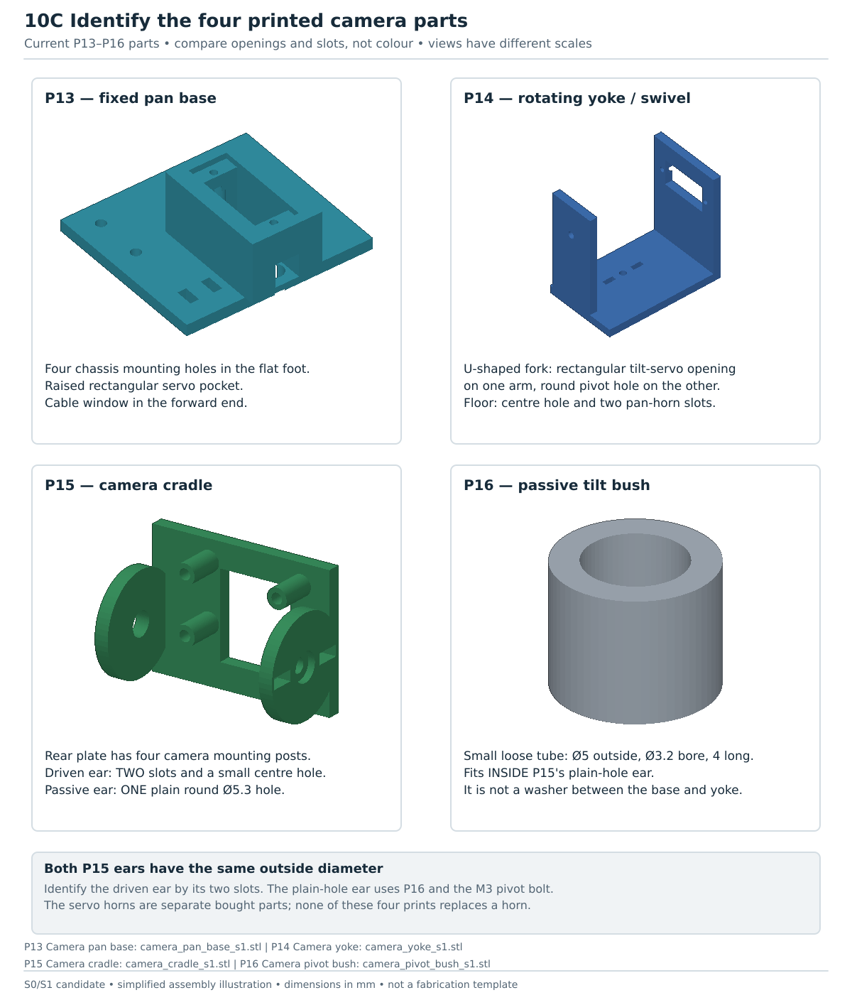

**Take:** P13–P16, two matched positional MG90S servos, their horns and supplied centre screws, five V1 M3×16 sets (four base fixings and one tilt pivot), all eight V3 M2×10 sets, four V4 camera fixing sets and one V8 cable tie. P16 is the temporary fit bush; V6 is its nylon replacement for running. These are allocations from the [sensor hardware BOM](p0-bom.md#sensor-mounting-hardware), not extra quantities.

**Match the bought interfaces:** nominal MG90S body 22.8 × 12.4 × 22.5, 32.5 mm flange span, 27.5 mm flange-hole pitch, 2.5 mm flange thickness and 5.5 mm shaft offset from the body centre. The [TowerPro listing](https://torqpro.com/product/mg90s/) does not fix every horn/flange offset. Each horn must fit the relieved centre and accept two M2 through-fixings at radius 6–9 mm; the candidate assumes a 2.5 mm horn plate. Confirm the supplied centre screw's thread and reach through the printed part. A matching spline alone does not establish a matching horn. Resolve a mismatch before assembly; the illustration's orange horn is schematic.

#### 10C.1 Fix the pan servo and base

1. **Load P13's two M2 nuts before bolting the base to the chassis.** Insert them from below into the hex pockets beneath the servo flange positions. Feed the pan lead through the **8 × 8 mm forward side window**, then lower the servo body into the rectangular pocket from above. Its shaft points upward and lies towards the robot's rear relative to the servo body centre.
2. Clamp both servo flanges using two V3 M2×10 screws: **head → washer → servo flange → P13 support → trapped M2 nut**. No washer goes in a hex nut trap. Curve the lead around the base's right side and restrain its insulated bundle with one V8 tie through the two base slots at X=120, Y=−16/−24; the tie crosses the rearward-running lead at Y=−20. Route rearward above the chassis, not under the base. A different cable exit is an interface mismatch to resolve.
3. Attach P13 using four V1 M3×16 sets: **rows 1 and 3 from the chassis front, column 7 inward from each side**, X=+96/+80, Y=±24. Stack: **head → washer → base 4 → chassis 6 → washer → nyloc**. The base projects forward; the pan axis is X=108, **8 mm ahead of the chassis front**. Install the nuts before other front-bay equipment obstructs them.

#### 10C.2 Join the swivel to the pan servo

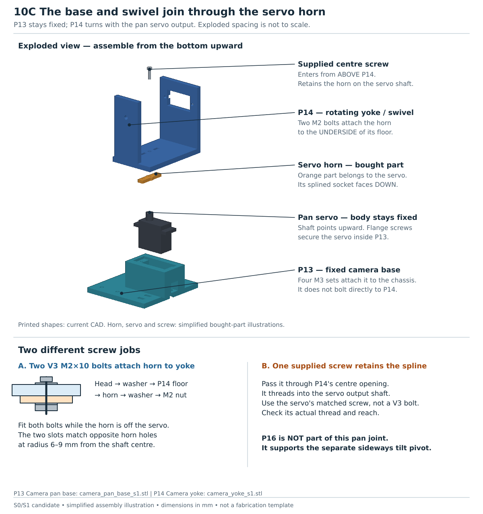

1. **Bolt the horn to P14 while both are off the servo.** Put the horn against the **underside of P14's floor**, with its splined socket facing downward. Align its centre with P14's centre opening and two opposite horn holes with the floor's elongated slots. Use two V3 M2×10 bolts, inserted from inside the U-shaped yoke: **head → washer → P14 floor → horn → washer → M2 plain nut**. These two bolts attach the horn to the print; neither enters the servo shaft.
2. Lower the P14/horn subassembly onto the pan servo's spline. The horn, rather than a bolt between the prints, connects the rotating yoke to the servo. P14's floor sits above P13; it must not be clamped against the base.
3. With the yoke still empty, insert the servo's **supplied centre screw from above**, through P14's centre opening and horn, into the servo shaft. This is a third, separate fixing; it is not a V3 M2×10 bolt or the V1 M3 tilt-pivot bolt. Check engagement and retention on the actual servo without forcing the spline. Complete this joint before the cradle/camera obstructs screwdriver access.

The base and pan-servo body stay still; the horn and whole yoke turn together. Set the mechanical centre using a qualified servo procedure before powered use. The CAD's nominal pan −90..+90 range is not an established electrical limit.

#### 10C.3 Fit the tilt mechanism and camera

1. Put two M2 nuts into P14's **outer-face** hex pockets before inserting the tilt servo. Feed the servo body from between the yoke arms through the **rectangular opening**, so the body extends outside the yoke and the flanges seat against its inner face. Clamp the flanges with two V3 M2×10 screws and head washers into those trapped nuts. No washer goes in a nut trap.
2. Identify P15's driven ear by its **two elongated slots and small centre screw hole**. Both cradle ears have the same outside diameter; the other ear has only the plain Ø5.3 pivot hole. Attach the matched tilt horn to the driven ear's **outer face, towards the tilt servo**, using the remaining two V3 horn fixings with washers and plain nuts. The shaft relief faces the servo.
3. With the camera PCB still off, fit the cradle between the yoke arms, engage the tilt horn with its servo spline and install the supplied centre screw **from inside the cradle**. Preserve access to this screw until its thread/reach and retention are checked; do not force the cradle or yoke to overcome a horn mismatch. Align the plain-hole ear with the opposite yoke arm and fit the pivot described below.
4. For the passive pivot, read the stack from **outside the yoke towards the camera**: **M3×16 head → Ø7 washer → yoke wall 4 → P16 bush 4 → Ø7 washer → M3 nyloc**. P16 passes through the cradle ear's Ø5.3 hole. The **3 mm ear surrounds the 4 mm bush**; it is not another layer squeezed between the bush and washer. Nominal axial play is 0.5 mm at each end. The fixed wall and inner Ø7 washer retain the ear.
5. Tighten the pivot nut onto the stationary bush. Check the passive joint for free movement with the tilt horn disengaged during fitting. Binding means a bush/print-fit problem, not a reason to leave the nut loose. Complete the horn retention and pivot checks before adding the PCB. Use the same-size V6 nylon bush for running.
6. Attach Camera Module 3 Standard to P15's **four integral 8 mm posts**, lens forward and CSI connector downward. Use four V4 M2×16 screws from the camera side, Ø4.5 × Ø2.2 × 0.5 nylon washers against the PCB, and matching washers/M2 nuts behind the cradle. Nominal thread projection is about 1.3 mm using the drawing's 1.12 mm board allowance. Check that the tilt centre-screw head clears the PCB. Open the CSI latch and fit the ribbon while connector access is clear; do not place the PCB directly against the rear plate.

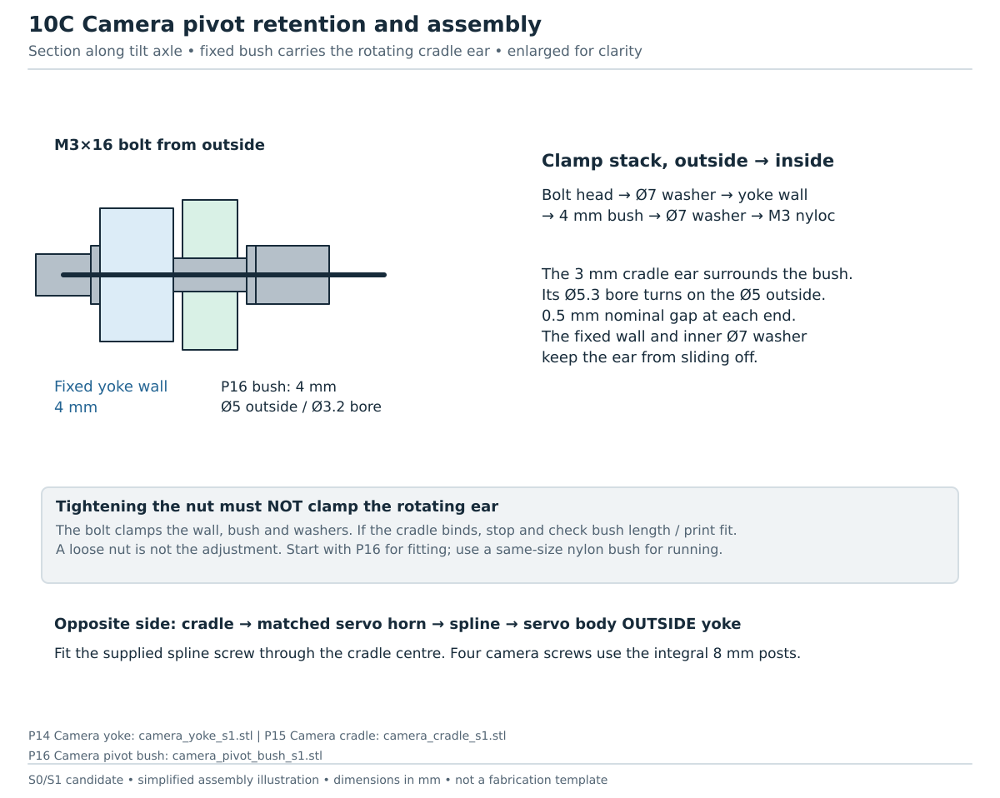

The candidate tilt axis is Z=72. CAD checks cover nominal tilt −45..+30, but horn fit, electrical limits and the real ribbon sweep still require qualification. Follow 10D before powered head motion.

### 10D. Route and restrain sensor cables

1. **LiDAR W09:** the functional connection is **scanner → owned scanner cable → interface PCB → USB cable → Pi USB port**. With the PCB securely mounted as described in 10B.2, route the scanner cable rearward and down through an accessible bridge opening to P17; route USB towards the robot's left and down to the Pi. Restrain the insulated cable jackets near both PCB plugs, leaving enough slack to unplug them without pulling on the board. Final restraint positions depend on the identified PCB and plugs; do not tighten ties over components. Keep all slack below the scan plane and clear of the motor/belt. Identify the actual connectors, switches and any auxiliary power input before connecting; this functional route and the core-scanner drawing are not an interface-board pinout.
2. **Camera W10:** use Pi 4's CSI camera socket with power removed, contacts facing the connector contacts. Start with the 300 mm trial ribbon; connect before fitting the HAT/bridge if needed for latch access. Route toward the two slots at the bridge's front edge (X=56, Y=±10), using a padded restraint on the ribbon's insulated backing, then a broad relaxed loop to the downward-facing camera connector. Reserve the space behind/above the head, below Z=126; do not pull the ribbon tight or crease it over an edge. These are route/anchor allocations, not a proven dynamic cable model.
3. **Head W14/W15:** run the servo leads rearward separately from CSI, with a loop at the yaw axis and another for tilt. Connect motor power only through the proposed stop-switched head supply after H05/H07 closure; do not use the Pi header for motor power.
4. With the servos unpowered and horns released as necessary, move the mechanism slowly through its intended range. At every pose, check ribbon slack, connector seating, bends, track/deck/frame contact and whether the ribbon enters the lens view. Reject any path that pulls a latch or rubs an edge. Record the usable angle range and actual cable lengths before powered head motion. Recheck scanning sightlines with all cables, plugs and the eventual stop enclosure installed.

### 10E. Record the remaining interface checks

Record H01 seated gap/support fit; H02 scanner model, four feet, interface-board retention and connector identity; and H03 servo/horn match, pivot retention and full ribbon sweep. The CAD and exported meshes establish a nominal mounting candidate. Strength, vibration, thermal performance and powered capture remain G1–G6 tests. No new chassis, deck or board adapter is specified by this sensor candidate.
Qualify open-air electronics first. If cooling is needed, check a low-profile heatsink under the HAT before choosing a fan. Repeat thermal and audio-noise tests with the scanner bridge installed.

## 11. Assemble the two supply domains

**HOLD H04–H06:** the [power diagram, budgets and stop circuit](s1-system-plan.md#two-supplies-and-physical-stop) are a reviewable proposal. Do not fabricate a battery adapter or energize the combined system from a generic block diagram. The [BOM](p0-bom.md#remaining-system-materials) records what is owned, proposed and still unspecified.

1. Retain B1 in the centre bay across the chassis, with non-slip support, straps and end restraint. Put B2 in the rear bay only after checking its complete plug/retention envelope. Select B2 from the owned 5 V/3 A banks; record model, output port and cable before designing retention. The official Pi supply is a bench reference if available; no new compute supply is a baseline purchase. Both batteries must be independently removable for charging; no installed charging circuit is specified.
2. Mount the stop button where it can be reached without reaching across the tracks. Its enclosure, relay, fuses and terminal covers need the H05 drawing before printing. Do not drill a new stop hole in the retained chassis to improvise this interface.
3. Build the drive harness with B1 absent. F0 is adjacent to B1 positive; K1 COM/NO feeds separately fused OpenCR and camera-head branches. The stop's first NC contact interrupts K1 coil supply; its second NC contact reports stop to OpenCR. Route returns directly to drive return. Keep the unused relay NC terminal insulated and the OpenCR SMPS jack empty.
4. Fit the separate compute lead to Pi USB-C. Leave OpenCR 5 V output disconnected from the Pi. USB will provide a signal-ground connection; the positive rails are not joined. Resolve H06 before the Pi–OpenCR USB connection is used with both supplies.
5. Inspect every crimp/solder joint, insulation sleeve and terminal clamp, then check polarity and shorts using a meter with supplies disconnected. Tug-test each terminated wire. Compare the harness against W01–W16 and attach matching labels at both ends. Fuse ratings remain provisional until their load and fault checks pass.

## 12. Dress the harness and check service access

Use the [harness schedule](s1-system-plan.md#harness-schedule) for every endpoint, connector assignment and length allowance. W06/W07 retain the lower exit, bend and P7 restraint in steps 2/6; H09 resolves the complete route to OpenCR. Do not assume the factory 180 mm leads reach merely because the lower bend fits.

1. Route power pairs under the deck, TTL leads upward inboard of P7, both USB leads to the Pi's left side, and the CSI ribbon forward to the camera. Keep the ribbon away from tight cable ties and sharp edges.
2. Install screw-mounted tie saddles on free grid holes, edge protection at crossings and accessible connector restraints. Leave relaxed loops for unplugging and the camera sweep. No loop may reach either track at its slackest tested tension.
3. With everything unpowered, demonstrate that each plug can be released without pulling on its wires. Disconnect deck-crossing leads while the deck is still seated; then remove the four U4 screws and lift the deck/columns as a unit. Restore and recheck all labels. This service demonstration is required before fixing final cable lengths.
4. For the corrected moving head, sweep every permitted pose by hand with servos unpowered and ribbon fitted. Check against the deck, stop enclosure and LiDAR. H03 determines actual motion limits; there is no assumed ±90° travel release.

## 13. Commission in stages

**Timing:** begin G0 and isolated G1 checks while the deck is still off, following the [bench sequence](#bench-checks-before-attaching-the-deck). **Implementation gate:** the owned hardware has a prior TurtleBot3 installation, but Skala-specific control is not implemented in this repository. Preserve and inventory that baseline, then implement and bench-test Skala's [software contract](s1-system-plan.md#software-and-data-endpoint), reusing appropriate device support, before tests involving motion. Migrating the old TurtleBot3 application is not required. Neither an old working TurtleBot3 nor successful Pi boot closes the new power/stop requirements.

| Gate                                          | Procedure                                                                                                                                                                                                                                                                                                     | Evidence needed before proceeding                                                                                                                                                                                                                                                                                                            |
| --------------------------------------------- | ------------------------------------------------------------------------------------------------------------------------------------------------------------------------------------------------------------------------------------------------------------------------------------------------------------- | -------------------------------------------------------------------------------------------------------------------------------------------------------------------------------------------------------------------------------------------------------------------------------------------------------------------------------------------- |
| G0 — preserve existing TurtleBot3 baseline    | Image the SD card before inventory boot. Pi-only power, drive battery absent and OpenCR/motors disconnected; connect OpenCR by USB only for G0.3/G0.4, with motor leads still unplugged. Read OS/ROS/kernel and identify available firmware source/binaries before flashing                                   | Humble/Jammy is the pre-upgrade baseline; both distributions were updated as of 2026-11-23. Record the upgraded installation. Retain the inventory output, kernel/package versions and backup/restore status; a firmware package on the Pi does not prove what is flashed on OpenCR. Read motor settings later in G3 without a factory reset |
| G1 — isolated compute                         | Drive battery absent. Boot Pi on the official supply if available, or test the selected owned 5 V/3 A bank/cable. Qualify camera, WM8960 recording and identified A1 individually, then simultaneously                                                                                                        | OS/kernel/driver versions; saved samples; correct device identities; voltage/current, temperature, throttle/reset and gap logs. No LiDAR connection until H02 identifies its interface                                                                                                                                                       |
| G2 — controller and stop, motors disconnected | Load reviewed USB-device firmware. Verify startup disarmed, K1 EN low and stop input. Test coil/contact behavior first with a current-limited source and test load                                                                                                                                            | S1 always opens K1; release/reboot/reconnection does not arm. Verify H06 compute-only, drive-only, both-on and stop-pressed power paths; no unintended upstream VBUS source                                                                                                                                                                  |
| G3 — motor identity, one at a time            | Raise and support one track. Use current-limited 11.1 V bench drive supply while full-charge H06 is unresolved. Read and retain valid existing IDs/baud/mode; verify physical left/right mapping. Change only mismatches, one motor at a time with torque off; test zero, then low speed up to proposed 5 rpm | Motor settings and direction/sign recorded; candidate map is left 1 / right 2, with any retained alternative matched in software. Stable track engagement, free idler, no rubbing, motor voltage/temperature/load and actual supply current logged. No stall/holding-current experiment inferred from the stall rating                       |
| G4 — fault tests with both tracks raised      | Verify command expiry, DXL bus watchdog, USB unplug, frozen command process, OpenCR reset and stop press/release                                                                                                                                                                                              | Both tracks stop and no automatic restart; head power/PWM also stop once fitted. Distinguish command timeout from bus traffic timeout. Record observed latency                                                                                                                                                                               |
| G5 — loaded floor tests                       | Fit all retained payload and batteries; check mass/CG, fasteners, ground clearance and battery retention. Start on level clear floor at low speed; progress straight, turn, reverse and stop                                                                                                                  | Turning current/heat, stopping distance, sag, clearance, track retention and loosened hardware. No slope/stair or payload rating inferred                                                                                                                                                                                                    |
| G6 — full research capture                    | Repeat simultaneous video/audio/LiDAR/IMU/drive recording with drive off, driving and head motion                                                                                                                                                                                                             | No unexplained resets or hidden gaps; power/thermal margins, noise, timestamp mapping and frame calibration documented; storage-full and restart events explicit                                                                                                                                                                             |
| G7 — bounded body integration                 | Replay saved episodes, then teleop and a bounded Sophia/Cliste experiment using only exercised capabilities                                                                                                                                                                                                   | Requests, acknowledgments, actual feedback and outcomes agree; network loss stops locally. Native cognitive use of each modality is evaluated separately                                                                                                                                                                                     |
|                                               |                                                                                                                                                                                                                                                                                                               |                                                                                                                                                                                                                                                                                                                                              |

The [commissioning procedures](commissioning-procedures.md) give step-by-step commands, pass criteria and a record template for G0 and G1; G2–G7 procedures follow the Skala firmware. For every gate retain date, hardware revisions, software commits, wiring revision, exact load/limits, results and failures. Initial 50°C warning / 60°C stop and 250 ms command expiry are proposed firmware test settings, not demonstrated operating limits. Check them against the actual motor firmware and measured stopping behavior.

## 14. Shutdown, maintenance and completion

Stop motion and disarm, finish/flush the recording, shut down the Pi cleanly, then disconnect compute and drive supplies. Charge removed batteries with their specified chargers. The drive stop intentionally leaves logging alive; it is not an all-power isolation switch.

After initial runs, inspect bracket clamps, idler cap screws, hub retention, track tension, printed spacer seating, battery straps and cable abrasion. Recheck after any load change. A new cooler, battery or head position requires a fresh clearance/CG/power check.

The [closure register](s1-system-plan.md#closure-register-and-effect-on-existing-parts) is the single list of remaining engineering decisions and affected parts. Closing those items and recording G1–G7 results completes this incarnation's declared use. Until then, the guide is complete in planned scope, with explicitly unfinished interfaces; it is not a fully released set of construction instructions.
