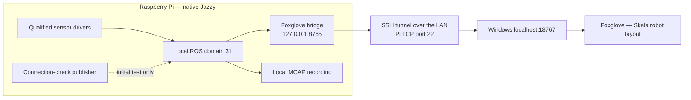

# Connect the physical Skala robot to Foxglove

Updated 2026-11-27. Run native ROS 2 Jazzy and a Foxglove bridge on the Raspberry Pi, then open an SSH tunnel from Windows. Foxglove receives the Pi's live ROS topics through that tunnel. Docker and LAN-wide DDS discovery are unnecessary for this viewing connection.

**This is a setup procedure, not a completed Pi connection test.** Ubuntu and ROS upgrades were reported complete; record their installed versions before adding packages. The repository has a working simulation, but its physical OpenCR controller and Pi body driver remain requirements. This guide can establish a connection before those drivers exist, using one clearly labeled diagnostic topic. Actual sensors appear only when their drivers run.

## Connection at a glance



| Setting | Physical robot | Existing simulation |
| --- | --- | --- |
| ROS runtime | Native Jazzy on the Pi | Jazzy in the workstation container |
| ROS domain | `31` in the supplied robot environment | `30` |
| ROS discovery | Local to the Pi | Local to the container |
| Clock | Real sensor/ROS timestamps; `use_sim_time=false` | `/clock`; simulation time |
| Foxglove address on Windows | **`ws://localhost:18767`**, while the SSH tunnel runs | `ws://localhost:18766` |
| Commands through the bridge | Viewing only; publishing, services and parameter access disabled | Simulator controls and recording services enabled |

The different domains are a chosen separation, not an observed Pi setting. All robot publishers, the bridge and robot-side ROS inspection terminals must use the same environment. Windows Foxglove does not participate in DDS and has no ROS domain to match. [ROS discovery settings](https://github.com/ros2/ros2_documentation/blob/jazzy/source/Tutorials/Advanced/Improved-Dynamic-Discovery.rst)

## 1. Prepare the Pi and confirm the installation

Use the compute-only state from [G0/G1 commissioning](commissioning-procedures.md): drive power disconnected, motor leads and head servos disconnected. Keep OpenCR disconnected during the first connection and stationary camera/LiDAR checks. Firmware changes and powered driving belong to later gates.

**On the Pi, in Bash:**

```bash
cat /etc/os-release
uname -r
dpkg --print-architecture
test -f /opt/ros/jazzy/setup.bash
source /opt/ros/jazzy/setup.bash
printf 'ROS distro: %s\n' "$ROS_DISTRO"
ros2 --help
timedatectl status
```

Expected baseline: Ubuntu `24.04`, architecture `arm64`, and `ROS_DISTRO=jazzy`. Retain the observed output. If that baseline is missing, resolve the installation before continuing; these commands do not upgrade Ubuntu or migrate ROS. [Native Jazzy installation guidance](https://github.com/ros2/ros2_documentation/blob/jazzy/source/Installation/Ubuntu-Install-Debs.rst)

Confirm that the Pi's wall clock is synchronized before collecting timestamped experiments. A later second computer running ROS algorithms will also need clock synchronization. The first connection check below only establishes transport.

## 2. Install SSH and the telemetry packages

**On the Pi:**

```bash
sudo apt update
sudo apt install openssh-server git ros-jazzy-foxglove-bridge \
  ros-jazzy-rmw-fastrtps-cpp ros-jazzy-rosbag2 \
  ros-jazzy-rosbag2-storage-mcap
sudo systemctl enable --now ssh
systemctl is-active ssh
hostname -I
id -un
```

These commands assume the ROS APT repository from the native Jazzy installation is present. If a ROS package cannot be found, inspect that repository configuration rather than switching distribution names. The bridge publishes schemas with the data, so Foxglove itself does not need the Pi's ROS installation. [Foxglove bridge installation and configuration](https://github.com/foxglove/foxglove-sdk/blob/main/ros/src/foxglove_bridge/README.md)

Record the Pi's login name and LAN address from the last two commands. Use an address reachable from Windows; a router DHCP reservation can keep it stable. A `.local` hostname is optional and depends on working name resolution. If SSH is blocked by an existing firewall, allow TCP 22 from the workstation or its trusted network; this procedure does not require opening 8765 or DDS ports on the LAN. [Ubuntu OpenSSH setup](https://ubuntu.com/server/docs/how-to/security/openssh-server/)

Get the configuration directly from source control. For a new checkout:

```bash
git clone https://github.com/c-daly/skala.git "$HOME/skala"
```

For an existing checkout at that path, inspect local edits and update it instead:

```bash
git -C "$HOME/skala" status --short
git -C "$HOME/skala" pull --ff-only
```

Keep local edits if Git reports a conflict; do not replace the directory. The examples below assume `~/skala`. Substitute the actual checkout path consistently if it differs.

## 3. Start the robot's local ROS environment and bridge

The supplied [ROS environment](../../config/robot/ros-env.bash) selects Jazzy, domain 31, Fast DDS and local discovery. It also sources `~/skala_ws/install/setup.bash` if that driver workspace exists. Add the actual overlay there if hardware packages live elsewhere; custom message packages must be visible to the bridge too. The file applies to the shell that sources it and does not rewrite shell startup files or existing services.

**Pi terminal A:**

```bash
cd "$HOME/skala"
source config/robot/ros-env.bash
ros2 pkg prefix foxglove_bridge
dpkg-query -W ros-jazzy-foxglove-bridge
bash scripts/skala-robot-bridge
```

Leave this terminal running. The [robot bridge profile](../../config/robot/foxglove.yaml) binds **only to the Pi's loopback address, port 8765**. It forwards visible topic data and the connection graph, with no command publication, service calls, parameter access or asset retrieval. It does not start drivers, upload recordings, register a cloud device or arm motors. The Foxglove desktop activation code is not a device token and is not used here.

**Pi terminal B:**

```bash
source "$HOME/skala/config/robot/ros-env.bash"
ros2 node list
ros2 param get /foxglove_bridge use_sim_time
ss -ltnp 'sport = :8765'
ros2 topic pub --rate 1 /skala/connection_check std_msgs/msg/String \
  '{data: "Skala Pi connection check; diagnostic data only"}'
```

Expected: `/foxglove_bridge` appears, its `use_sim_time` is `False`, and the listening socket is `127.0.0.1:8765`. The last command publishes a diagnostic message until Ctrl+C. It is not sensor telemetry. Starting a second bridge on the same port fails; stop the first process before switching to the service in step 7.

## 4. Open the tunnel from Windows

**In Windows PowerShell, outside WSL and Docker:**

```powershell
$PiLogin = Read-Host 'Pi login name'
$PiAddress = Read-Host 'Pi LAN address or hostname'
ssh "${PiLogin}@${PiAddress}"
```

Confirm the SSH host fingerprint against the Pi on first connection, then log in. For the default ED25519 host key, display the fingerprint on the Pi with `ssh-keygen -lf /etc/ssh/ssh_host_ed25519_key.pub`. Run `exit` to return to PowerShell. Open the tunnel in that same PowerShell session:

```powershell
ssh -N -T -o ExitOnForwardFailure=yes -o ServerAliveInterval=15 `
  -o ServerAliveCountMax=3 `
  -L 127.0.0.1:18767:127.0.0.1:8765 "${PiLogin}@${PiAddress}"
```

Leave the window running. A successful tunnel normally prints nothing. Ctrl+C closes it. The local endpoint is Windows `127.0.0.1:18767`; SSH delivers it to port 8765 on the Pi. Starting the tunnel from Windows makes the endpoint directly available to Windows Foxglove. The `-L` and `-N` options are described in the [OpenSSH manual](https://man.openbsd.org/ssh.1).

If `ssh` is unavailable, install the Windows **OpenSSH Client** optional feature. If 18767 is already occupied, choose another unused local port and use that same port in Foxglove. A successful SSH login alone does not prove that the bridge is running; the diagnostic message in the next step checks the complete path.

## 5. Connect Foxglove and choose a robot layout

In Foxglove Desktop, open a new **Foxglove WebSocket** connection to:

```text
ws://localhost:18767
```

In **Topics**, find `/skala/connection_check` and add it to a **Raw Messages** panel. The diagnostic text should arrive repeatedly with advancing receive times. Stop the Pi's test publisher with Ctrl+C and confirm that new messages stop. This checks Pi ROS → bridge → SSH → Windows Foxglove without requiring assembled sensors.

Create a layout named **Skala robot**. A copy of the simulation layout can supply the panel arrangement, but replace its `/sim/...` paths with the topics actually listed by the robot. Remove the simulator ground-truth series and the `/sim/record/start` and `/sim/record/stop` buttons. This viewing profile does not expose recording services. Keep the **Skala simulation** layout and its 18766 connection separate.

| Panel | Select from the robot's observed topics |
| --- | --- |
| LiDAR | A topic of type `sensor_msgs/msg/LaserScan` |
| Camera | `sensor_msgs/msg/Image` or supported compressed image, plus matching `CameraInfo` |
| IMU plots | `sensor_msgs/msg/Imu`: acceleration and angular velocity |
| Drive feedback | Actual joint/encoder state and odometry, when implemented |
| ROS logs | `/rosout` |
| Pi resources | `/foxglove_bridge/sysinfo`; these are computing metrics, not battery or motor measurements |
| Map and robot pose | `/map`, `/tf`, `/tf_static` and robot description, once physical state publication and SLAM run |

A topic name is not proof of a working stream. Check that values update and correspond to a physical change. In the 3D panel, choose a frame that exists: initially the scan's own `header.frame_id` can display a stationary scan. A `map` frame becomes appropriate only when SLAM publishes it. Missing transforms are not repaired by changing the network connection.

## 6. Add the qualified hardware streams

Start each driver in a Pi shell that has sourced `config/robot/ros-env.bash`. Existing background services must be restarted with the same domain and discovery settings; sourcing a file in another terminal does not change a running node. Use real time for hardware nodes, with `use_sim_time=false` where that parameter is declared.

| Device | Bring-up route and current boundary |
| --- | --- |
| RPLidar A1 | Complete [G1.3](commissioning-procedures.md#g13-rplidar-a1-and-its-interface-board). Use the verified device path and the headless `sllidar_a1_launch.py` command there, then select its observed scan topic |
| Camera Module 3 or a qualified replacement | Complete [G0.5](commissioning-procedures.md#g05-decision-after-g0-the-pi-operating-system) and [G1.2](commissioning-procedures.md#g12-camera-module-3). A working `rpicam` capture proves the camera path but does not create a ROS image topic; a compatible ROS camera node must also run |
| WM8960 microphones | Complete [G1.1](commissioning-procedures.md#g11-wm8960-audio-hat). An ALSA recording does not automatically appear in Foxglove; a ROS audio publisher and supported schema are separate integration work |
| OpenCR IMU and motor feedback | Inventory the installed firmware under G0 and implement/qualify the [OpenCR interface](../../firmware/opencr_reflex/README.md). The IMU's presence on the board does not itself publish a ROS topic; the sensor-only steps above leave OpenCR disconnected |

Inspect the running graph on the Pi:

```bash
source "$HOME/skala/config/robot/ros-env.bash"
ros2 topic list -t
ros2 node list
```

For each actual topic, run `ros2 topic info --verbose TOPIC` and `ros2 topic hz TOPIC`, replacing `TOPIC` with its listed name. Inspect publisher QoS if the name is visible but data is missing. Keep the topic names, types, node versions and sensor frames in the commissioning record. Do not rename hardware topics to `/sim/...` just to fill a panel.

A stationary LiDAR/camera view can work before mapping or driving. Physical SLAM additionally needs measured sensor transforms and a working motion/odometry path. No map or odometry is invented by the bridge. The existing RViz WASD panel and Windows controller helper command the simulator; they are not a hardware teleoperation configuration.

## 7. Make the bridge start automatically

After the manual diagnostic check passes, stop the foreground bridge with Ctrl+C. The supplied [user service](../../config/robot/skala-foxglove.service) assumes the checkout is `~/skala`; edit its `ExecStart` path if needed.

**On the Pi:**

```bash
install -D -m 644 "$HOME/skala/config/robot/skala-foxglove.service" \
  "$HOME/.config/systemd/user/skala-foxglove.service"
systemctl --user daemon-reload
systemctl --user enable --now skala-foxglove.service
systemctl --user status skala-foxglove.service --no-pager
journalctl --user -u skala-foxglove.service -n 50 --no-pager
```

To run the user service after boot without an interactive login:

```bash
sudo loginctl enable-linger "$(id -un)"
```

Recheck the diagnostic topic after a Pi reboot before treating startup as complete. The service sources its own ROS environment and restarts a failed bridge. It starts **only the telemetry bridge**; device drivers still need their qualified launch/service configuration. The Windows SSH tunnel must also be opened for each connection session. [systemd service behavior](https://www.freedesktop.org/software/systemd/man/latest/systemd.service.html)

For routine service control:

```bash
systemctl --user restart skala-foxglove.service
systemctl --user stop skala-foxglove.service
```

To remove automatic bridge startup, run `systemctl --user disable --now skala-foxglove.service`. Disable lingering only if no other user services depend on it.

## 8. Record a first hardware episode locally

Record on the Pi so the capture does not depend on Wi-Fi remaining connected. Install MCAP support in step 2, then choose only topics observed in step 6. **Edit the example topic list before running:**

```bash
source "$HOME/skala/config/robot/ros-env.bash"
mkdir -p "$HOME/bags/skala"
df -h "$HOME/bags/skala"
episode_dir="$HOME/bags/skala/$(date -u +%Y%m%dT%H%M%SZ)"
ros2 bag record --storage mcap -o "$episode_dir" \
  /scan /camera/image_raw /camera/camera_info /imu /odom /tf /tf_static
```

These names are examples, not a verified hardware topic map. Omit unavailable streams and record the missing coverage. Use Ctrl+C after a short capture, then `ros2 bag info "$episode_dir"` to check its duration and message counts. Unlike the simulator's recorder, this direct command has no five-minute or free-space stop; monitor storage and stop it explicitly. Record hardware with real timestamps, without `--use-sim-time`.

Retain the OS/kernel, driver revisions, topic/frame map and physical test conditions alongside the bag. Copy the completed directory to Windows with `scp -r`, using the Pi's actual absolute bag path, and open the `.mcap` file in Foxglove. The robot layout can then review it offline. A replay check should confirm usable images/scans and timestamp progression before a longer experiment.

## Troubleshooting and completion

| Symptom | Check next |
| --- | --- |
| SSH cannot connect | Pi LAN address, SSH service, TCP 22, Wi-Fi client isolation and login credentials |
| Tunnel exits immediately | Reported SSH error; an occupied local port or forwarding policy can prevent binding |
| Foxglove cannot connect | Keep the tunnel open; on the Pi, check the bridge process and `ss` output for 127.0.0.1:8765 |
| Connected, but diagnostic topic absent | Publisher running; all Pi processes sourced the same environment; domain 31 and middleware agree |
| Topic visible, no new messages | Local publisher rate, schema dependencies, QoS and bridge logs; inspect the Pi directly before changing the tunnel |
| Camera makes viewing sluggish | Begin with one stream at a modest resolution/rate; use a supported compressed image transport when the camera driver provides it |
| Camera/scan works, but no map or robot | Inspect physical SLAM, robot description and TF publishers; they are separate from the bridge |
| Driver works in a terminal but not after boot | Its service must source the driver overlay and robot environment and have the required device permissions |
| Simulation recording buttons fail on the robot | Remove those buttons; the robot profile intentionally has no `/sim/record/...` services |
| Resources panel stops updating after changing layouts | Reconnect the Foxglove data source, then inspect bridge logs if the stream remains absent |

Connection commissioning is complete when the diagnostic stream survives a reconnect, actual qualified sensor topics update in Foxglove, a short hardware bag reopens correctly, and the selected startup behavior has been checked after reboot. Retain which of those checks passed; an initial diagnostic-only connection is useful but remains a partial hardware result.

A later ROS application in the workstation container may need direct DDS or another ROS transport to the Pi. That is a separate connection from Foxglove's WebSocket tunnel. Keep the workstation's current local-only Compose profile until that application and its bidirectional tests are defined. Hardware teleoperation requires the local disarm, timeout and stop behavior specified in [G2 and later gates](commissioning-procedures.md#later-gates--what-each-needs-before-it-can-be-written).

## Local configuration check

On 2026-11-27, the supplied environment and launcher ran in the workstation's Jazzy container on domain 31, using temporary port 18768 to avoid the active simulator. A WebSocket client received the diagnostic string. The bridge reported loopback binding, `use_sim_time=false`, `remote_access=false` and only the `connectionGraph` capability; command publication, services, parameter access and asset retrieval were not advertised. Bash syntax and the service file's static validation passed. The [validation receipt](../../config/robot/validation-2026-11-27.json) retains the package version, configuration hashes and scope.

These checks exercised the native ROS configuration on x86-64 inside the existing container. Pi arm64 installation, the Windows-to-Pi SSH tunnel, user-service startup after reboot and physical sensor capture still require the checks above.
