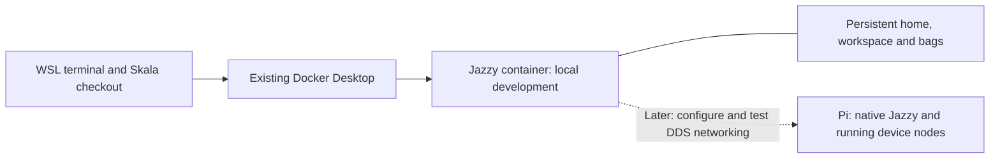

# ROS 2 Jazzy on the workstation with Docker

Updated 2026-11-27. This setup runs **ROS 2 Jazzy on Ubuntu 24.04 inside Docker**, using the existing Windows Docker Desktop installation from the WSL terminal. It is a local development environment. The robot is not ready for a connection test, so discovery stays inside the container and the Pi is unchanged.

## Machine and scope

The preparation check found x86-64 WSL2 running Ubuntu 26.04, Docker Desktop 4.74.0, Docker Engine 29.4.3 and Compose 5.1.3. Docker was already available; another Docker Engine installation inside WSL is unnecessary. The container uses the supported Noble/Jazzy package environment independently of the WSL distribution. The [Docker Desktop WSL guide](https://docs.docker.com/desktop/features/wsl/) describes this integration.

| Component | Configuration |
| --- | --- |
| Compose project / service | `skala-ros2` / `ros` |
| Local image | `skala/ros2-workstation:jazzy-local` |
| Base image | `ros:jazzy-ros-base-noble`, pinned by digest in `docker/ros2/Dockerfile` |
| Tools | ROS Base, C++/Python demos, RViz2, rosbag2 with SQLite storage, colcon, rosdep, compiler tools and Git |
| Account | Non-root `ros`; UID/GID match this checkout's 1000:1000 |
| ROS domain | `30`, a workstation default to verify against the Pi later |
| Middleware / discovery | `rmw_fastrtps_cpp`; `ROS_AUTOMATIC_DISCOVERY_RANGE=LOCALHOST`; empty `ROS_STATIC_PEERS` |
| Networking | Compose bridge network; no published ports or host networking |
| Persistent home/workspace | Docker volume `skala-ros2_ros-home`, mounted at `/home/ros`; workspace at `/home/ros/ws` |
| Repository | Current checkout mounted read/write at `/workspaces/skala` |

The source files are `docker/ros2/Dockerfile`, `docker/ros2/compose.yaml` and `docker/ros2/smoke.py`. Run the commands below **from the Skala repository root in WSL**, where `docker/ros2/compose.yaml` exists. The [ROS Docker guide](https://github.com/ros2/ros2_documentation/blob/jazzy/source/How-To-Guides/Run-2-nodes-in-single-or-separate-docker-containers.rst) covers the underlying node/container workflow.



## Build and start

Check that Docker Desktop is running and its WSL integration is enabled for this distribution:

```sh
docker version
docker compose version
```

`docker version` must show both **Client** and **Server**. A socket error from a restricted agent session does not by itself mean the interactive terminal needs a Docker reinstall or a socket-permission change. Resolve the session's access first; otherwise check Docker Desktop's WSL integration.

Build and start just this Compose project:

```sh
docker compose -f docker/ros2/compose.yaml up -d --build --wait
docker compose -f docker/ros2/compose.yaml ps
```

Expected: service `ros` is running and healthy. Its idle command is `sleep infinity`; ROS nodes start when explicitly launched. The health check verifies ROS Python/message/storage imports, not robot connectivity.

For a checkout with a different numeric Linux identity, set `SKALA_UID` and `SKALA_GID` to `id -u` and `id -g` before the initial build. The account mapping must also agree with the persistent volume's ownership; changing build arguments does not migrate an existing home volume.

## Open a ROS shell

```sh
docker compose -f docker/ros2/compose.yaml exec ros bash
```

The interactive shell sources Jazzy automatically. Inside it:

```sh
echo "$ROS_DISTRO"                       # jazzy
echo "$ROS_DOMAIN_ID"                    # 30
echo "$ROS_AUTOMATIC_DISCOVERY_RANGE"     # LOCALHOST
ros2 --help
ros2 pkg prefix rviz2
cd /home/ros/ws
```

Use `exit` to leave the shell; the container stays running. For a single command from the host, invoke the upstream entrypoint so ROS paths are set:

```sh
docker compose -f docker/ros2/compose.yaml exec ros /ros_entrypoint.sh ros2 pkg list
```

`docker compose exec ros ros2 ...` alone may fail because an exec process does not rerun the image entrypoint. An interactive Bash shell or `/ros_entrypoint.sh` supplies the environment.

## Verify local ROS operation

Run the included functional check from the host:

```sh
docker compose -f docker/ros2/compose.yaml exec -T ros \
  /ros_entrypoint.sh python3 /usr/local/lib/skala-ros/smoke.py
```

It starts a C++ publisher, receives at least three messages in a separate Python process, writes the received messages through rosbag2/SQLite and reads them back for comparison. It uses `/skala_docker_smoke/chatter`, cleans up its publisher and temporary bag, and exits nonzero if any check fails. A successful report contains `"status": "passed"` and `"robot_connection_tested": false`.

For the interactive talker/listener exercise, open **two shells in the same container**. In the first:

```sh
ros2 run demo_nodes_cpp talker
```

In the second:

```sh
ros2 run demo_nodes_py listener
```

Messages should appear in both terminals. Stop each node with Ctrl+C. `LOCALHOST` here means the container's network namespace; it does not expose ROS nodes to the Pi or to an unrelated container. ROS documents the [discovery range and static-peer settings](https://github.com/ros2/ros2_documentation/blob/jazzy/source/Tutorials/Advanced/Improved-Dynamic-Discovery.rst).

## Files, builds and RViz

Keep development packages under `/home/ros/ws/src` and recorded bags under `/home/ros/bags`; both persist in the named volume across container recreation. The checkout at `/workspaces/skala` is a live host bind mount, so edits there change the repository directly. Container-local changes outside these mounted locations disappear when it is recreated.

Once a ROS package exists, build it from `/home/ros/ws`:

```sh
colcon build --symlink-install
source install/setup.bash
```

The current Skala body-driver directory still contains requirements rather than a runnable robot stack. Installing this environment does not supply a Skala launch file or start device drivers. New interactive shells source `/home/ros/ws/install/setup.bash` when it exists; keep its builds within Jazzy.

RViz2 is installed, but **desktop-window forwarding is not configured by this Compose file**. A WSLg/display mount and working graphics path are separate setup steps. A successful package lookup or local messaging check does not establish that an RViz window works. CLI development, recording and replay checks can proceed without it.

## Does the Pi need changes?

**No additional ROS installation or Docker is required merely to communicate with this workstation**, assuming native Jazzy is working on the Pi. Its device and application nodes must be running. ROS 2 nodes discover peers in the same domain and require compatible message types and QoS; the workstation does not remotely start the Pi's drivers just by opening a ROS shell. See the [ROS discovery explanation](https://github.com/ros2/ros2_documentation/blob/jazzy/source/Concepts/Basic/About-Discovery.rst) and [domain-ID guidance](https://github.com/ros2/ros2_documentation/blob/jazzy/source/Concepts/Intermediate/About-Domain-ID.rst).

The eventual connection check may require environment or networking changes on one or both machines:

1. Record the Pi's active ROS distribution, domain and middleware, including the environment used by any services. Match domain IDs; `30` is the workstation default, not a newly verified Pi setting.
2. Establish a working bidirectional DDS path between the container and Pi, then select subnet or explicit-peer discovery. The current Compose file deliberately fixes `LOCALHOST`; exporting another value only in the host terminal does not change it. Apply reviewed Compose settings and recreate the service when the robot is ready.
3. Check firewall and network isolation, then use a harmless talker/listener test in both directions before sensor topics. Match QoS and installed message definitions before diagnosing missing data as a network fault.

Docker Desktop host networking is opt-in and operates at TCP/UDP level, without direct access to the Windows host interfaces. Adding `network_mode: host` alone does not prove that LAN discovery and data paths work. WSL mirrored networking can support multicast, but it changes the WSL environment and is not itself proof of Docker-to-Pi connectivity. Review the [Docker host-networking limitations](https://docs.docker.com/engine/network/drivers/host/) and [Microsoft WSL networking guidance](https://learn.microsoft.com/en-us/windows/wsl/networking) when that test becomes possible. No Windows/WSL networking, firewall, discovery-server or Pi changes are needed for the local setup above.

## Stop, resume and update

Stop this container while retaining its files:

```sh
docker compose -f docker/ros2/compose.yaml stop
```

Resume it:

```sh
docker compose -f docker/ros2/compose.yaml up -d --wait
```

`docker compose -f docker/ros2/compose.yaml down` removes this project's container/network but retains the named home volume. Adding `--volumes` deletes that stored workspace and bags; it is not a routine update command. While running, the container's `unless-stopped` policy resumes it when Docker restarts.

To change installed tools, edit the Dockerfile, rebuild and recreate the service. Installations made interactively as root are temporary container changes, not reproducible image updates. The base image digest is pinned; APT package versions are recorded in the validation receipt, but the APT repository itself is not a frozen snapshot.

## Recorded validation

On **2026-11-27**, the container was built, started and confirmed healthy. Local C++ to Python delivery passed with three received messages; all three were written to and read back from a SQLite ROS bag. A temporary C++ package built with colcon and ran successfully. Interactive shell setup, repository write ownership and home-volume persistence across container recreation also passed.

The [workstation setup receipt](../../docker/ros2/validation-2026-11-27.json) records the built image, package versions, source hashes and completed checks. Robot communication, sensor operation and RViz window rendering remain untested. This environment does not close the [Pi commissioning gates](commissioning-procedures.md).
