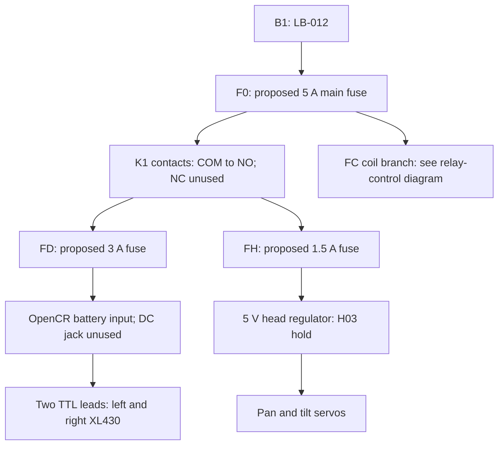
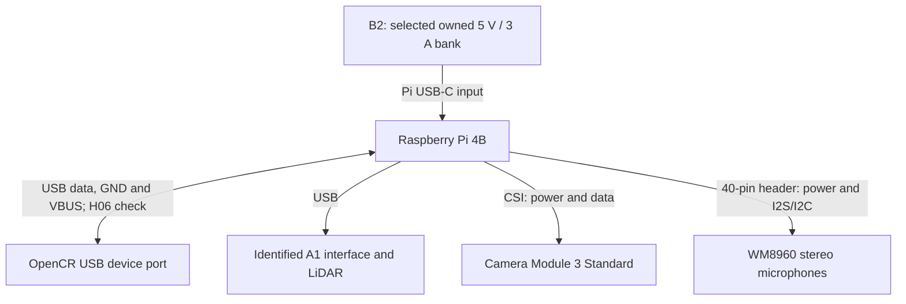
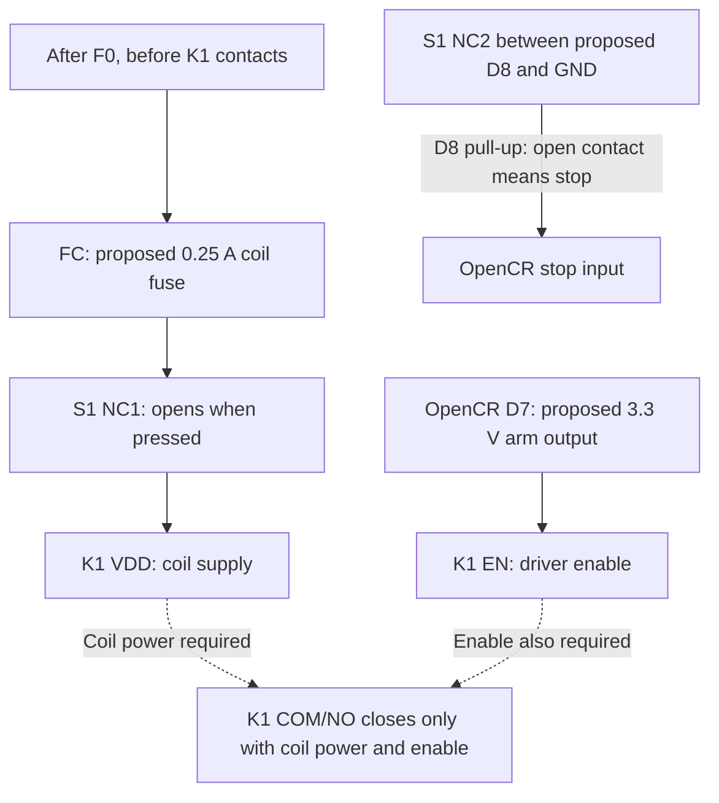

# S1 complete-system design

Updated 2026-11-22. **This plan describes the intended complete two-fixed-track robot. Its unresolved interfaces are not released for powered assembly.** This page owns the electrical connections, remaining placements, software requirements and closure register. The [assembly guide](p0-assembly.md) owns the work sequence, the [BOM](p0-bom.md) owns purchasing quantities, and the [build review](p0-build-review.md) distinguishes checked geometry from physical evidence.

The intended endpoint is a mobile, teleoperated research platform recording LiDAR, video, stereo audio, IMU, motor feedback and actions, with a tested body interface for later Sophia/Cliste experiments. Camera pan/tilt remains in the intended current payload, with unresolved mechanics explicitly retained. Powered flippers, stairs and self-righting are later work.

**Status vocabulary:** *owned* records hardware reported in hand; *sourced* records a manufacturer specification; *CAD-checked* means the named model passed its stated checks; *physically qualified* requires a recorded test on the actual assembly; *proposed* is an engineering choice awaiting qualification. These are distinct forms of evidence. A **HOLD** blocks the purchase, fabrication or energization affected by its named unresolved issue; it does not block unrelated bench tests. In the placement table, “confirmed” means ownership or specified identity, never a fit or powered-test result. H01–H10 are the holds below; G0–G7 are the test gates in the guide.

## Hardware and placement

**Construction resumption:** the user expects BOM hardware without substitutions and has substantial assembly completed, with the deck still separate for access. Follow the guide's [bench sequence](p0-assembly.md#bench-checks-before-attaching-the-deck): back up and inventory the inherited installation, work through power explicitly, test supported subassemblies, then complete installation. Skala reuses hardware and useful low-level code; retaining the TurtleBot3 application stack is not a requirement. H01–H10 retain their existing meanings; delivered parts and prior TurtleBot3 operation do not establish the new power circuit, motor signs, sensor fit or loaded performance.

| Item | State and proposed home | Attachment / service requirement |
| --- | --- | --- |
| Two XL430-W250-T drives | Confirmed; existing lower modules | Existing P1/P2/P7 and lower harness retained; no external H-bridge |
| OpenCR 1.0 | Confirmed; P9 on rear deck, PCB underside Z=85 | U1 board stack; USB faces left, TTL bank forward. Match owned board revision before relying on Rev H schematic |
| Raspberry Pi 4B | Confirmed; P10 on front deck, PCB underside Z=85 | User reports no cooler fitted. USB faces left, GPIO rear, USB-C forward. Keep microSD removable |
| WM8960 Audio HAT | Confirmed owned, onboard stereo microphones | X=−8.5, Y=±29 support positions. V7 candidate uses M2.5 F/F 12 mm pillars and complete replacement screw stacks; H01 now requires the naturally seated 12.5 mm gap/component check. Modeled top Z=109.6 |
| Camera Module 3 Standard | Confirmed owned; U2 pan axis X=108, tilt axis Z=72 | P13–P16 replace the colliding legacy mechanism; four existing chassis holes, no chassis reprint. Standard 15-pin CSI ribbon; actual servo/horn and moving-ribbon match remain H03 |
| RPLidar A1 | Confirmed owned **with cable and small external interface board** | P11L/R and P12 independently support the scanner from the deck. P12 top Z=138 plus 35 mm scanner columns; nominal scan plane Z=188.5 for the A1M8 v3.0 drawing. Owned scanner and board identity still H02 |
| Drive battery B1 | Owned LB-012, 88 × 35 × 26 mm | Across Y in centre bay. Two straps, non-slip pad and end restraint; inspect strap paths against actual plate before releasing tray |
| Compute source B2 | Reuse one of the user's owned 5 V/3 A USB power banks; exact model/port not yet selected | Rear bay total allowance 88 × 54 × 50 mm, including cable/retention. Record bank and plug dimensions before releasing a mount. Bench option: official Pi supply if available. H04/H08 |
| Stop button S1 | Proposed 2NC latching mushroom, front-right accessible face | Reserve around X=64, Y=−52. Mount in a separate insulated enclosure on existing grid; head/contact-block envelope, hand access and camera sweep need CAD H05 |
| Relay K1, fuses and head regulator | Proposed insulated removable electrical tray, front under-deck region | Reserve X=36..100, Y=−28..28, Z=0..50; this is a routing/layout allocation, not verified free volume. H03/H05 must resolve competition with the camera base. Keep all terminals covered |
| Cooling | No cooler assumed owned | Start open-air bench capture. Choose a low-profile Pi 4 heatsink only after HAT clearance; add a fan only if simultaneous capture throttles. H01/H08 |

Camera Module 3 Standard remains the **owned camera and CAD baseline**, not a fixed requirement. The user permits substitution. Before selecting another camera, check its driver on the inventoried OS, review the P15 cradle and full head clearance, and revise cable/power allocations where needed. A USB camera would add to the shared USB load in the budget below. Record the selected camera and repeat H03 and G1's applicable checks; do not assume the existing cradle fits it.

The U2 bridge carries load directly into existing deck holes at X=−32/+40, Y=±56 (deck rows 11/2, outermost columns). Its side frames put their uprights outside the boards and connector approach. The camera base uses X=80/96, Y=±24 (chassis rows 3/1, column 7 from either side). The [assembly guide, step 10](p0-assembly.md#10-fit-audio-camera-and-lidar) owns all fastening stacks, hole counts and matching checks; [V1–V8 in the BOM](p0-bom.md#sensor-mounting-hardware) own additional quantities.

P11–P17 now have conditional CAD/STL candidates; the former `lidar_adapter_p0.stl` and three legacy head files are superseded. P17 is a carrier, not yet the board-specific insulated attachment. P1–P10 are unchanged. Power/stop enclosure and battery retention pieces still lack released CAD. The camera base occupies X=72..133.5, Y=±32, Z=0..25, and its servo/head extend above it; **H05 must exclude this space from the earlier front electrical-tray allowance**. The proposed stop near X=64, Y=−52 must also be checked with the real head sweep and hand approach. These allocations do not establish a complete fitted power tray.

The sensor audit verifies named source geometry and sampled poses; it does not certify continuous flexible-ribbon motion, thermal performance or strength. Nominal HAT top leaves 24.4 mm to the bridge underside. A1's motor hangs below its feet: 35 mm columns give 8.5 mm clearance under the candidate's 26.5 mm projection. A1M8 scanner startup is specified up to 600 mA plus motor demand (100 mA typical, peak unspecified) in the retained [SLAMTEC datasheet, page 11](https://files.seeedstudio.com/products/114992561/LD108_SLAMTEC_rplidar_datasheet_A1M8_v3.0_en.pdf); the owned USB board and total starting load still require H02/H08 checks.

### Printed spacers while hardware is in transit

U6 is an unthreaded **Ø5 outside / Ø3.2 bore / 6 mm long** insulating spacer, eight total. A printed replacement with flat ends and an actual screw-clearance bore is reasonable for temporary PCB fitting; retain the specified metal screws, washers and nuts. Tighten just enough to seat the board, without bending it. Check for softening/creep during warm operation before treating it as permanent.

U2 is an **M3 female–female 12 mm threaded adapter support**, eight total, below P9/P10. A printed threaded/pilot-hole substitute is only a temporary bench-fit option, with unqualified thread pull-out. A clearance-hole tube requires a different long screw/nut stack and a clearance check; it does not work with the listed screws at both ends. Keep the ordered U1 60 mm columns for loaded driving. WM8960 supports are a fourth, separate item; H01 is unresolved.

## Two supplies and physical stop

The domains share a signal ground through the Pi–OpenCR USB connection. They are independently powered, **not galvanically isolated**. No wire joins their positive supply rails. Do not also connect OpenCR's 5 V output to the Pi GPIO or USB-C input.

The three diagrams separate drive power, compute power and relay control. They show functional connections, not connector pin positions or every return wire. Solid arrows identify power/data paths as labelled; dashed arrows in the control diagram describe the relay's required behavior. Use the harness schedule for terminations; the named holds still apply.

### Drive power

B1 supplies both tracks and the head servos through K1's normally open contacts. Opening K1 removes both branches. The fused coil feed is upstream of those contacts and is detailed in the control diagram below. Fuse values remain proposals.

### Compute power and sensor connections

B2 powers the Pi and its downstream sensors. Pressing the motion stop does not intentionally interrupt this supply. The Pi–OpenCR USB connection carries data, ground and VBUS; H06 must verify the interaction between supplies. The CSI connection shown is for the current Camera Module 3 baseline.

### Relay control and stop sensing

K1 **VDD** supplies its coil; **EN** is a separate logic input. The proposed D7 signal goes to EN, never to VDD. S1 has two normally closed contacts: NC1 interrupts coil power, and NC2 reports the button state to OpenCR. Header mapping remains H05/H07 work.

K1 is proposed as the assembled [Pololu 2482 relay carrier](https://www.pololu.com/product/2482), with a 12 V Omron G5LE-14 coil, onboard driver and suppression. Use its **COM/NO** contacts, leave NC empty. Its EN input accepts 3.3 V control; VDD is the coil supply, not the switched output. Power VDD through the normally closed stop contact, so pressing the button removes coil power independently of firmware. Proposed OpenCR D7 drives EN; D8 reads the second NC contact to ground using a 3.3 V pull-up. Never put battery voltage on D7/D8. The exact OpenCR header pin positions and firmware pin mapping remain H05/H07 checks.

An [IDEC XW1E-BV402MFR](https://www.idec.com/en-us/switches-indicator-lights/switches-pushbuttons/emergency-stop-switches/xw-22mm-estop/xw1e-bv402mfr) is a concrete stop candidate. It switches only coil current, not total motor current. The relay's DC load rating and coil pickup at the lowest allowed battery voltage must be checked using the [Omron G5LE datasheet](https://components.omron.com/us-en/system/files/2025-01/datasheet_pdf/K100-E1.pdf); resistive ratings do not qualify motor transients or contact life. This is a prototype stop circuit, not a certified safety system. H05 includes enclosure, terminal protection, inrush, relay release and restart tests.

**Stop behavior:** pressing S1 removes power from both track drives and the head regulator. Pi/sensors remain powered. Stop release alone must not restart motion: OpenCR latches disarmed, sets relay EN low, writes zero goals and requires a fresh explicit arm command. USB loss, stale commands, controller restart and detected faults also disarm. A short press must be captured; test it, do not assume the polling loop catches it. A welded K1 contact is a remaining single-point failure; the accessible B1 connector is the independent manual disconnect. This arrangement does not provide power-off braking or hold the robot on a slope.

### OpenCR schematic findings

The [pinned ROBOTIS Rev H schematic](https://github.com/ROBOTIS-GIT/OpenCR-Hardware/blob/4c56093c5aaedbcb98b374f94a8046187834022c/Schematic/OpenCR_REVH.pdf), PDF pages 3, 7 and 11, was inspected. Page 7 connects DXL_PWR to the raw DC_BB_VCCIN through Q9; the separate regulated 12 V output is not the motor supply. Page 11 allows USB to supply the logic rail through D10. Page 3 also contains a controllable USB-host VBUS source U5, so “there is a diode” is insufficient to prove every firmware configuration prevents backfeed. Use USB device mode, leave the SMPS jack and alternate external power inputs unused, and run H06's supply-combination test. Do not cut USB VBUS casually: detection/enumeration and logic power would change.

The [XL430 manual](https://emanual.robotis.com/docs/en/dxl/x/xl430-w250/) gives 6.5–12.0 V operating voltage while recommending 11.1 V three-cell lithium power. A fully charged conventional 3S pack reaches 12.6 V; the LB-012 is also [sold as compatible with TurtleBot3/OpenCR](https://robotis.us/products/lipo-battery-11-1v-1800mah-lb-012). These facts need an explicit resolution, H06, rather than an invented claim that OpenCR regulates the motor rail. Initial motor bench tests can use a current-limited 11.1 V supply with B1 disconnected. Do not add a drive buck converter without considering braking energy and its inability to sink regenerated current.

### Compute-source candidate and budget

**Current decision, 2026-11-07: select and test one of the user's existing 5 V/3 A USB power banks.** No new bank or compute converter is a baseline purchase. Record model, usable 5 V output port, capacity in Wh if available, dimensions and cable before designing retention. Do not assume the bank has a USB-C output: match the source port to a suitable cable ending at the Pi's USB-C input. Mount the bank independently of the Pi connector. No charging/pass-through operation is assumed while installed.

The bank powers the Pi; the **Pi powers the WM8960 through 5 V/GND on the 40-pin header**, the camera through CSI, and the identified A1 interface through USB. The HAT has no separate supply lead or regulator. These downstream loads count once in the compute total. The stopped head-servo regulator supplies pan/tilt motors only.

H04 must verify the selected owned bank, cable, strain relief and retention against the bay, compatibility with the owned Pi 4 revision, loaded voltage, wake-up/auto-off, useful runtime and shutdown before cutoff. A 5 V/3 A output is a normal candidate for Pi 4, whose official supply is 5.1 V/3 A; the rating alone is neither rejection nor qualification. If a bank fails, distinguish cable drop, USB-peripheral limits, thermal behavior and bank behavior before changing the architecture. Try another suitable owned bank when appropriate; the converter alternative below requires a new fit and electrical review.

The following is a **sizing worksheet**, not measured consumption. Values tagged allowance are deliberately provisional. All compute loads share the input budget; the USB subtotal is an additional limit, not extra available power.

| Rail/load | Planning current | Basis |
| --- | --- | --- |
| Each XL430 at 11.1 V | 1.3 A stall; 2.6 A pair | Manufacturer stall point; not a continuous operating target |
| OpenCR, excluding motor/head power | 0.25 A at battery input | Allowance to measure |
| Two head servos | 2.0 A total at 5 V | Allowance, not a published MG90S worst case; simultaneous startup/jam test required |
| Head input at 11.1 V, 85% assumed efficiency | 1.06 A | 10 W / (11.1 V × 0.85) |
| Drive-domain subtotal incl. 0.04 A relay | 3.95 A | Screening total; low battery and startup can increase input demand |
| Pi 4B board under workload | 1.50 A at 5 V | Allowance; benchmark exact workload |
| Camera Module 3 | 0.25 A | Allowance |
| WM8960 recording, speakers disconnected | 0.15 A | Allowance |
| A1 and owned interface | 0.60 A running allowance | Revision/startup peak unverified; measure H02/H08 |
| OpenCR logic from USB during drive stop | 0.20 A | Allowance; include even though drive battery normally supplies logic |
| Cooling reserve | 0.15 A | Allowance, unselected fan |
| Compute total | **2.85 A / 14.25 W** | Sum of allowances, not measured demand or proof that a 3 A source is insufficient; qualify the actual bank/cable/workload under H08 |
| Pi USB subtotal: A1 plus OpenCR | **0.80 A allowance** | Compare actual startup/steady total with Pi 4's **1.2 A combined USB limit** |

The [Pi hardware documentation](https://www.raspberrypi.com/documentation/computers/raspberry-pi.html#power-supply) specifies a 3 A supply recommendation and 1.2 A aggregate USB peripheral budget for Pi 4B. The [official 5.1 V/3 A USB-C supply](https://www.raspberrypi.com/products/type-c-power-supply/) is the bench reference if available. An owned bank can be tested with drive power disconnected; a successful stationary test does not close mobile retention/runtime checks. If the measured USB or input budget fails, use a separately regulated, properly powered USB hub with tested upstream backfeed behavior, or a larger compute supply; do not conceal the shortfall with a higher nominal battery capacity. No runtime rating is assigned until both batteries are logged under a representative run.

Proposed drive-battery policy is a 10.5 V warning and disarm below 9.9 V for one second under load, subject to H06/H08 validation against the pack and transient measurements. The battery PCM is last-resort protection, not routine shutdown control. The USB bank may provide no software-readable state of charge: record its demonstrated session duration, reserve time for shutdown, and initially end sessions manually well before cutoff. An unattended clean-shutdown guarantee requires a power-state interface or a qualified alternative supply; do not claim one from a USB cable alone.

F0 5 A, FD 3 A, FH 1.5 A and FC 0.25 A are **initial fuse proposals**. Select DC-rated fuses/holders and validate their time-current curves against wire/connector ratings and startup; a number on a fuse is not a continuous current limiter. Place F0 immediately after B1's positive connector. The OpenCR onboard 10 A fuse does not replace protection for the added harness. Use 18 AWG stranded copper for main/branch supply pairs as a provisional construction specification; the selected battery pigtails and factory TTL leads retain their own lower current limits. Keep all head return current on its supply return, not through a signal wire or USB shield.

## Power alternatives and head-regulator selection

The current baseline retains **independent compute and drive supplies** because several suitable-rated compute banks are already owned. This keeps compute powered when the drive battery is disconnected or the motion stop is pressed, subject to H06's USB interaction checks. It does not provide galvanic isolation or guarantee immunity to every electrical disturbance.

| Option | Decision and benefit | Cost or remaining work |
| --- | --- | --- |
| Owned 5 V/3 A bank for compute; LB-012 for drive/head | Current baseline. Reuses hardware and gives a standard Pi power connection | Two batteries to manage. Select the actual bank, measure runtime/load and implement an orderly shutdown; no unmeasured runtime promise |
| LB-012 plus DFRobot DFR0205 compute converter and a separate head regulator | Evaluated alternative, **not selected or required**. One battery and adjustable 5.1 V compute output | [DFRobot specifies 5 A at 5 V, 25 W, 51.4 × 46.5 × 22 mm](https://www.dfrobot.com/product-752.html). Requires a regulated-output USB-C connection, mounting, new branch protection and a combined battery/fuse budget. Battery sag/depletion affects both branches; stop must leave compute upstream |
| New Anker A1653 compute bank | Earlier shopping candidate, **superseded by owned-bank reuse** | No order required. Its dimensions and connector arrangement must not be assumed for an owned bank |

The head regulator is an independent choice, not a reason to replace a working compute bank. **Retain the Pololu D24V50F5 if already purchased**; ownership has not been confirmed. If it has not been bought, the [Hobbywing UBEC 5A AIR](https://www.hobbywingdirect.com/collections/ubec/products/ubec-5a-air), set to **5 V**, is the lower-cost candidate. [Hobbywing specifies 5 A continuous and a 50 × 17 × 10 mm body](https://www.hobbywing.com/en/products/ubec-5a93.html); the [Pololu](https://www.pololu.com/product/2851) is fixed 5 V, approximately 17.8 × 20.3 × 8.8 mm, with documented input/thermal-dependent output capability. Record one selected unit, its lead/connector envelope and installed-load results under H03/H05/H08 before releasing its mount/harness. Do not buy both.

The previously discussed AITRIP LM2596 boards are an optional head-supply bench experiment if already available. The [seller](https://www.amazon.com/dp/B0B3M91PNJ) advises less than 2.5 A and heatsinking for prolonged operation; they are not the selected compute supply. Claimed converter current does not establish complete-system qualification.

## Harness schedule

All lengths are **procurement/routing allowances**, except the already checked lower 43.85 mm path. Measure the installed centreline including connector exits, bends and service access before cutting wire. A fully inserted plug plus strain relief must fit, not merely the cable diameter. Factory plug pin numbering follows the manufacturer drawing, never an assumed view of a loose connector.

| Cable | From → to; electrical assignment | Route / termination / readiness |
| --- | --- | --- |
| W01 | B1 → F0 → K1 COM; B1 negative → drive return | Short 18 AWG pair to covered distribution tray; mating battery pigtail and polarity HOLD H05. Battery-facing positive contact must be recessed. Disconnect B1 for all wiring |
| W02 | K1 NO → FD → OpenCR battery input; return → B1 negative | Retain OpenCR battery connector type/polarity, routed up inside rear-left deck edge; ~300 mm allowance. Do not use a similarly shaped plug by eye. H05 |
| W03 | F0 output → FC → S1 NC1 → K1 VDD; K1 GND → drive return | Stop coil circuit, 24 AWG stranded pair, ~500 mm allowance for complete loop. EN is a separate low-current control lead |
| W04 | OpenCR D7 → K1 EN | ~300 mm signal lead, restrained 2.54 mm female housing at carrier. Common ground is already provided by the unswitched W02 return and K1 return; do not add a thin parallel motor-return wire. Proposed pin mapping H07 |
| W05 | OpenCR D8 → S1 NC2 → OpenCR GND | ~400 mm twisted pair; D8 3.3 V pull-up. Open wire reports stop. No battery voltage on this circuit |
| W06 / W07 | OpenCR separate 3-pin TTL ports → left/right XL430 | **Pin 1 GND, 2 VDD, 3 DATA**, verified against both keyed ports before use. Retain 180 mm factory leads for lower fit; full upper path H09 may require longer factory JST–JST X3P leads. Never insert in four-pin RS485 ports |
| W08 | Pi USB-A → OpenCR micro-B | USB **data** cable, ~300 mm allowance, device mode. Both sockets face left; small retained loop stays inside track keep-out. H06 backfeed/logic-power test |
| W09 | Pi USB-A → owned A1 interface → owned LiDAR cable | Rear scanner exit down to P17 beneath P12, USB left to Pi. Retain owned cable/board; match connector type, switches and any auxiliary input under H02. Keep the motor/belt and scan plane clear |
| W10 | Pi CSI camera socket → Camera Module 3 Standard | 15-conductor, 1 mm-pitch Pi 4 ribbon, **300 mm trial length**. Front bridge restraint slots X=56, Y=±10, then a relaxed loop to the downward-facing camera connector. Reserve behind/above the head below Z=126. Anchors are designed; H03 still needs actual flexible-ribbon sweep/length and connector contact checks |
| W11 | Pi 40-pin header → WM8960 socket | Pi supplies 5 V/GND; I2C control and I2S audio share the correctly aligned header. No separate HAT power cable or regulator. Keep BCM2/3,17–21 reserved until exact HAT schematic/overlay pin use is pinned. H01/H07 |
| W12 | Selected B2 5 V output port → Pi USB-C | Short cable supporting the required 5 V/3 A supply path, ~200–300 mm allowance; source plug matches the actual bank. Verify port/cable compatibility and loaded voltage, plus angled-plug fit if used. No PD voltage-trigger module. H04/H08 |
| W13 | K1 NO → FH → head regulator VIN/GND → servo power distribution | Separate return to drive return; 5 V output, provisional 2 A load allowance. Regulator, output protection and servo current HOLD H03/H05. Do not use OpenCR's USB-backed 5 V rail for stop-switched head power |
| W14 / W15 | OpenCR reserved D6 / D9 PWM → pan / tilt signal | ~300 mm allowances. Shared reference comes from W02/W13 power returns; each servo ground connects to head power distribution. Header pinout, timer support, actual servo pulse range and 3.3 V input acceptance HOLD H03/H07; add a proper level buffer only if required. Never power servo motors from a GPIO |
| W16 | Optional fan → compute 5 V/GND | Not populated unless H08 needs it. Reserve 0.15 A; do not assume a free GPIO connector beneath the HAT |

Drive power pairs run under the deck; the CSI ribbon takes the forward route and audio stays at the HAT. Cross sensitive/data lines and power pairs briefly where necessary rather than tying long parallel runs together. Use screw-mounted tie saddles at existing grid holes, smooth edge protection at plate crossings and labels at **both** ends. Keep every loose loop inside the body and away from tracks. Add service slack sufficient to unplug connectors with the deck seated; do not require lifting the deck against plugged cables. No inline splice or loose breadboard connector is permitted in a drive-power branch.

For W06/W07 route from each P7 upward inboard, then to the forward-facing TTL bank. The 180 mm lead minus the checked 43.85 mm exposed lower bend is **not** proof of 136.15 mm usable upper length: plug seating/internal travel and bends also consume length. H09 records both complete routes and selects a factory length; do not cut or stretch the owned leads to make them fit.

## Software and data endpoint

Source inspection on 2026-11-22 finds only requirements READMEs under `firmware/opencr_reflex/` and `software/talos/`; this repository has no Skala-specific flashing or launch implementation. Separately, the user confirms the Pi and OpenCR previously operated these same two motors in a TurtleBot3 and now identifies the Pi installation as **ROS 2 Humble on Ubuntu 22.04 (Jammy)**, correcting the earlier Jazzy recollection. Kernel/package versions, OpenCR firmware and motor configuration await workshop inventory. Preserve the baseline information and implement Skala's requirements below, reusing suitable low-level device support. The user's latest clarification leaves the TurtleBot3 application stack behind; installing Jazzy does not entail migrating TurtleBot3 navigation, robot description or launches. Missing repository code is not evidence that the owned boards are blank.

Software work begins with the deck supported off the chassis. The [assembly bench sequence](p0-assembly.md#bench-checks-before-attaching-the-deck) orders inventory, power work, stationary sensors, trial routing and raised-track checks. G0 preserves the existing baseline; G1 can run from a qualified isolated compute source while H04–H06 drive/mobile-power design continues. G2 and the applicable power checks precede motor tests.

1. Record the installed OS/kernel, architecture and ROS distribution; back up the SD card and workspace before upgrades or reflashing. Inspect automatic TurtleBot3 startup with drive power absent so it is not accidentally carried into the Skala installation. Use the clean baseline below and qualify the [Waveshare driver](https://github.com/waveshareteam/WM8960-Audio-HAT) on that exact kernel; inspect installer changes and pin the working commit. Confirm capture using `arecord -l`, then an explicitly selected card/device and supported PCM format. Keep speakers disconnected during the first recording tests.
2. Resolve software compatibility **before final assembly**, using the [bench checkpoint](commissioning-procedures.md#before-final-assembly-software-compatibility-checkpoint) and [G0.5's decision tree](commissioning-procedures.md#g05-decision-after-g0-the-pi-operating-system). Humble/Jammy is the confirmed existing installation; the user's latest clarification requests a clean start. The recommended [fresh baseline](commissioning-procedures.md#g07-clean-installation-on-the-existing-card) is Ubuntu Server 24.04 LTS (64-bit) with native Jazzy on the existing healthy card. A spare card is optional. Jazzy is recommended for its supported Noble packages, not a camera feature requirement. The reviewed stock Jammy 1073 kernel lacks the Camera Module 3 driver; userspace packages alone cannot fix it. Verify enumeration and save a short capture on the chosen installation, checking focus and orientation. `rpicam-hello --list-cameras` applies only when those [Raspberry Pi camera tools](https://www.raspberrypi.com/documentation/computers/camera_software.html) are installed; `camera_ros` is another route with its own libcamera requirements. Identify the A1 USB device/serial path, then use the matching [SLAMTEC SDK](https://github.com/Slamtec/rplidar_sdk) or compatible ROS driver; baud rate and scan mode come from the identified revision. Bind device paths by identity, not enumeration order; replace any obsolete TurtleBot3 sensor launches.
3. Preserve and identify the OpenCR firmware before modifying it. Implement Skala's OpenCR USB **device** firmware and Pi driver, reusing suitable DYNAMIXEL/IMU support while implementing startup disarmed, explicit arming, velocity-mode control and telemetry. Existing TurtleBot3 firmware is a source/reference candidate, not a required application architecture. Read existing IDs/baud/protocol/mode first. Candidate mapping is **left ID 1, right ID 2**; preserve valid settings and change only mismatches, one motor at a time with torque disabled. Verify physical wheel signs while raised and clear old goals before enabling. Apply Skala geometry consistently to motor-command conversion, odometry and the robot description; update IMU orientation and sensor transforms. XL430 load is inferred, not an ammeter.
4. Proposed initial raised-track limit: **5 rpm per drive**, explicit acceleration ramp, 20 Hz command heartbeat, command expiry **250 ms**, firmware watchdog, temperature warning/stop **50/60°C**. These are conservative test choices, not qualified floor limits. Set the XL430 bus watchdog to **25 × 20 ms = 500 ms** where supported by the owned firmware. It watches bus packets; continued telemetry traffic can keep it alive even if Pi commands stop, so it does not replace command-age checking in OpenCR.
5. On a stale Pi command, fault or stop, zero goals, disable torque/head PWM and drop K1 EN. Require manual rearm after fault acknowledgment. Verify behavior for frozen Pi process, unplugged USB, stopped DXL packets, controller reset, battery sag and stop release. Test K1 control from USB power before motor power; startup must not pulse the relay.
6. Implement the Pi body driver, bounded queues and recorder. Record monotonic capture timestamps, sequence numbers, source clock IDs, timestamp uncertainty/mapping, reconnect boundaries, dropped samples, requested/accepted commands, actual feedback, stop state and battery readings. USB arrival time is not automatically sensor exposure time. Store camera calibration, LiDAR/IMU body transforms and head commanded pose; MG90S does not provide measured angle feedback.
7. Expose only exercised streams/actuators through the [Talos capability contract](../design/talos-capability-manifest.md). Teleop and local recording come before remote autonomy. Network loss must stop motion locally without relying on Sophia. A saved LiDAR scan is not yet a Cliste-native sensory representation; keep that integration explicitly separate.

Use `vcgencmd get_throttled` and temperature logging during capture qualification, with voltage measured at the Pi under load. Record baseline/restart counters so old fault bits are not confused with new events. A storage-full condition ends recording explicitly and disarms remote experiments; it must not silently drop evidence while claiming a complete episode.

## Closure register and effect on existing parts

| ID | Unresolved decision / required evidence | What may change; how to close |
| --- | --- | --- |
| H01 | Confirm actual HAT seating and cooler clearance | V7 specifies both ends and thread engagement. Match natural board-face gap to 12.5 mm; otherwise revise only that support stack. Actual header contact/underside clearance remain physical checks. Bridge clears the modeled HAT; a cooler is not assumed fitted |
| H02 | Match owned A1/interface and finish board-specific attachment | P11/P12/V2 supply a deck-supported bridge and scanner stack for A1M8 v3.0. Verify four feet and hanging motor. Identify USB board, fit insulating supports to P17 and strain-relieve both plugs; its exact attachment cannot be selected from “small external board.” Then verify current/scan clearance. No duplicate interface kit |
| H03 | Match selected camera and servo/horns; qualify moving cable and electrical limits | P13–P16 use Camera Module 3 geometry with a retained pivot and integral camera posts. Owned flange/shaft offsets, spline screw reach, horn holes, cable sweep and operating pulse/power limits remain to confirm. If the camera is substituted, review the cradle, full head envelope and power/cable route before reusing these parts. A fixed camera remains an optional early experiment |
| H04 | Mobile compute-source fit and behavior | Battery holder and W12; possibly source choice. Record and test one of the owned 5 V/3 A banks against the **total** bay envelope with its actual cable and restraints, then loaded voltage/thermal/runtime/shutdown tests; no replacement purchase from rating alone |
| H05 | Stop/distribution enclosure, pigtails, fuse curves and contact ratings | Electrical tray, enclosure, wiring and mounting hardware. Pin exact connector housings/contacts and fuse holders, check DC transient behavior, pull test terminations, validate power removal and rearm. Current circuit is a reviewable proposal, not released harness fabrication |
| H06 | Drive full-charge voltage and USB interaction | Potential drive supply conditioning or USB arrangement. Resolve 12.6 V vs published 12.0 V operating limit against owned XL430/ROBOTIS guidance. Match OpenCR revision; test compute-only, drive-only and both-on for unwanted power and USB-host VBUS behavior |
| H07 | Inherited hardware inventory and Skala control implementation | Software and possibly WM8960 integration choice. Confirm exact ROS/OS/kernel and firmware, preserve a restore path, then verify geometry/signs, pin maps, startup/arming, all stop/watchdog fault injections and sensor capture. Existing hardware software is user-confirmed; Skala-specific implementation is absent from this repository. Migrating TurtleBot3's application is not a prerequisite |
| H08 | Simultaneous power/heat/audio-noise evidence | Cooling, compute source or powered hub; optional speaker deferred. Run camera/audio/LiDAR/recording together, then drive/head load; log USB peaks, supply droop, throttling, resets and noise |
| H09 | Full motor and deck-service cable routes | Longer factory X3P leads and tie locations; P7/lower bends retained unless actual routing forces change. Measure each installed route with both plugs seated and deck service access included |
| H10 | Physical base, payload and complete-robot performance | Lower reinforcement only if evidence demands it. Record fit/retention, payload mass/CG, sag/clearance, creep, turning/traction/temperature and stopping distance. CAD clearance is not a payload rating |

## Completion evidence

The [guide's commissioning sequence](p0-assembly.md#13-commission-in-stages) progresses from isolated electronics to the full platform. Each run must retain hardware revisions, software commits, wiring revision, limits, test load, observations and failures. A passing bench capture does not close mobile power or structural checks.

The current incarnation is complete when H01–H10 are closed or explicitly narrowed by an accepted scope decision; the complete mounted system can drive/turn/stop under its declared load, survive command/power faults without unintended restart, and record replayable synchronized sensor/action episodes within measured power, thermal and storage limits. Pan/tilt remains unavailable until H03 is closed. Remote cognitive integration has its own functional experiment; it is not implied by this mechanical completion.

## Upgrades worth the effort

| Upgrade | Benefit / effort | Recommendation and dependency |
| --- | --- | --- |
| Owned compute-bank reuse | Avoids a new supply purchase and custom compute regulator harness | Current baseline, not an upgrade purchase. Select the model and qualify its cable, retention, loaded behavior and shutdown under H04/H08 |
| Labelled, removable harness and whole-deck service | Easier fault diagnosis and fewer damaged connectors; inexpensive labels/saddles | Include in baseline W01–W16; preserves future module reuse |
| Endurance-rated microSD and automatic log rotation | More practical sustained capture, bounded disk use; no new USB load | Prefer for the next storage purchase; measure write latency and dropped frames. Capacity chosen from measured bitrate × desired session duration |
| Rail current/voltage logging | Separates brownouts, motor load and sensor faults; shunt monitor, mounting and software | Optional after first power measurements. Size shunt/connector for fault current and map actual I2C addresses before sharing WM8960 pins. Do not pretend XL430 Present Load already supplies this |
| Passive cooling before a fan | Preserves microphone signal and reduces moving parts | Try HAT-compatible low-profile heatsink if needed; add fan only from H08 thermal evidence |
| Fixed camera for early recording | Starts useful audiovisual work while moving head is corrected; one simple temporary support | Intermediate experiment only. Reuse camera/ribbon; keep H03 open for intended pan/tilt |

No Pi replacement, new LiDAR, extra microphone, external track motor controller or powered flipper hardware is needed just to conduct these first floor-based research experiments.

## Later flipper power and controller boundary

The [three main cost tiers](../design/physical-design-spec.md#options-from-budget-to-aspirational) are budget DIY BLDC/cycloidal, integrated brushless joints and aspirational high-end Dynamixel, with reduced XL430 and brushed gearmotor alternatives retained. Bare BLDCs require additional three-phase power stages; integrated robot joints contain theirs. The current Pi/OpenCR do not replace motor power electronics. The [physical-design comparison](../design/physical-design-spec.md#bldc-fit-and-power-screen) owns the initial space/power screen and the [integration changes](../design/physical-design-spec.md#if-bldc-cycloidal-pitch-is-selected).

This S1 circuit and its current allowances cover two tracks and the head, **not four tracks plus four pitch motors**. No space is reserved for four pitch drivers. If that route is selected, rederive battery/distribution, branch and main protection, DC stop switching, regenerative-energy handling, cooling and moving wiring from the actual hardware. Do not increase F0 alone or assume unused OpenCR connectors provide spare power. Preserve independent compute power; any higher-voltage pitch rail must keep XL430s on a compatible supply. These future requirements do not change the present S1 quantities or add flipper tests to H01–H10.

Evaluate the [two-pitch and four-leg layouts](../design/physical-design-spec.md#form-factor-choices-and-joint-counts) independently. Two sole articulated tracks need two track drives and two pitch actuators; the ultimate four pitch-plus-lateral legs need at least eight positioning actuators plus four track drives. Lateral axis orientation is not frozen. Each stage needs its own measured simultaneous-load budget, stop behavior, communications capacity and mechanical support. Retain the current sensor/compute research path while developing those stages; the existing battery and chassis are not constraints that must be preserved at any cost.
