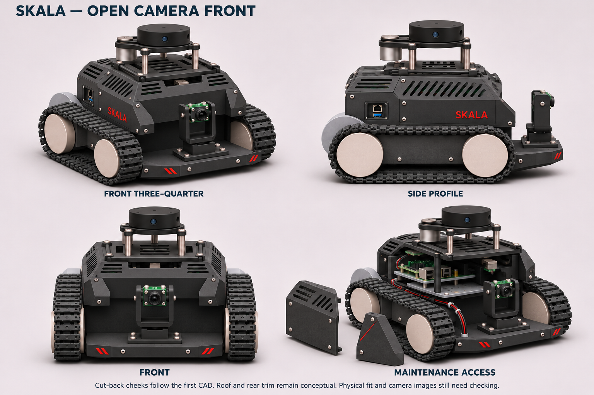
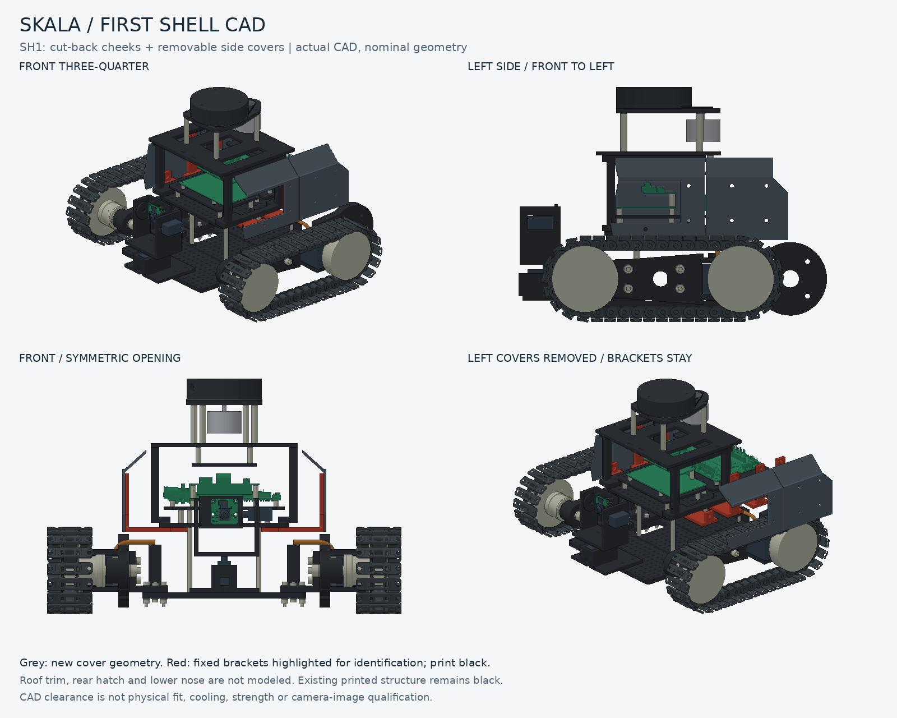

# Exterior shell concept

Updated 2026-11-26. **Visual direction: a black-and-red faceted shell with a finished appearance, easy maintenance access and an open camera front.** The new study cuts the cheeks back behind the camera while retaining bilateral symmetry, angular shoulders, the corrected A1 appearance and the small interface-board arrangement. Keep the existing printed structure black and use red for small trim pieces and the nameplate.

The shell is a removable, nonstructural cover around the current two-track assembly. Its first purpose is to make the robot look complete and keep cabling orderly. Impact protection and weather sealing are outside this first version.

**November 26 CAD decision:** the deep cheeks in the earlier artwork entered the modeled sideways/downward camera views. Cut them back for a wider clear view while retaining the intended camera travel. [First-fit CAD, STEP/STL files and mounting instructions](shell-first-fit.md) now cover one cheek, one rear side cover and their independent deck brackets. The installed review shows both sides; physical fit remains to be checked.

## Selected appearance

The updated sheet shows front three-quarter, side, front and maintenance views. The camera stands forward of the body with its sides open; the short faceted cheeks end behind the head. The maintenance view shows removable covers while the camera and LiDAR stay mounted. The scanner retains the A1's teardrop base, optical head, belt/pulley and rear hanging motor.

The tiny USB-interface PCB stays inside the shell on its small carrier beneath the **rear** of the bridge. Plan for a small insulating holder within the existing shell outline. Reach it through the side opening, with removable roof trim providing additional access. Its cradle and light clip remain to be sized; exact PCB screw-hole spacing is optional. The [LiDAR assembly guide](../assembly/p0-assembly.md#10b-install-the-lidar-bridge-and-scanner) defines the mounting and cable route.

This image is an **appearance proposal around the first CAD**, not an assembly drawing. Roof/rear/nose trim, vents, internal electronics, cable dressing and cosmetic details are illustrative. The [CAD preview and first-fit guide](shell-first-fit.md) define the actual new pieces; the current [hardware assembly](../assembly/p0-assembly.md#10-fit-audio-camera-and-lidar) defines the retained hardware. Printed fit, actual camera images, stop-button placement and ventilation still need qualification.

The CAD preview deliberately shows only the modeled covers and brackets. The roof, rear and nose are open. Red in this CAD drawing identifies the new brackets; those structural parts should be printed black.

### Original styling references

The November 8 studies remain the source of the black-and-red faceted appearance. The updated sheet above supersedes their deep camera recess, generic LiDAR and decorative camera-lens colouring. The [November 25 intermediate sheet](../concept/2026-11-25-shell-concept-update.png) records the deep-cheek proposal before the CAD view check. These earlier images are historical styling references; current CAD determines openings and clearances.

Keep the exposed tracks, raised LiDAR, faceted shoulders, planned vented faces and restrained red accents. Keep the camera opening symmetric and free of long forward wings. Place seams along changes of angle and trim lines so the removable pieces still read as one body.

## Proposed removable sections

| Group | Proposed construction | Maintenance purpose |
| --- | --- | --- |
| A Roof trim | Separate pieces around the existing LiDAR bridge, with open-ended splits around its supports | Slide the trim away sideways while the bridge and scanner stay fixed. Expose the rear PCB carrier and its cable restraints; avoid a single lid trapped beneath the LiDAR |
| B Side covers | SH1 rear side covers on independent deck brackets; vents remain to be designed | Reach the rear electronics and PCB carrier area. Removing a cover leaves the sensor bridge fixed |
| C Front cheeks | SH1 cut-back forward side sections, ending behind the camera | Keep the head exposed for motion and access. The left piece includes the Pi USB/Ethernet opening; the right outline is symmetric with no copied port opening |
| D Rear hatch | A separate rear service panel with its final opening matched to the selected power bank and cable | Reach the compute supply without peeling off the whole shell. Define a separate removal path for the centrally mounted drive battery |
| E Lower nose trim | A small detachable strip completing the front outline | Reach the camera-base nuts and front wiring. Its height must clear the camera view at downward tilt |

These are service groups, not final print-part counts. B/C have first-fit CAD; A/D/E remain proposals. The first side cover and cheek have a 1 mm seam and fit the existing 210 mm working footprint on the 220 mm bed. Use separate red trim pieces where practical so accents do not require reprinting a large black panel.

## Attachment and access

SH1 uses four replaceable brackets under each side of the deck, attached through spare holes. Accessible M3 cover screws are separate from these deck fixings. Removing a cover must not loosen a sensor bracket, change board spacing or disturb track adjustment. The [first-fit guide](shell-first-fit.md#mounting-the-first-left-side-set) gives holes, fastener stacks and the initial installation sequence. The shell is not a carrying handle.

Normal servicing should need only the affected panel: the left cheek for Pi connectors, rear side cover for the rear electronics, and future rear hatch for the compute bank. The camera mechanism stays exposed. The small LiDAR PCB's holder stays on P17 when a cover comes away; keep its USB/scanner leads with the stationary structure rather than tying them to a removable panel. After removing the cover screws, SH1's planned path is 3 mm outward, 10 mm upward, then outward past the track. Future roof pieces must clear the LiDAR bridge and hanging motor. Keep the stop button directly reachable with every panel installed; its position belongs to the [power and harness plan](../assembly/s1-system-plan.md#hardware-and-placement).

## Fit the selected shape around the current robot

The [system plan](../assembly/s1-system-plan.md) and current CAD provide the packaging references: a 200 × 152 mm chassis, a 164 × 120 mm upper deck, camera pan axis X=108, tilt axis Z=72 and nominal A1 scan plane Z=188.5, measured from the chassis top. The shell outline must follow the assembled hardware and plugged-in cables.

The existing sensor audit bounds the nominal rigid head by a 49.531 mm radius about the pan axis, over Z=33–92.248. Use that roughly 99 mm diameter as the starting mechanical space for the recess, then add clearance for matched horns, fasteners, tolerances and the flexible ribbon. **Mechanical clearance and a clear camera image are separate checks:** a cheek that misses the cradle can still enter the image at full pan or downward tilt. Preserve the current intended motion range as a design target; shorten a cheek or open a facet before assuming the range can be reduced to suit the shell.

Keep the LiDAR's scan band unobstructed through 360 degrees, with no roof lip or decorative fin rising into it. Keep cosmetic trim out of the space between the bridge and the A1's hanging motor: the current candidate has only 8.5 mm nominal clearance there. The P17 carrier below the bridge is separate from this motor space. Leave direct acoustic openings over both WM8960 microphones and a useful airflow path around the Pi/HAT. Compare simultaneous capture temperatures and microphone recordings with the panels fitted and removed before fixing the vent pattern. Keep track clearance and underside access independent of the cosmetic shell.

The bank dimensions with its connector, stop enclosure, final cable bends and cooling arrangement remain inputs to the panel geometry. They do not prevent agreeing the silhouette and panel groups now.

## First modeling and fitting pass

Proceed directly from CAD checks to printed fit pieces; there is no cardboard stage.

1. Review the SH1 CAD and its clearance/removal receipt. The cut-back front preserves the intended head travel; the generated appearance sheet supplies styling context only.
2. Print the first left cheek, rear side cover and four brackets using the [first-fit package](shell-first-fit.md#files-and-first-print-quantities). Fit them to the actual assembly and check the silhouette, camera images, ribbon movement, plug access and independent removal. Separate tab or seam samples remain optional.
3. Correct the CAD from that physical fit before completing the other side and the remaining roof/rear/nose panels. Resolve the stop opening and battery access, then vents and red trim. Recheck changed interfaces and record added mass before loaded driving checks.

The next step is to review and fit the first printed set. The existing base, sensor mounts and assembly instructions remain the starting hardware.

## Image generation record

The November 26 sheet was made with the built-in imagegen tool using the November 25 appearance sheet and the first actual shell CAD preview. The [cut-back prompt](../concept/2026-11-26-shell-cutback-prompt.txt) records the constraints. The CAD preview is rendered directly from the models, without generated geometry. Earlier images and the November 25 [initial](../concept/2026-11-25-shell-update-prompt.txt) and [refinement](../concept/2026-11-25-shell-update-refinement-prompt.txt) prompts are retained unchanged.
