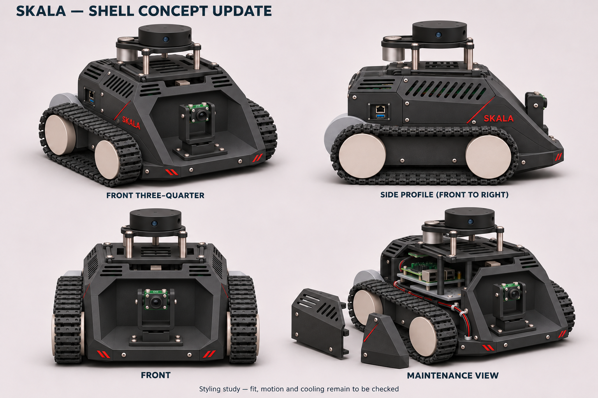
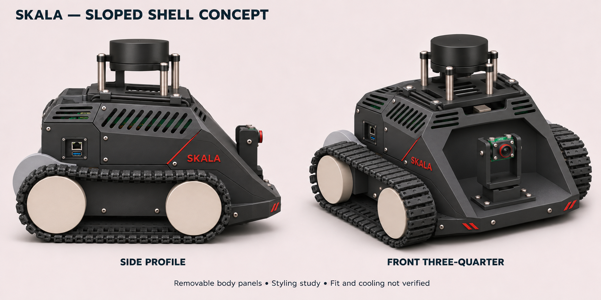
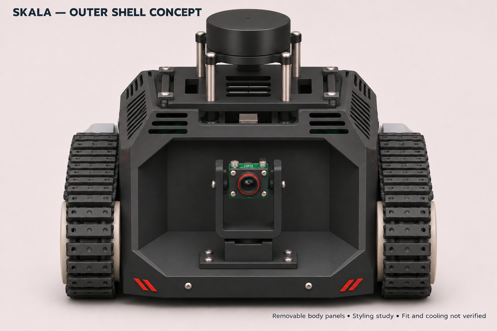
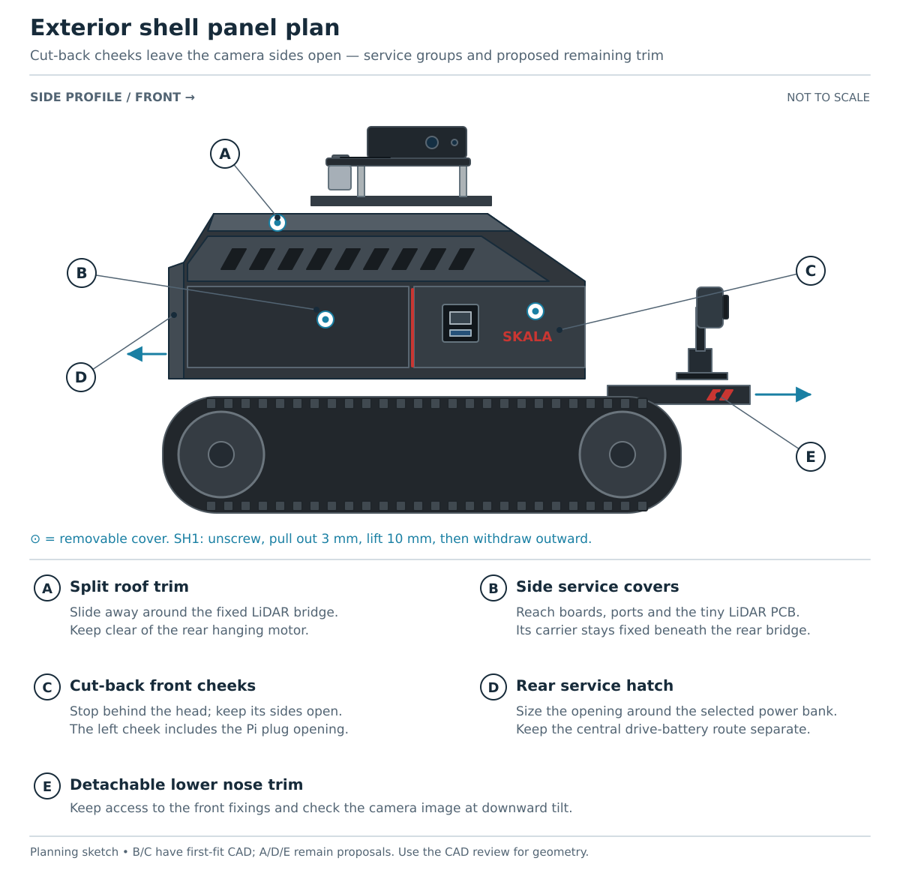

# Exterior shell concept

Updated 2026-11-26. **Visual direction selected: the saved black-and-red shell concept, with a finished appearance and easy maintenance access.** The updated study retains its faceted body, symmetric camera recess and shoulders that slope gradually towards the nose, and incorporates the corrected A1 appearance and small interface-board arrangement. Keep the existing printed structure black and use red for small trim pieces and the nameplate.

The shell is a removable, nonstructural cover around the current two-track assembly. Its first purpose is to make the robot look complete and keep cabling orderly. Impact protection and weather sealing are outside this first version.

## Selected appearance

The updated sheet shows four views of the same proposed exterior. The side profile retains the long, shallow shoulder slope; the front keeps the mirrored, faceted camera recess. The maintenance view shows a side cover and adjacent cheek removed while the camera and LiDAR stay mounted. The scanner now has the A1's teardrop base, optical head, belt/pulley and rear hanging motor, replacing the generic cylindrical scanner in the earlier artwork.

The tiny USB-interface PCB stays inside the shell on its small carrier beneath the **rear** of the bridge. Plan for a small insulating holder within the existing shell outline. Reach it through the side opening, with removable roof trim providing additional access. Its cradle and light clip remain to be sized; exact PCB screw-hole spacing is optional. The [LiDAR assembly guide](../assembly/p0-assembly.md#10b-install-the-lidar-bridge-and-scanner) defines the mounting and cable route.

This is a **styling and access study**, not shell CAD or an assembly drawing. Internal electronics, cable dressing, fasteners and seams in the generated image are illustrative. The current [hardware assembly](../assembly/p0-assembly.md#10-fit-audio-camera-and-lidar) determines their actual locations. Optical clearance, panel removal, stop-button placement and ventilation still need the checks below; no new printable shell parts are released by this image.

### Original styling references

The November 8 studies remain the source of the selected appearance. The updated sheet above supersedes their generic LiDAR and decorative camera-lens colouring. Their hardware details and proportions are illustrative; the current assembly determines mounting, openings and clearances.

Keep the exposed tracks, raised LiDAR, broad sloping shoulders, deep-looking angular camera recess, vented side faces and restrained red accents. Express the recess with planar facets. Place seams along existing changes of angle and red trim lines so the removable pieces still read as one body.

## Proposed removable sections

| Group | Proposed construction | Maintenance purpose |
| --- | --- | --- |
| A Roof trim | Separate pieces around the existing LiDAR bridge, with open-ended splits around its supports | Slide the trim away sideways while the bridge and scanner stay fixed. Expose the rear PCB carrier and its cable restraints; avoid a single lid trapped beneath the LiDAR |
| B Side covers | A removable cover on each side, with ventilation and access openings positioned from the actual boards and plugs | Reach Pi/OpenCR connectors, microSD, the small LiDAR interface PCB and cable restraints without removing the deck. The Pi USB/Ethernet ports face robot-left; the two sides need different service openings |
| C Front cheeks | Mirrored faceted pieces following the saved gradual slope | Remove either cheek to reach the pan base, servo/horn fixings and ribbon. Preserve the symmetric exterior even if the concealed attachments differ |
| D Rear hatch | A separate rear service panel with its final opening matched to the selected power bank and cable | Reach the compute supply without peeling off the whole shell. Define a separate removal path for the centrally mounted drive battery |
| E Lower nose trim | A small detachable strip completing the front outline | Reach the camera-base nuts and front wiring. Its height must clear the camera view at downward tilt |

These are service groups, not final print-part counts. Keep individual prints within the existing 210 mm working footprint on the 220 mm bed; a long side/cheek assembly may need a joint at the diagonal seam. Use separate red trim pieces where practical so accents do not require reprinting a large black panel.

## Attachment and access

Use small replaceable mounting tabs on stationary chassis/deck structure. Start with locating tabs and accessible M3 screws; choose the number and exact positions after checking the occupied grid holes and screwdriver paths. Removing a cover must not loosen a sensor bracket, change board spacing or disturb track adjustment. The shell is not a carrying handle.

Normal servicing should need only the affected panel: side cover for board connections, rear hatch for the compute bank, front cheek for the camera mechanism. The small LiDAR PCB's holder stays on P17 when the cover comes away; keep its USB/scanner leads with the stationary structure rather than tying them to a removable panel. Roof pieces must have a removal path around the LiDAR bridge and the hanging motor. Keep the stop button directly reachable with every panel installed and with either service cover removed; its position belongs to the [power and harness plan](../assembly/s1-system-plan.md#hardware-and-placement).

## Fit the selected shape around the current robot

The [system plan](../assembly/s1-system-plan.md) and current CAD provide the packaging references: a 200 × 152 mm chassis, a 164 × 120 mm upper deck, camera pan axis X=108, tilt axis Z=72 and nominal A1 scan plane Z=188.5, measured from the chassis top. The shell outline must follow the assembled hardware and plugged-in cables.

The existing sensor audit bounds the nominal rigid head by a 49.531 mm radius about the pan axis, over Z=33–92.248. Use that roughly 99 mm diameter as the starting mechanical space for the recess, then add clearance for matched horns, fasteners, tolerances and the flexible ribbon. **Mechanical clearance and a clear camera image are separate checks:** a cheek that misses the cradle can still enter the image at full pan or downward tilt. Preserve the current intended motion range as a design target; shorten a cheek or open a facet before assuming the range can be reduced to suit the shell.

Keep the LiDAR's scan band unobstructed through 360 degrees, with no roof lip or decorative fin rising into it. Keep cosmetic trim out of the space between the bridge and the A1's hanging motor: the current candidate has only 8.5 mm nominal clearance there. The P17 carrier below the bridge is separate from this motor space. Leave direct acoustic openings over both WM8960 microphones and a useful airflow path around the Pi/HAT. Compare simultaneous capture temperatures and microphone recordings with the panels fitted and removed before fixing the vent pattern. Keep track clearance and underside access independent of the cosmetic shell.

The bank dimensions with its connector, stop enclosure, final cable bends and cooling arrangement remain inputs to the panel geometry. They do not prevent agreeing the silhouette and panel groups now.

## First modeling and fitting pass

Proceed directly from CAD checks to printed fit pieces; there is no cardboard stage.

1. Place a rough shell surface around the current assembly, retaining the selected front symmetry and side slope. Include the moving head, cable allowances, scanner scan band and plugged-in connectors as spaces the shell must leave clear. Start with the front recess: it is the strongest visual feature and the tightest moving interface.
2. Split that surface into the service groups above and demonstrate a removal path for each. Locate the stop opening and battery access before adding vents, screws or cosmetic details.
3. Model and print one cheek and one side cover with their mounting tabs and seams. Fit them to the actual assembly and check the front and side silhouette, camera images across the intended motion, ribbon movement, connector clearance and hand/tool access. Confirm that both pieces fasten securely and can be removed independently. Separate tab or seam samples are optional if a particular fit is uncertain.
4. Correct the CAD from that fit check, then complete the remaining panels, vents and red trim. Recheck any changed interfaces before printing the full set. Record the added mass before loaded driving checks.

The updated concept sheet supplies the front, side, three-quarter and maintenance views for this review. The next step is a rough CAD surface and removal-path check around the actual assembly, followed by CAD and print files for the first cheek and side cover. The remaining shell parts follow the physical fit check; the existing base, sensor mounts and assembly instructions remain the starting hardware.

## Image generation record

The updated sheet was made with the built-in imagegen tool, using the original styling studies and the corrected CAD assembly illustrations as references. The [initial prompt](../concept/2026-11-25-shell-update-prompt.txt) and [final refinement prompt](../concept/2026-11-25-shell-update-refinement-prompt.txt) record the constraints. The final refinement kept the camera hardware black and moved the small interface PCB beneath the rear bridge. Original November 8 image files are retained unchanged.
