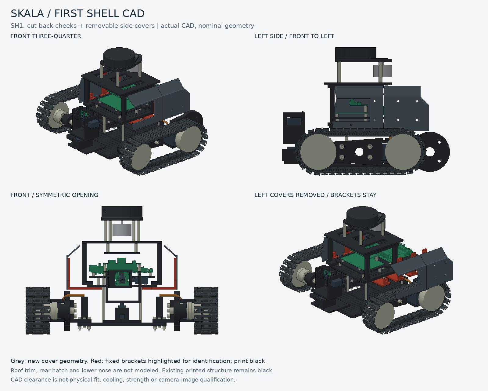
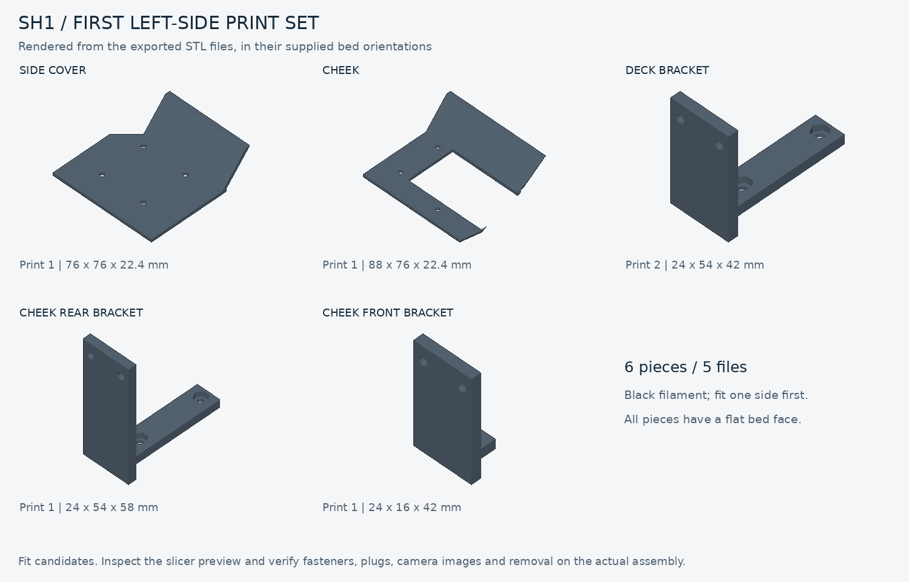

# First shell CAD and fit set

Updated 2026-11-26. **SH1 models removable side covers, cut-back front cheeks and their independent deck brackets.** The camera remains in its current position and keeps its intended ±90° pan and −45° to +30° CAD tilt range. Positive tilt points downward. The first print set is for the left side; the installed review also shows the right side. Roof trim, rear hatch, nose trim, vents and red accents are later work.



The original deep cheeks entered the modeled camera view during sideways/downward poses. The new cheeks stop behind the head and leave its sides open. The silhouette is symmetric; only the left cheek has the Pi connector opening. Its open front edge provides space for plugs to move outward. This is a deliberate change from the deep recess in the earlier artwork.

## Files and first print quantities

Download the [first-fit package](../../cad/review/shell/shell-first-fit-s1.zip) for the five STEP/STL pairs, audit and this guide. Open the [installed assembly STEP](../../cad/review/shell/shell_installed_s1.step) to inspect both sides with the retained upper hardware. The [audit receipt](../../cad/review/shell/audit.json) records the actual checks and output hashes. These files are separate from the existing lower and sensor print sets.

| First left-side fit piece | Quantity | STL |
| --- | ---: | --- |
| Rear side cover | 1 | [shell_side_cover_s1_L.stl](../../cad/review/shell/shell_side_cover_s1_L.stl) |
| Cut-back front cheek with Pi access opening | 1 | [shell_cheek_s1_L.stl](../../cad/review/shell/shell_cheek_s1_L.stl) |
| Side-cover deck bracket | 2 | [shell_deck_bracket_s1.stl](../../cad/review/shell/shell_deck_bracket_s1.stl) |
| Cheek rear bracket | 1 | [shell_cheek_rear_bracket_s1.stl](../../cad/review/shell/shell_cheek_rear_bracket_s1.stl) |
| Cheek front bracket | 1 | [shell_cheek_front_bracket_s1.stl](../../cad/review/shell/shell_cheek_front_bracket_s1.stl) |



Print these six pieces in black. Each export is oriented with its outside face on the bed, including the brackets' mast faces; their feet rise from that face. The cover wall is 2.4 mm, the sloped shoulder is approximately 2.5 mm normal to its face, and bracket feet are 4 mm thick. All exported footprints fit the existing 210 mm working area. Inspect the slicer preview around the sloped shoulder, nut recesses and screw holes; bridging/support needs depend on the slicing profile. Do not mirror the left cheek's port opening onto the right as a substitute for the right-side source geometry.

## Mounting the first left-side set

All coordinates are millimetres in the current robot frame: X forward, Y left, chassis top Z=0. Bracket feet sit **under** the existing upper deck, at Z=56–60. They use spare holes and do not share sensor, board or track fasteners. Install the brackets while the underside and upper face of the deck are accessible; nearby board adapters can obstruct a screwdriver during initial installation.

| Bracket | Deck fixing holes (X, Y) | Cover screw centres (X, Z), axis along Y |
| --- | --- | --- |
| Rear side-cover bracket | (−104, 56), (−88, 56) | (−96, 74), (−96, 106) |
| Forward side-cover bracket | (−72, 56), (−56, 56) | (−64, 74), (−64, 106) |
| Cheek rear bracket | (−32, 40), (−16, 40) | (−24, 74), (−24, 106) |
| Cheek front bracket | (8, 56), (24, 56) | (16, 66) |

For the first left-side set, the candidate hardware is:

- **8 M3×16 bolts, 16 washers and 8 M3 nyloc nuts** for the four bracket feet. Bolts enter from above the deck. The nominal stack is 4 mm deck + 4 mm foot + two 0.5 mm washers + 4 mm nut, leaving 3 mm thread projection.
- **7 M3×8 bolts, 7 washers and 7 ordinary M3 hex nuts** for the two covers. Bolts enter from outside. Use nominal 5.5 mm AF × 2.4 mm nuts in the brackets' 5.7 mm AF × 2.6 mm recesses; nyloc nuts are too tall for these recesses. The nominal thread projection is 1.3 mm.

Seat the ordinary nuts from the inner face before fitting each cover. Check that the printed hex recess prevents the nut turning and that it stays seated during cover removal; nut retention remains a first-print acceptance check. Keep all cables restrained to the stationary frame.

## Fit and removal

Fit one cheek and one side cover directly after CAD review; there is no cardboard stage. Check the seam, fastener seating, available hand/tool space and actual Pi plug access before printing the other side. The nominal seam between these panels is 1 mm. Each panel fastens to its own pair of brackets.

For removal, take out that panel's exterior screws, pull it outward **3 mm**, lift **10 mm**, then withdraw it outward. The lift keeps the lower skirt above the track tops. Leave its fixed brackets, the other cover and all sensor/board fasteners in place. Check the path on the physical assembly with the robot unpowered; cables and actual plugs are not fully represented by rigid CAD.

Sweep the actual camera through the intended range while checking the image and ribbon, with and without the first cheek. Mechanical clearance alone does not establish a clear image. Trim or revise the cover if it enters the image; do not silently reduce the head travel to accommodate the shell.

## What the CAD check establishes

The builder checks the new solids against the retained lower/upper/sensor assembly, spare deck holes, the modeled Pi plug withdrawal space, the scan height, panel-to-panel fit, exterior screwdriver access and sampled independent removal paths. A conservative continuous bound covers the rigid camera mechanism, with a 3 mm minimum allowance required behind it. It does not bound an unmatched horn or the moving ribbon.

The optical check samples 78 pan/tilt poses across the full intended range. It uses the Standard camera's nominal [66° horizontal × 41° vertical field of view](https://www.raspberrypi.com/documentation/accessories/camera.html), an approximate lens origin, a 4 mm aperture allowance and 300 mm view distance. It tests whether the **new shell pieces** enter those views. It is not calibrated optical evidence or a claim that existing tracks, brackets or other robot parts never appear in the image. Physical images and between-sample behaviour remain to be checked.

The exported STLs are checked independently for a closed single solid, positive volume, agreement with CAD volume and bed placement. The existing `cad/out` files are preserved. Printed fit, stiffness, fastener retention, ribbon routing, microphone response, cooling and loaded driving remain unqualified. This first set is for fitting, not a complete enclosure or a structural load path.

## Regenerate

From the repository root:

```sh
.venv/bin/python cad/build_shell_s1.py
.venv/bin/python cad/preview_shell_s1.py
```

The build refuses new exports if a geometry check fails. `cad/shell_s1.py` owns the new geometry; the established lower, upper and sensor generators remain its references. After editing geometry, regenerate and inspect the CAD preview before updating the [appearance concept](exterior-shell-concept.md) or synchronizing the vault.
