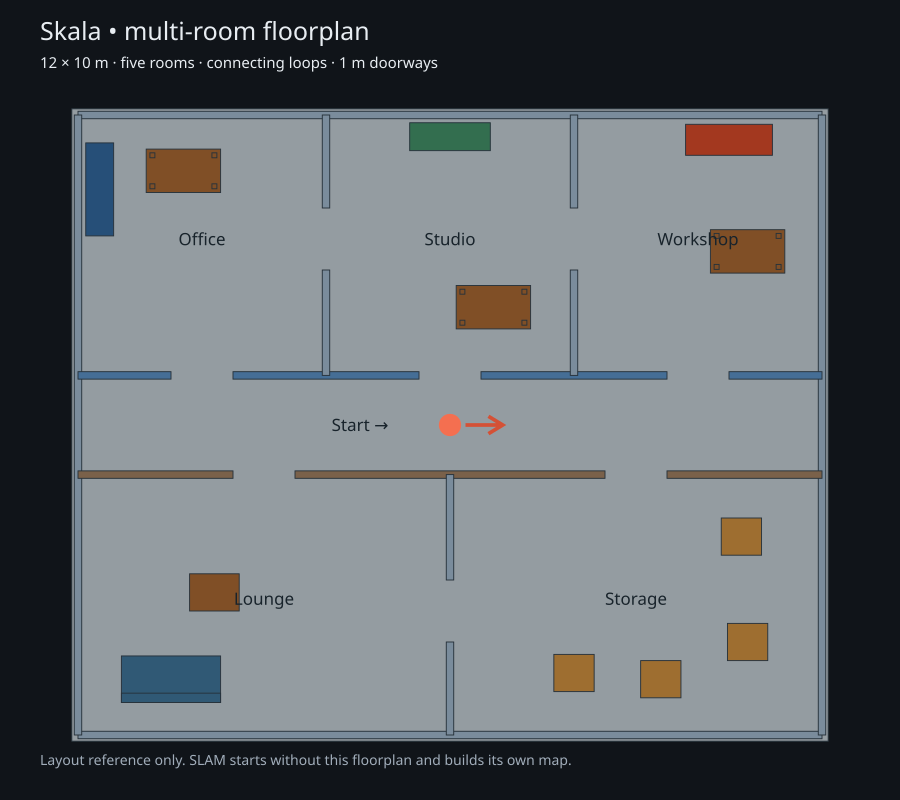
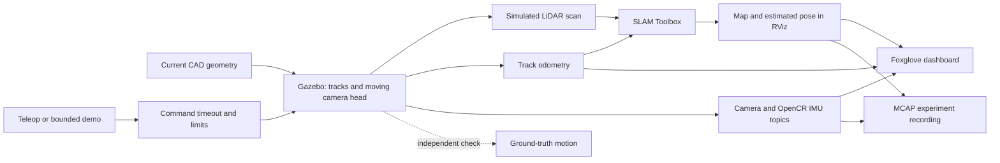
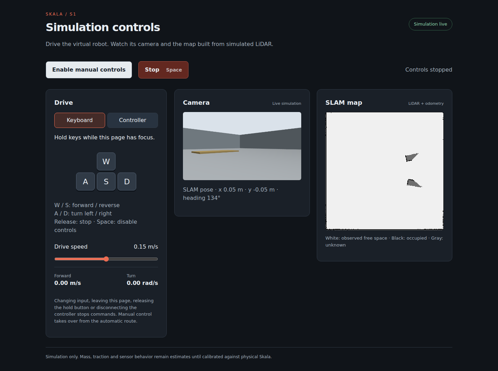
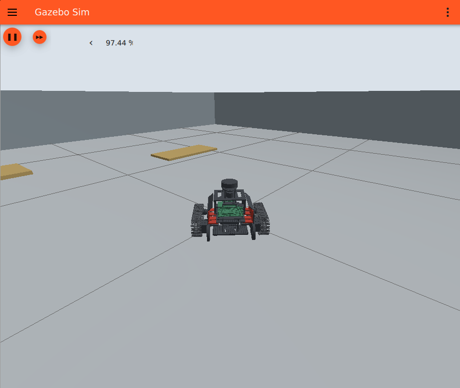
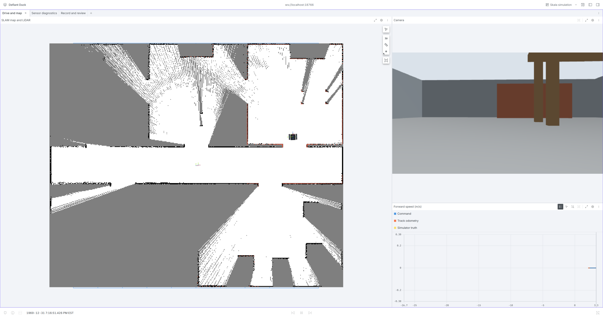

# Skala SLAM simulation

Updated 2026-11-27. This simulation assembles the **current S1 fixed-track CAD, U1/U2 sensor hardware and SH1 cut-back shell pieces** in Gazebo Harmonic, using ROS 2 Jazzy in the workstation Docker container. It represents the assembled CAD target; the physical robot's assembly and qualification remain separate.

The first exercise is a visible LiDAR SLAM demonstration: drive Skala through a floorplan, watch its simulated A1 scan build a map in RViz, and inspect its camera feed. The room and robot assets are local; no downloaded Gazebo models or Pi connection are required.

## Open the demonstration

From the repository root in WSL, with Docker Desktop running:

```sh
scripts/skala-sim start floorplan
```

This builds the image if necessary, starts the container, builds the simulation and RViz control packages in its persistent home, then opens **Gazebo and RViz**. Gazebo follows the detailed CAD robot. RViz opens maximized with the live SLAM map, a lightweight robot outline, red LiDAR returns, camera image and **Skala Drive** panel. The first image build downloads substantial ROS/Gazebo dependencies; subsequent starts reuse it. WSLg's X11 socket must exist at `/mnt/wslg/.X11-unix/X0`.

The command returns after starting the windows. In **RViz → Skala Drive**, click **Enable WASD**. Keep RViz focused, hold **W/S** to move forward/reverse and **A/D** to turn. Releasing keys stops motion. **Space** or **STOP** disables controls until Enable WASD is selected again. Losing RViz focus also stops keyboard control. These keys publish ROS commands directly from RViz; the browser is optional.

The 12 × 10 m floorplan has five furnished rooms, a 1.48 m clear central corridor, 1 m doorways and connecting passages that form loops. Skala starts in the middle of the corridor facing east. Turn left into the studio, or drive along the corridor to the other doorways. The map starts unknown; explore to reveal it. Scroll over the RViz map to zoom. This layout reference is **not supplied to SLAM**:



For an Xbox-compatible **XInput controller connected to Windows**, run this in another WSL terminal, leaving RViz visible:

```sh
scripts/skala-sim controller
```

Hold **LB** and use the **left stick**. Release LB to stop motion; **B** disables controls. After a stop, release and press LB again to resume. Ctrl+C exits the bridge and stops. The bridge reads Windows XInput and sends local simulation commands; RViz remains the display, and browser focus is not required. PlayStation/other devices that do not expose XInput can use the browser mapping option below. No physical controller was available for qualification; only the XInput load/probe and synthetic browser gamepad path were checked.

To use the smaller lab and its automatic mapping route, first stop the current simulation, then run:

```sh
scripts/skala-sim stop
scripts/skala-sim start lab
scripts/skala-sim demo
```

The route follows six waypoints on the clear central floor using the **SLAM-estimated pose**. It does not read simulator ground truth. It stops at the end, on Ctrl+C, or if an obstacle is too close in the forward scan. This is a demonstration controller for this world, not a general navigation planner. Do not run it alongside teleoperation or the functional check.

## Foxglove telemetry dashboard

The simulation launch starts **Foxglove Bridge and the recording service automatically**, alongside Gazebo, SLAM and the command guard. They do not need individual toggles. Driving stays disabled until an input mode is enabled, and recording starts only on request.

Install [Foxglove Desktop](https://foxglove.dev/download), sign in, and open the local connection:

```sh
scripts/skala-sim dashboard
```

The endpoint is **`ws://localhost:18766`**. Docker publishes it on host loopback only. This local connection needs no cloud device registration or device token. Account activation codes and account identifiers are not part of the repository configuration.

Import [the Skala layout](../../software/skala_sim/config/foxglove-skala.json) through **Layouts → Import from file**. Its three tabs provide:

| Tab | Contents |
| --- | --- |
| Drive and map | Large SLAM map, LiDAR, robot pose, camera and commanded/odometry/ground-truth speed plot |
| Sensor diagnostics | IMU yaw and acceleration, head joints, bridge/container resources and ROS logs |
| Record and review | Start/stop recording service buttons, recording status, control mode and session instructions |

The resource panel reports the bridge process and its container environment; it is not a physical battery or motor monitor. Unimplemented hardware measurements are not synthesized. Drive with RViz WASD or the Windows controller bridge while Foxglove displays telemetry. RViz keyboard control stops when focus leaves RViz. The controller bridge does not depend on window focus.

Foxglove's [example gallery](https://docs.foxglove.dev/docs/getting-started/explore-examples) supplies other prebuilt layouts with example datasets: **Ctrl+K → Getting started → Explore examples**. Adapt their topics before using them with Skala. [Layouts](https://docs.foxglove.dev/docs/visualization/layouts) can be duplicated, exported and imported; save distinct layouts or use tabs for different experiments. Importing a layout does not start or stop ROS services.

### Record and replay an experiment

In **Record and review**, select **Start MCAP recording**, drive, then **Stop and save MCAP**. Equivalent terminal commands are:

```sh
scripts/skala-sim record start
scripts/skala-sim record stop
```

Each recording has a timestamped directory under `/home/ros/bags/skala/` in the persistent Docker home, containing a source/scenario manifest, recorder log and `bag/` MCAP data. It captures camera, scan, IMU, odometry, simulator truth, transforms, map, joints and command/mode streams using simulation time. The manifest records wall time separately. Recordings stop after five wall-clock minutes or when free space drops below 1 GiB; starting requires 2 GiB free. Repeated recording sessions still consume disk space and need retention management.

Copy a completed episode to the workstation, replacing `EPISODE` with the directory reported by recording status:

```sh
docker cp skala-ros2-ros-1:/home/ros/bags/skala/EPISODE ./skala-recording
```

Open the `.mcap` file in Foxglove to review it with the same layout. Recording service buttons require the live connection; they do not operate during file playback. Raw recordings are local and are not automatically uploaded or committed. MCAP preserves the observed messages; a saved SLAM pose graph is a separate artifact when mapping must resume.

## Optional browser controls

Open [the local control panel](http://localhost:18765) and select **Enable manual controls**. This takes control from RViz keyboard mode or the automatic route. The browser provides a compact camera/map preview and flexible Gamepad API mappings; RViz is the primary full-size map display. Use these controls:

| Input | Driving | Stop |
| --- | --- | --- |
| Keyboard | Hold **W/S** for forward/reverse and **A/D** to turn left/right. The browser page must have focus | Release the keys to stop motion; **Space** disables controls |
| Standard gamepad | Connect a USB or Bluetooth controller to Windows, choose **Controller**, press a controller button to expose it to the browser, then enable controls. Hold **LB/L1** and use the **left stick** | Release LB/L1 to stop motion; **B/Circle** disables controls |

The panel uses the browser's [Gamepad API](https://developer.mozilla.org/en-US/docs/Web/API/Gamepad_API/Using_the_Gamepad_API/), so the controller stays attached to Windows. No USB device forwarding into WSL or Docker is needed. Xbox/PlayStation-style standard mappings use axes 1/0 and buttons 4/1; the panel exposes axis/button indices, inversion settings and live raw values for other mappings. A particular physical controller still needs a connection test. Browser tests used synthetic gamepad input; that does not establish compatibility with every controller.

The **Stop** button latches a stopped mode. Enable manual controls again to resume. Changing input, losing browser focus, hiding/closing the page or disconnecting the controller stops browser commands. A relay enforces speed limits and a 0.5-second command timeout. RViz keyboard, controller/browser, automatic and stopped modes are explicit; inactive sources are ignored. Deceleration still follows the simulated drive limits.

Stop the background simulation and its windows with:

```sh
scripts/skala-sim stop
```

The development container and stored files remain. `scripts/skala-sim gui` is the foreground alternative; use Ctrl+C in that terminal. Background launch logs are retained at `/home/ros/skala-sim.log` inside the container. The HTTP control port is bound only to `127.0.0.1:18765` on the host; it does not expose DDS to the Pi.

`scripts/skala-sim headless floorplan` runs the same physics, sensor rendering and SLAM without desktop windows. `lab` is the default when no world is specified. Do not launch a second copy while one is running: both use the same ROS topics and Gazebo partition. Simulation discovery stays local to the container. The Pi is unchanged.

## What is running



| Interface | Purpose |
| --- | --- |
| `/sim/cmd_vel` — `geometry_msgs/msg/Twist` | Automatic/check forward speed and yaw rate; accepted only in demo mode |
| `/sim/teleop/cmd_vel` | Manual commands from the browser; accepted only in manual mode |
| `/sim/keyboard/cmd_vel` | Native RViz commands; accepted only in keyboard mode |
| `/sim/control_mode`, `/sim/control_mode/state` — `std_msgs/msg/String` | Select/report `keyboard`, `manual` (Windows controller/browser), `demo` or `stopped` |
| `/sim/head/pan`, `/sim/head/tilt` — `std_msgs/msg/Float64` | Head angles in radians; positive pan turns left, positive tilt looks down |
| `/sim/scan` | 360 idealized LiDAR returns at 5 Hz, 0.15–12 m range |
| `/sim/camera/image_raw`, `/sim/camera/camera_info` | 640 × 368 RGB image and ideal camera calibration at 5 Hz |
| `/sim/imu` | Idealized IMU at the approximate OpenCR location, 50 Hz |
| `/sim/joint_states` | Simulated pan/tilt positions |
| `/sim/odom` | Track-controller dead reckoning; this is not independently measured motion |
| `/sim/ground_truth/odom` | Simulator motion for validation only; not an input to SLAM or the demo controller |
| `/map`, `/tf`, `/tf_static` | SLAM occupancy grid and `map → odom → base_footprint → base_link → sensors` transforms |
| `/clock` | Simulation time; SLAM, state publication and RViz use it |
| `/sim/record/start`, `/sim/record/stop` — `std_srvs/srv/Trigger` | Start/stop a bounded local MCAP recording |
| `/sim/record/state` — `std_msgs/msg/String` | Idle, active episode or saved/failed recording status |

The camera head uses the CAD limits: pan ±90°, tilt −45° to +30°. The OpenCR IMU is published for inspection and future fusion; **this initial SLAM configuration uses LiDAR and track odometry, without IMU fusion**. Camera-based SLAM and stereo audio simulation are not implemented.

The source package is `software/skala_sim/`. Gazebo Harmonic is the supported pairing supplied by Jazzy's `ros_gz` packages ([Gazebo installation guidance](https://gazebosim.org/docs/harmonic/ros_installation/)). SLAM uses [SLAM Toolbox's Jazzy implementation](https://github.com/SteveMacenski/slam_toolbox/tree/jazzy), not a preloaded map of the test room.

## Geometry, physics and limits

The visual meshes are derived from the existing CAD in metres. Their source hashes and frame positions are recorded in `software/skala_sim/models/skala/geometry.json`. Manufacturing STEP/STL files are not rewritten. Visual-only vertex clustering uses a 0.25 mm grid to reduce small CAD details; the maximum vertex displacement is about 0.217 mm. The A1 shape remains an illustrative model based on the retained datasheet, and the camera optical origin is an approximation.

Gazebo's [TrackController](https://gazebosim.org/api/sim/8/classgz_1_1sim_1_1systems_1_1TrackController.html) and [TrackedVehicle](https://gazebosim.org/api/sim/8/classgz_1_1sim_1_1systems_1_1TrackedVehicle.html) drive rigid track contact envelopes. The individual printed link visuals do not circulate. Collision shapes simplify the chassis, payload, camera and shell. This supports contact-based driving and mapping experiments; it does not reproduce link articulation, tooth engagement, track tension, motor current, stall torque or printed-part flex.

Mass, center of mass, inertia, friction, steering efficiency and acceleration limits are **unmeasured estimates** in `software/skala_sim/config/parameters.json`. The initial total mass is 2.34 kg. The camera, scan and IMU have idealized timing and measurements; reflectance failures, rolling scans, camera exposure/autofocus and measurement noise are not modeled. A successful map or obstacle crossing is not a qualification of real Skala traction or climbing performance.

The desktop viewers use the workstation's **RTX 5070 through Mesa D3D12/WSLg**. The GUI Compose override exposes `/dev/dxg` and mounts `/usr/lib/wsl` read-only, following [Microsoft's container guidance](https://github.com/microsoft/wslg/blob/main/samples/container/Containers.md). The earlier forced software viewer configuration was removed after sluggishness was observed. RViz uses inexpensive display geometry; Gazebo retains the full CAD meshes. The separate headless sensor server still uses bounded Mesa software rendering with [Gazebo's EGL path](https://gazebosim.org/api/sim/8/headless_rendering.html). Real-time speed depends on workstation load; camera and LiDAR rates refer to simulation time.

## Refine the estimates with real telemetry

The available sensor set supports later calibration: drive-sprocket feedback, the OpenCR IMU, camera and LiDAR. Record timestamped velocity commands, encoder positions/velocities, IMU, scans, images, camera calibration and the frame transforms together in a ROS bag. Keep the actual hardware topic names and frame conventions in that run's manifest; `/sim/...` names above belong to this simulator.

1. Measure mass, center of mass and sensor mounting transforms directly. First calibrate distance per sprocket revolution on a low-slip straight run. The CAD nominal pitch is 12 mm with 16 sprocket teeth, giving 0.192 m of track advance per revolution; verify the actual geometry and encoder conversion.
2. Run repeated straight starts/stops and left/right turns at several modest speeds on a recorded floor surface. Use camera/LiDAR localization or a measured course as the independent motion reference. Include stationary IMU samples to estimate bias and noise.
3. Compare wheel-implied distance with independent actual travel. For forward travel with nonzero expected distance, `slip_fraction = (expected_distance - actual_distance) / expected_distance`. For turns, compare full position and heading trajectories; tracked steering includes lateral sliding as well as longitudinal slip. The IMU gyro helps measure rotation, while acceleration integration alone drifts.
4. Fit a small set of parameters against these runs, then check different, withheld runs. Record uncertainty and surface dependence. A friction value, wheel scale error and steering-efficiency adjustment can compensate for one another; a single trajectory does not uniquely identify all of them.
5. Commit the revised parameters with the telemetry/run IDs, measurement method, before/after errors and remaining limitations. Keep the initial estimates in version history. Add actuator or sensor models when the observed effect cannot be expressed by the existing parameters.

Edit the parameter file and regenerate SDF/URDF using the standard-library Python generator:

```sh
python3 software/skala_sim/skala_sim/description.py
```

Run `scripts/skala-sim stop`, then `scripts/skala-sim start floorplan` to rebuild the packages and load the changes. For changed CAD, regenerate the visual assets first:

```sh
.venv/bin/python cad/export_simulation.py
python3 software/skala_sim/skala_sim/description.py
```

Mass/inertia calibration does not make this velocity-controlled track model an electrical motor model. Effort, current, stall and thermal behavior require an additional drivetrain implementation.

## Functional check

On a freshly started world, with no teleop or demo process sending commands:

```sh
scripts/skala-sim check
```

The check requires real ROS messages, verifies room-scale scan returns, camera content/calibration, IMU gravity and frames, drives and turns the physical simulated model, checks command expiry, moves the camera joints, and requires a SLAM map and complete camera transform chain. It retains JSON, camera images and a map image under `/home/ros/sim-validation` in the persistent Docker home. Failures exit nonzero and are retained in the receipt.

## Recorded demonstration — 2026-11-27

The [functional check](../../software/skala_sim/validation/2026-11-27/validation.json) passed: 360 finite LiDAR returns, a populated 640 × 368 camera image, IMU gravity, 0.346 m forward travel, 0.903 rad turning, pan/tilt motion, and a 237 × 237 SLAM grid at 2.5 cm resolution. Command expiry stopped the robot; manual priority and the stop latch each prevented automatic commands from moving it.

The [mapping route](../../software/skala_sim/validation/2026-11-27/demo.json) reached all six waypoints in 49.5 seconds using SLAM transforms, without reading ground truth. The [browser checks](../../software/skala_sim/validation/2026-11-27/controls-validation.json) demonstrated keyboard-driven motion and tested release, Space, focus loss, synthetic gamepad steering/hold/stop/disconnect, and rejected stale commands. **A physical controller and the physical robot were not tested.**





The [RViz capture](../../software/skala_sim/validation/2026-11-27/rviz-window.png) shows the live map, scan, camera and CAD model. The [qualification record](../../software/skala_sim/validation/2026-11-27/qualification.json) pins the exercised sources and artifacts and records limits and resolved failures. An initial one-shot control-mode request preceded DDS discovery; the check now waits for the command subscriber before sending it. Earlier route callbacks lagged when handled once per control tick; a dedicated executor now services scan and transform updates.

The workstation's [Docker guide](../assembly/ros2-workstation-docker.md) covers the underlying container, persistent volumes and separation from later Pi networking. Physical qualification continues under the [commissioning procedures](../assembly/commissioning-procedures.md).

The larger floorplan passed its [sensor, motion and SLAM checks](../../software/skala_sim/validation/2026-11-27/floorplan/validation.json). [Native RViz keyboard movement was confirmed interactively](../../software/skala_sim/validation/2026-11-27/floorplan/rviz-interactive.json); automated Windows/X11 input injection had intermittent focus/coordinate failures, retained with the evidence. The [Foxglove transport check](../../software/skala_sim/validation/2026-11-27/floorplan/foxglove-transport.json) received live messages across the map, scan, camera, IMU, odometry and transforms and discovered both recording services.

The [desktop dashboard check](../../software/skala_sim/validation/2026-11-27/floorplan/foxglove-dashboard.json) exercised both recording buttons. [MCAP readback](../../software/skala_sim/validation/2026-11-27/floorplan/recording.json) recovered 49,377 messages over 40.0 simulation seconds, including deserialized images, scans, IMU, odometry, map and transforms. This was a stationary capture and does not establish moving-recording performance under every workload. The bridge requires the newer Foxglove SDK WebSocket protocol; an initial probe using only the legacy protocol failed its handshake, while SDK protocol negotiation passed.



The [robot connection guide](../assembly/robot-connection.md) supplies the Pi bridge and Windows SSH tunnel for initial telemetry viewing. The physical robot will need its own verified topic/frame mapping and control protections before reusing control panels. Physical drivers, Nav2 autonomous navigation, IMU/encoder fusion, hardware diagnostics and calibration remain separate work. Selecting the simulator dashboard does not configure those capabilities.
